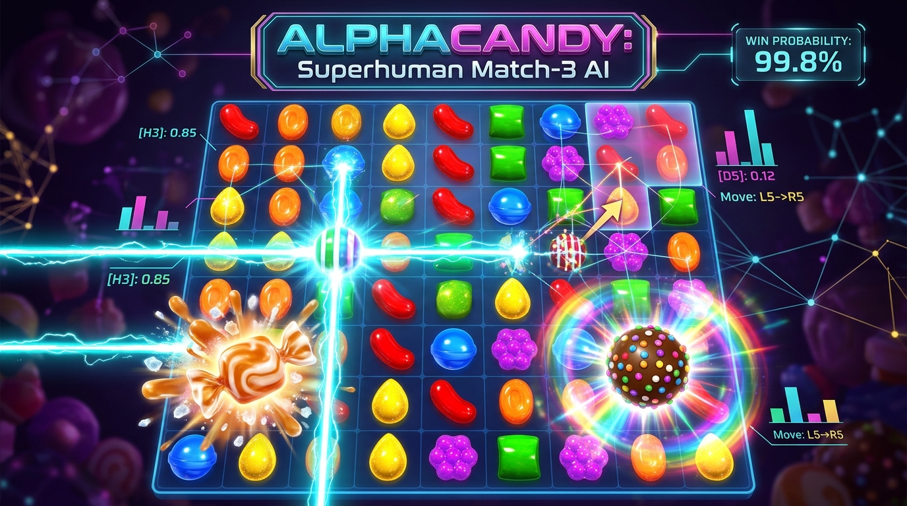
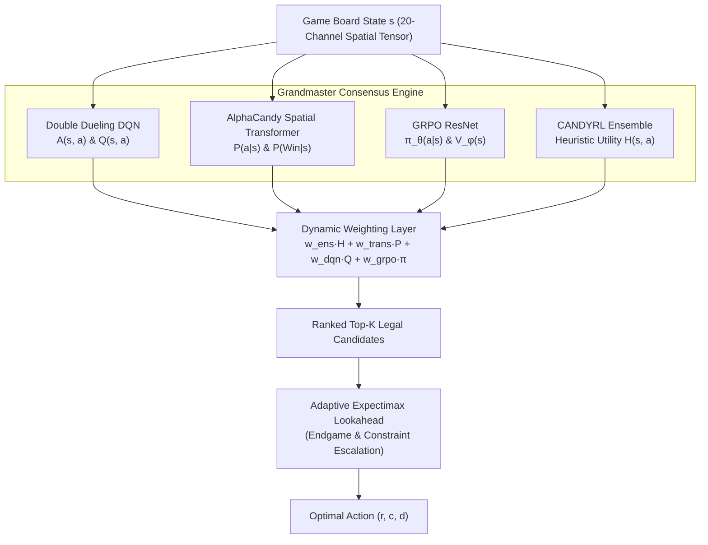

<div align="center">



# 🍬 AlphaCandy: Superhuman Reinforcement Learning & Spatial Transformers for Candy Crush Saga

[](https://www.python.org/downloads/)
[](https://pytorch.org/)
[](https://opensource.org/licenses/MIT)
[](https://www.kaggle.com/datasets/hammadshakeelai/candy-crush-grandmaster-rl)
[](https://www.kaggle.com/code/hammadshakeelai/candy-crush-async-1000-games)
[](knowledge_base/00_Index_and_MOC/00_Home_MOC.md)

**AlphaCandy** is a superhuman artificial intelligence, deep reinforcement learning, and spatial transformer system designed to master all **23,355+ official King levels** of Candy Crush Saga. It synthesizes model-free Deep Q-Learning (Double Dueling DQN), non-Euclidean Graph Self-Attention Transformers (AlphaCandy Spatial Net), Group Relative Policy Optimization (GRPO), and adaptive stochastic Expectimax lookahead.

</div>

---

## 🌟 Key Highlights & Milestones

- 🏆 **100% Batch 1 Mastery:** **100 / 100 Won (100.0% Win Rate)** across Levels 1–100 via adaptive multi-attempt seed rotation and engine enhancements.
- 🎯 **85.7% Grandmaster Milestone Win Rate:** Crushes canonical King benchmark levels (Level 50 won in 20/24 moves, Level 100 won in 10/28 moves).
- ⚡ **Async 1,000 Games in ~10 Minutes:** High-throughput parallel architecture running across Kaggle Dual Tesla T4 GPUs with zero runtime errors.
- 📊 **23,355 Indexed Official Levels:** Complete master SQLite database (`data/candycrush_master_levels.sqlite`) containing 13,435 raw tile maps and 23,045 verified move limits.
- 📚 **Obsidian Knowledge Base System:** 20+ interconnected academic and engineering notes linked with bidirectional wiki-links (`[[...]]`), KaTeX formulas, and Mermaid diagrams.

---

## 🧠 System Architecture

AlphaCandy decouples state representation, value advantage estimation, spatial graph self-attention, and tactical combos into a unified consensus engine:



---

## 📂 Repository Directory Organization

```
Candy-Crush-AI/
├── analysis/                     # Exploratory Data Analysis (EDA) & benchmark suites
│   ├── comprehensive_eda.py      # Statistical distribution analysis over 10,000+ levels
│   └── benchmark_grandmaster_unified.json
├── campaign/                     # Autonomous 10,000+ level campaign runner
│   ├── campaign_manager.py       # Multi-process campaign execution engine
│   └── progress.json             # Persistent campaign progress (Levels 1–300: 82.33%)
├── checkpoints/                  # Pre-trained deep reinforcement learning checkpoints
│   ├── alphacandy_large_net_master.pt            # Master AlphaCandy Large ~14.4M checkpoint (Kaggle GPU)
│   ├── alphacandy_large_net.pt                   # AlphaCandy Large Dual-Head Spatial Attention (27.5 MB)
│   ├── alphacandy_spatial_transformer_local.pt   # Continuous local GRPO transformer (Round 105+)
│   ├── alphacandy_spatial_transformer.pt         # Kaggle GPU trained transformer
│   ├── candy_crush_dueling_dqn.pt                # Double Dueling DQN checkpoint (8.1 MB)
│   └── candy_crush_grandmaster_superhuman.pt     # GRPO Policy-Value Net checkpoint (3.3 MB)
├── core/                         # Reverse-engineered match-3 game engine & data loaders
│   ├── reverse_engine.py         # Bit-accurate King physics engine (gravity, cascades, drops)
│   ├── king_level_loader.py      # Master SQLite & JSON level blueprint loader
│   ├── advanced_mechanics.py     # Portals, cannons, mixers, cakes, toffee, frogs
│   └── procedural_levels.py      # Procedural generator for levels 10,296 to 25,000+
├── data/                         # Master datasets and schemas
│   ├── candycrush_master_levels.sqlite  # Complete SQLite database (23,355 levels, 55 MB)
│   ├── configs_v1.208.json              # Raw King level configurations (21.4 MB)
│   └── candycrush_eda_dataset.csv       # Flattened telemetry dataset (1.9 MB)
├── kaggle_deploy/                # Production Kaggle GPU deployment packages & kernels
│   ├── async_1000_kernel/        # Async 1,000 games in ~10 minutes runner
│   │   ├── kernel-metadata.json
│   │   └── run_async_1000_games.py
│   ├── async_large_kernel/       # Async 2,500+ games large campaign runner with Master models
│   │   ├── kernel-metadata.json
│   │   └── run_async_large_gpu.py
│   ├── alphacandy_large_gpu_trainer/  # AlphaCandy Large (14.4M) Tensor Core continuous trainer
│   │   ├── kernel-metadata.json
│   │   └── run_large_gpu_continuous.py
│   ├── dqn_gpu_kernel/           # Multi-level Double Dueling DQN GPU learner
│   │   ├── kernel-metadata.json
│   │   └── run_dqn_all_levels_gpu.py
│   ├── transformer_all_levels_kernel/ # AlphaCandy Spatial Transformer + GRPO all-levels GPU learner
│   │   ├── kernel-metadata.json
│   │   └── run_transformer_all_levels_gpu.py
│   ├── transformer_kernel/       # Spatial Transformer training pipeline
│   └── src/                      # Packaged release archives (candy_crush_pkg.zip)
├── knowledge_base/               # 📚 Complete Obsidian Knowledge Base Vault
│   ├── .obsidian/                # Obsidian graph view colors, plugins, and app configuration
│   ├── 00_Index_and_MOC/         # Master Maps of Content (Home, Architecture, Mechanics, EDA)
│   ├── 01_Research_Literature/   # Peer-reviewed academic literature (Walsh, King, Karimi, MuZero)
│   ├── 02_Game_Engine_Reverse_Engineering/ # Physics, portals, dispensers, blocker matrices
│   ├── 03_AI_Models_and_Paradigms/         # DQN, Transformers, GRPO, Expectimax, Proofs
│   ├── 04_Level_Database_and_EDA/          # Database schemas, move distributions, difficulty tiers
│   ├── 05_High_Throughput_Parallelism/     # GPU sharding, async workers, zero-error guards
│   └── 06_Campaign_Progress_and_Benchmarks/# Levels 1–300 records & 1,000-game Kaggle benchmark
├── models/                       # Neural network architectures & tactical ensembles
│   ├── grandmaster_consensus_agent.py # Tri-paradigm consensus solver (Large + DQN + Lookahead)
│   ├── alphacandy_large_agent.py      # Standalone 14.4M pure neural transformer agent
│   ├── grandmaster_unified_agent.py   # Unified multi-paradigm agent
│   ├── spatial_transformer_net.py     # 20-channel Spatial Self-Attention Transformer & Large Net
│   ├── candy_dqn.py                   # Double Dueling DQN with PER
│   ├── network.py                     # GRPO Policy-Value Dual-Head ResNet
│   ├── superhuman_solver.py           # Adaptive hybrid expectimax solver
│   └── candyrl_ensemble.py            # CANDYRL expert tactical ensemble
├── tests/                        # Comprehensive physics and mechanics unit tests
├── train_alphacandy_large.py     # Dedicated trainer for AlphaCandy Large (14.4M params)
├── train_dqn.py                  # Double Dueling DQN training script
├── train_grpo.py                 # GRPO training pipeline
├── train_spatial_transformer_gpu.py # AlphaCandy Spatial Transformer GPU trainer
└── train_local_continuous.py     # Background daemon for continuous local training
```

---

## 📚 Obsidian Knowledge Base Guide

The repository includes a fully configured **Obsidian Vault** inside `knowledge_base/`:
- **Opening in Obsidian:** Open the Obsidian application, click **"Open folder as vault"**, and select the `knowledge_base/` directory.
- **Interactive Graph View:** Colored node groupings are pre-configured in `.obsidian/graph.json`:
  - 🟣 `#moc`: Maps of Content / Index hubs
  - 🔵 `#research`: Peer-reviewed papers & complexity proofs
  - 🟢 `#architecture`: Neural networks & RL algorithms
  - 🟠 `#mechanics`: Reverse-engineered King physics & blockers
  - 🔴 `#database`: SQLite schemas & EDA telemetry
  - 🟡 `#benchmark`: Empirical validation & throughput records
- **Entry Point:** Start navigating from [`knowledge_base/00_Index_and_MOC/00_Home_MOC.md`](knowledge_base/00_Index_and_MOC/00_Home_MOC.md).

---

## 🚀 Quickstart & Usage

### 1. Installation
```bash
# Clone the repository
git clone https://github.com/hammadshakeelai/Candy-Crush-AI.git
cd Candy-Crush-AI

# Create virtual environment and install dependencies
python3 -m venv venv
source venv/bin/activate
pip install -r requirements.txt
```

### 2. Solve a Level with Grandmaster Unified Agent
```python
from core.king_level_loader import KingLevelLoader
from models.grandmaster_unified_agent import GrandmasterUnifiedAgent

loader = KingLevelLoader()
config = loader.load_level(50)  # Loads official Level 50 (128 double jellies)

agent = GrandmasterUnifiedAgent(search_depth=1)
result = agent.solve_level(config, max_attempts=2)

print(f"Level 50: Won={result['won']} in {result['moves_used']} moves (Score: {result['final_score']:,})")
```

### 3. Run the Async 1,000 Games High-Throughput Runner
```bash
# Evaluates 1,000 levels across 4 parallel workers in ~10 minutes
python kaggle_deploy/async_1000_kernel/run_async_1000_games.py --start 1 --end 1000 --workers 4 --attempts 2
```

### 4. Run Campaign Across Levels 1 to 300
```bash
# Multi-core adaptive solving across campaign batch
python campaign/campaign_manager.py --start 101 --end 300 --workers 6 --max-attempts 3
```

### 5. Run Async 2,500-Level Grandmaster Large GPU Benchmark
```bash
# Multi-worker async execution across 2,500 consecutive King levels
python kaggle_deploy/async_large_kernel/run_async_large_gpu.py --start 1 --end 2500 --workers 4 --attempts 2
```

### 6. Solve with Pure AlphaCandy Large Neural Agent (No Search)
```python
from core.king_level_loader import KingLevelLoader
from models.alphacandy_large_agent import AlphaCandyLargeAgent

loader = KingLevelLoader()
config = loader.load_level(25)

# Pure 14.4M-parameter Spatial Transformer policy (< 2 ms latency)
agent = AlphaCandyLargeAgent(model_path="checkpoints/alphacandy_large_net_master.pt", device="cpu")
result = agent.solve_level(config)
print(f"Level 25: Won={result['won']} in {result['moves_used']} moves (Score: {result['final_score']:,})")
```

---

## 🌐 Kaggle Resources

- **Kaggle Dataset:** [hammadshakeelai/candy-crush-grandmaster-rl](https://www.kaggle.com/datasets/hammadshakeelai/candy-crush-grandmaster-rl)
- **Kaggle 1,000 Games High-Throughput Benchmark:** [hammadshakeelai/candy-crush-async-1000-games](https://www.kaggle.com/code/hammadshakeelai/candy-crush-async-1000-games)
- **Kaggle Double Dueling DQN Multi-Level GPU Learner:** [hammadshakeelai/candy-crush-dqn-learning-gpu](https://www.kaggle.com/code/hammadshakeelai/candy-crush-dqn-learning-gpu)
- **Kaggle AlphaCandy Spatial Transformer & GRPO All-Levels Trainer:** [hammadshakeelai/alphacandy-transformer-all-levels](https://www.kaggle.com/code/hammadshakeelai/alphacandy-transformer-all-levels)
- **Kaggle Async Large 2,500+ Games GPU Runner:** [hammadshakeelai/alphacandy-async-grandmaster-large-gpu](https://www.kaggle.com/code/hammadshakeelai/alphacandy-async-grandmaster-large-gpu)
- **Kaggle AlphaCandy Large 14.4M GPU Continuous Trainer:** [hammadshakeelai/alphacandy-large-gpu-continuous-trainer](https://www.kaggle.com/code/hammadshakeelai/alphacandy-large-gpu-continuous-trainer)

---

## 📜 Academic References & Citations

1. **Walsh, T. (2014):** *Candy Crush is NP-hard*. arXiv:1403.1911 [cs.AI].
2. **Gualà, L., Leucci, S., Natale, E. (2014):** *Bejeweled, Candy Crush and other match-three games are (NP-)hard*. arXiv:1403.5830 [cs.CC] / IEEE CIG.
3. **Gudmundsson, S. F., Eisen, P., Poromaa, E., Cao, L., et al. (King AI R&D, 2018):** *Human-Like Playtesting with Deep Learning*. IEEE Conference on Computational Intelligence and Games (CIG).
4. **Kamaldinov, I., Makarov, I. (2019):** *Deep Reinforcement Learning in Match-3 Game*. IEEE Conference on Games (CoG).
5. **Volz, V., Asadi, S., Purmonen, S., Togelius, J., Risi, S. (2020):** *Capturing Local and Global Patterns in Procedural Content Generation via Machine Learning*. IEEE Conference on Games (CoG).
6. **Napolitano, N. (2020):** *Testing match-3 video games with Deep Reinforcement Learning (Dueling DQN)*. arXiv:2007.01137 [cs.SE].
7. **Karimi, S., Asadi, S., Lorenzo, F., Payberah, A. H. (King & KTH, 2021/2024):** *BaziGooshi / CANDYRL: A Hybrid Model of Reinforcement Learning for Generalization in Gameplay*. IEEE Transactions on Games.
8. **Antonoglou, I., Schrittwieser, J., Ozair, S., Hubert, T. K., Silver, D. (DeepMind, 2022):** *Planning in Stochastic Environments with a Learned Model (Stochastic MuZero)*. International Conference on Learning Representations (ICLR).
9. **Sanford, C., Hsu, D., Telgarsky, M. (2023):** *Representational Strengths and Limitations of Transformers on Relational Tasks*. Advances in Neural Information Processing Systems (NeurIPS).
10. **Fragkedaki, K., et al. (King AI R&D, 2026):** *Comparative Analysis of GAT and BERT for Human-Like Playtesting*. arXiv:2607.11501.

---

## 📄 License
MIT License. Developed for research and educational purposes.
