---
tags:
  - moc
  - index
  - master
title: "AlphaCandy Grandmaster: Master Knowledge Base MOC"
created: 2026-10-25
updated: 2026-10-31
status: complete
aliases:
  - Home MOC
  - Master Index
---

# 🍬 AlphaCandy Grandmaster: Master Knowledge Base

> [!NOTE] System Overview
> **AlphaCandy** is a superhuman artificial intelligence system built to conquer all 23,355+ official King levels of Candy Crush Saga. It synthesizes discrete combinatorial optimization, model-free Deep Q-Learning, non-Euclidean Spatial Self-Attention Transformers, the **79.30M-Parameter AlphaCandy-Titan** flagship model, and continuous multi-tier autonomous fleet orchestration.
> 
> **Current Campaign Status:** **100.00% Solvability on Levels 1–2,500 (2,500 / 2,500 WON)**, advanced through **2,850 / 2,850 WON (100.0%)**, with **9,131+** global King levels conquered.

```mermaid
graph TD
    Home["🍬 Home Master MOC"] --> Arch["🧠 AI Architecture & Models"]
    Home --> Mech["⚙️ Game Engine & Reverse Engineering"]
    Home --> Research["📚 Academic Research Literature"]
    Home --> Data["📊 Level Database & EDA (23,355 Levels)"]
    Home --> Parallel["⚡ High-Throughput Parallelism"]
    Home --> Bench["🏆 Campaign & Benchmarks"]

    Arch --> M0["[[AlphaCandy_Titan_79M_Architecture]]"]
    Arch --> M1["[[AlphaCandy_Omega_Super_Model_Architecture]]"]
    Arch --> M2["[[AlphaCandy_Zero_Design]]"]
    Arch --> M3["[[Grandmaster_Unified_Agent]]"]
    Arch --> M4["[[AlphaCandy_Spatial_Transformer]]"]
    Arch --> M5["[[Double_Dueling_DQN_PER]]"]

    Mech --> E1["[[King_Engine_Core_Physics]]"]
    Mech --> E2["[[Special_Candies_and_Combinations]]"]
    Mech --> E3["[[Blocker_Hierarchy_and_Damage_Phases]]"]
    Mech --> E4["[[Portals_and_Teleporters_Topology]]"]

    Research --> R1["[[Walsh_2014_Candy_Crush_NP_Hard]]"]
    Research --> R2["[[King_2018_Human_Like_Playtesting_CNN]]"]
    Research --> R3["[[Karimi_2021_CANDYRL_BaziGooshi_Hybrid_RL]]"]
    Research --> R4["[[Silver_Schrittwieser_MuZero_World_Models_Match3]]"]

    Data --> D1["[[23355_Level_Master_Database_Schema]]"]
    Data --> D2["[[Exploratory_Data_Analysis_Insights]]"]
    Data --> D3["[[Difficulty_Tier_Classification]]"]

    Parallel --> P1["[[Autonomous_Multi_Tier_Fleet_Orchestration]]"]
    Parallel --> P2["[[Async_GPU_Parallelism_Architecture]]"]
    Parallel --> P3["[[Zero_Error_Fault_Tolerance_Guards]]"]

    Bench --> B1["[[100_Percent_Mastery_Levels_1_to_2500_Fortress_Conquest]]"]
    Bench --> B2["[[Campaign_Milestones_1_to_300]]"]
    Bench --> B3["[[Roadmap_to_100_Percent_Mastery_10000_Levels]]"]
```

---

## 🗺️ Master Maps of Content (MOCs)

| Map of Content | Description | Primary Focus |
| :--- | :--- | :--- |
| **[[01_Architecture_MOC]]** | Comprehensive AI architecture index | Multi-paradigm fusion, neural topologies, and continual learning bounds |
| **[[02_Game_Mechanics_MOC]]** | Reverse-engineered King physics & blockers | Cascades, multi-hit blockers, portals, dispensers, and combination matrices |
| **[[03_Research_Papers_MOC]]** | Peer-reviewed academic literature index | Computational complexity, playtesting CNNs, and hybrid reinforcement learning |
| **[[04_Level_Database_and_EDA_MOC]]** | Level database & exploratory data analysis | SQLite schemas, 23,355 level blueprints, and blocker emergence curves |
| **[[05_Campaign_and_Benchmarks_MOC]]** | Empirical benchmarks & campaign progression | 100.0% Levels 1–2,500, Fortress Conquest, and 9,131+ levels solved |

---

## 🔑 Core Technical Pillars

1. **Superhuman AI Paradigms:**
   - **AlphaCandy-Titan (79.30M Parameters):** Next-generation flagship super-architecture fusing an $S_6$ Color-Symmetric Stem, 12-block Hybrid Directional Scan + Portal Cross-Attention Backbone, `adaLN-Zero` Telemetry Conditioning, System-2 Pondering, and Pace-Adaptive Dynamic Quantile Tilting ($\text{CVaR}_{0.20} \leftrightarrow \text{CVaR}_{0.85}^+$) ([[AlphaCandy_Titan_79M_Architecture]]). Achieved **18 / 18 (100.0%)** on the Hard Benchmark & Fortress suite.
   - **AlphaCandy-Omega Super Model:** 36.01M-parameter unified Graph-Spatial Quantile Super Model fusing 12-block Portal Graph Self-Attention, 32-quantile distributional Huber loss, and internal latent world rollouts ([[AlphaCandy_Omega_Super_Model_Architecture]]).
   - **AlphaCandy-Zero Search & Expert Iteration:** Gumbel AlphaZero Sequential Halving, Prioritized Level Replay (PLR), Go-Explore near-miss endgame restarts, and Clairvoyant Zobrist Beam Search ([[AlphaCandy_Zero_Design]]).
2. **Reverse Engineering & Physics Fidelity:**
   - **Recursive BFS Special Detonations:** Queue-based multi-hop blast propagation bridging disconnected island geometries ([[King_Engine_Core_Physics]]).
   - **Color Bomb & Preset Special Preservation:** Defensive invariants preventing candy overwrite on Turn 1 and supporting official King tokens (`'047'` Wrapped, `'048'` Color Bomb, `'071'` / `'072'` Cannons).
   - **Multi-Layer Island Potential:** Quantifying double-jelly degradation ($2 \to 1 \to 0$) and $2 \times 2$ non-matchable box traps ([[Special_Candies_and_Combinations]]).
3. **Autonomous Heterogeneous Fleet Orchestration:**
   - **4-Tier Compute Architecture:** Kaggle Tesla T4 GPU sprints + Kaggle 5x concurrent 4-vCPU fleet (20 vCPUs, 150 GB RAM, auto-relaunching) + GitHub Actions 2-vCPU runner + Local 12-core CPU daemon ([[Autonomous_Multi_Tier_Fleet_Orchestration]]).
4. **Campaign Mastery Scale:**
   - Conquered **2,500 / 2,500 levels (100.00%)** on Levels 1–2,500, advanced to **2,850 / 2,850 (100.0%)**, with **9,131+** official levels won globally across the 23,355-level database ([[100_Percent_Mastery_Levels_1_to_2500_Fortress_Conquest]]).
