---
tags:
  - moc
  - index
  - master
title: "AlphaCandy Grandmaster: Master Knowledge Base MOC"
created: 2026-10-25
status: complete
aliases:
  - Home MOC
  - Master Index
---

# 🍬 AlphaCandy Grandmaster: Master Knowledge Base

> [!NOTE] System Overview
> **AlphaCandy** is a superhuman artificial intelligence system built to conquer all 23,355+ official King levels of Candy Crush Saga. It synthesizes model-free Deep Q-Learning, non-Euclidean Spatial Self-Attention Transformers, Group Relative Policy Optimization (GRPO), and adaptive stochastic Expectimax lookahead.

```mermaid
graph TD
    Home["🍬 Home Master MOC"] --> Arch["🧠 AI Architecture & Models"]
    Home --> Mech["⚙️ Game Engine & Reverse Engineering"]
    Home --> Research["📚 Academic Research Literature"]
    Home --> Data["📊 Level Database & EDA (23,355 Levels)"]
    Home --> Parallel["⚡ High-Throughput Parallelism"]
    Home --> Bench["🏆 Campaign & Benchmarks"]

    Arch --> M1["[[Grandmaster_Unified_Agent]]"]
    Arch --> M2["[[AlphaCandy_Spatial_Transformer]]"]
    Arch --> M3["[[Double_Dueling_DQN_PER]]"]
    Arch --> M4["[[GRPO_Policy_Value_ResNet]]"]
    Arch --> M5["[[Single_Model_Continual_Learning_Proof]]"]

    Mech --> E1["[[King_Engine_Core_Physics]]"]
    Mech --> E2["[[Blocker_Hierarchy_and_Damage_Phases]]"]
    Mech --> E3["[[Portals_and_Teleporters_Topology]]"]
    Mech --> E4["[[Dispenser_Refill_and_RNG_Distribution]]"]

    Research --> R1["[[Walsh_2014_Candy_Crush_NP_Hard]]"]
    Research --> R2["[[King_2018_Human_Like_Playtesting_CNN]]"]
    Research --> R3["[[Karimi_2021_CANDYRL_BaziGooshi_Hybrid_RL]]"]
    Research --> R4["[[Silver_Schrittwieser_MuZero_World_Models_Match3]]"]

    Data --> D1["[[23355_Level_Master_Database_Schema]]"]
    Data --> D2["[[Exploratory_Data_Analysis_Insights]]"]
    Data --> D3["[[Difficulty_Tier_Classification]]"]

    Parallel --> P1["[[Async_GPU_Parallelism_Architecture]]"]
    Parallel --> P2["[[Zero_Error_Fault_Tolerance_Guards]]"]

    Bench --> B1["[[Campaign_Milestones_1_to_300]]"]
    Bench --> B2["[[Async_1000_Games_Kaggle_Benchmark]]"]
```

---

## 🗺️ Master Maps of Content (MOCs)

| Map of Content | Description | Primary Focus |
| :--- | :--- | :--- |
| **[[01_Architecture_MOC]]** | Comprehensive AI architecture index | Multi-paradigm fusion, neural topologies, and continual learning bounds |
| **[[02_Game_Mechanics_MOC]]** | Reverse-engineered King physics & blockers | Cascades, multi-hit blockers, portals, dispensers, and combination matrices |
| **[[03_Research_Papers_MOC]]** | Peer-reviewed academic literature index | Computational complexity, playtesting CNNs, and hybrid reinforcement learning |
| **[[04_Level_Database_and_EDA_MOC]]** | Level database & exploratory data analysis | SQLite schemas, 23,355 level blueprints, and blocker emergence curves |
| **[[05_Campaign_and_Benchmarks_MOC]]** | Empirical benchmarks & campaign progression | 100/100 Batch 1, Batch 2 retries, Kaggle async 1,000 games runner |

---

## 🔑 Core Technical Pillars

1. **Academic Literature Foundations:**
   - **Toby Walsh (2014):** Mathematical proof establishing that generalized Match-3 is NP-complete via 3-SAT reduction ([[Walsh_2014_Candy_Crush_NP_Hard]]).
   - **King AI Research (Gudmundsson et al., 2018):** Human-like playtesting with deep CNNs over telemetry data ([[King_2018_Human_Like_Playtesting_CNN]]).
   - **CANDYRL / BaziGooshi (Karimi et al., 2021):** Hybrid RL combining intrinsic skill learning with extrinsic rewards for zero-shot level generalization ([[Karimi_2021_CANDYRL_BaziGooshi_Hybrid_RL]]).
2. **Superhuman AI Paradigms:**
   - **Double Dueling DQN with PER:** Decouples state value $V(s)$ from advantage $A(s,a)$ with Prioritized Experience Replay ([[Double_Dueling_DQN_PER]]).
   - **AlphaCandy Spatial Transformer:** 4-head Multi-Head Spatial Self-Attention (MHSA) treating cells as tokens to attend across non-Euclidean voids and teleporters ([[AlphaCandy_Spatial_Transformer]]).
   - **Unified Multi-Paradigm Ensemble:** Synthesizes DQN advantages, Transformer priors, GRPO policy, and CANDYRL tactical heuristics into consensus actions ([[Grandmaster_Unified_Agent]]).
3. **Big Data & Telemetry Scale:**
   - Unified master database containing **23,355 levels**, 13,435 raw tile maps, and 23,045 verified move limits in SQLite (`data/candycrush_master_levels.sqlite`).
4. **High-Throughput Parallel Execution:**
   - Multi-process worker pool sharded across Kaggle's dual Tesla T4 GPUs achieving $\ge 100\text{ levels/minute}$ throughput with guaranteed zero runtime errors ([[Async_GPU_Parallelism_Architecture]]).
