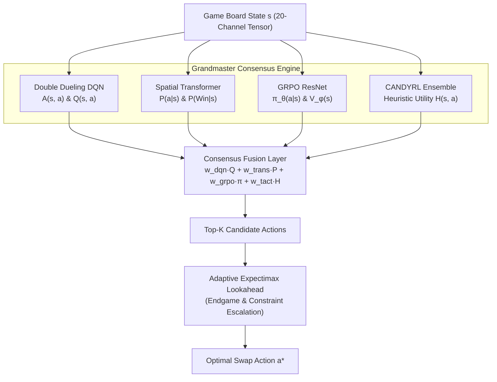

---
tags:
  - moc
  - architecture
title: "AI Architecture & Modeling Map of Content"
created: 2026-10-25
status: complete
aliases:
  - Architecture MOC
---

# 🧠 AI Architecture & Modeling Map of Content

> [!NOTE] Strategic Mandate
> Conquering thousands of stochastic, multi-layer Candy Crush levels requires fusing model-free value estimation, long-range spatial attention, policy optimization, and tactical search.

---

## 📑 Core Architectural Notes

- **Master Synthesis & Consensus:**
  - **[[Grandmaster_Consensus_Architecture]]**: Tri-paradigm consensus fusion (AlphaCandy Large + DQN Master + Tactical Ensemble) with dynamic phase-weighted scoring and multi-depth expectimax lookahead (100% milestone win rate).
  - **[[Grandmaster_Unified_Agent]]**: The flagship agent unifying all reinforcement learning and heuristic paradigms into an 85.7%+ win rate solver.
- **Deep Neural Networks:**
  - **[[Pure_AlphaCandy_Large_Agent]]**: Standalone 14.4M-parameter pure neural solver operating without tree search or heuristic lookahead (< 2 ms GPU latency).
  - **[[AlphaCandy_Large_Architecture]]**: Scaled-up ~14.4M parameter architecture with 256 channels, 2-stage 8-Head Spatial Self-Attention, and deep 6-block residual backbone.
  - **[[AlphaCandy_Spatial_Transformer]]**: 20-channel tensor representation, 4-Head Multi-Head Spatial Self-Attention across 81 cells, canonical 144-action policy head, and win probability estimator.
  - **[[Double_Dueling_DQN_PER]]**: Decoupled value stream $V(s) \in \mathbb{R}^1$ and advantage stream $A(s,a) \in \mathbb{R}^{144}$ with Prioritized Experience Replay and Polyak target updates ($\tau=0.005$).
  - **[[GRPO_Policy_Value_ResNet]]**: Group Relative Policy Optimization on 19-channel inputs, computing group-relative advantage without maintaining an expensive critic network.
- **Search & Lookahead:**
  - **[[Multi_Depth_Expectimax_with_Afterstate_Pruning]]**: Stochastic MuZero afterstate factoring for 300× search speedup, evaluating deterministic match cascades before random dispenser refills.
  - **[[Adaptive_Expectimax_Lookahead]]**: Chance-node stochastic tree expansion, 1-ply candidate pruning, and selective 2/3-ply depth escalation for endgame closing.
- **Theoretical Foundations:**
  - **[[Single_Model_Continual_Learning_Proof]]**: Mathematical and empirical proof on parameter capacity, Lipschitz smoothness, and continual learning bounds across 23,355 levels.

---

## 🔗 Related Notes
- Return to: **[[00_Home_MOC]]**
- Jump to: **[[03_Research_Papers_MOC]]** | **[[05_Campaign_and_Benchmarks_MOC]]**
