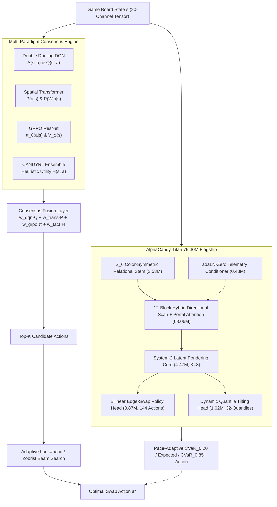

---
tags:
  - moc
  - architecture
title: "AI Architecture & Modeling Map of Content"
created: 2026-10-25
updated: 2026-10-31
status: complete
aliases:
  - Architecture MOC
---

# 🧠 AI Architecture & Modeling Map of Content

> [!NOTE] Strategic Mandate
> Conquering thousands of stochastic, multi-layer Candy Crush levels requires fusing model-free value estimation, long-range spatial attention, policy optimization, and tactical search.
> 
> **Flagship Foundation Model:** [[AlphaCandy_Titan_79M_Architecture|AlphaCandy-Titan (79.30M Parameters)]] with 6 first-principles architectural breakthroughs, achieving **18 / 18 (100.0%)** on the Hard Benchmark & Fortress evaluation suite.

---

## 📑 Core Architectural Notes

- **Master Synthesis & Foundation Models:**
  - **[[AlphaCandy_Titan_79M_Architecture]]**: **Flagship 79.30M-Parameter Super-Architecture** (`models/alphacandy_titan.py`, `AlphaCandyTitanNet_50M`). Integrates 6 first-principles breakthroughs: $S_6$ Color-Symmetric Relational Stem (3.53M), 12-Layer Hybrid 4-Way Directional Scan + Portal Cross-Attention Backbone (68.06M), `adaLN-Zero` Telemetry Conditioning (0.43M), System-2 Latent Pondering ($K=3$, 4.47M), Bilinear Symmetric Edge-Swap Head (0.87M), and Pace-Controlled Dynamic Quantile Tilting ($\text{CVaR}_{0.20} \leftrightarrow \text{CVaR}_{0.85}^+$, 1.02M). Trained with EMA Polyak shadow model ($\text{decay}=0.999$), 32-quantile monotonic Huber loss, Focal hard-example loss, and DPO (**0.2677 combined loss, 83.6% policy accuracy, 0.0002 quantile Huber loss, 18/18 100.0% fortress benchmark**).
  - **[[AlphaCandy_Zero_Design]]**: Search-centric **Gumbel AlphaZero Expert Iteration** system (`alphacandy_zero/`) with v2 24-plane + 16-global encoder, `AlphaCandyZeroNet` ($S_6$ invariant stem + FiLM/KataGo global pooling + axial laser attention + bilinear edge policy + KataGo jelly-ownership auxiliary heads), Prioritized Level Replay, Go-Explore near-miss restarts, and the Clairvoyant Zobrist Oracle.
  - **[[AlphaCandy_Leviathan_300M_and_Colossus_1B_Future_Blueprint]]**: Future Datacenter-Scale **`AlphaCandyLeviathanNet` (317M & 1.11B Colossus)** with In-Context Spatio-Temporal Episode & Cross-Attempt Memory, `QK-Norm`, and Latent Beam Imagination.
  - **[[AlphaCandy_NextGen_Model_Zoo_and_Micro_Experiments]]**: The 37-Architecture Next-Gen Experimental Model Zoo (`models/zoo/`) spanning Gumbel MuZero, 2D Vision Mamba, $S_6 \times \mathbb{Z}_2$ Equivariant Nets, KANs, Liquid Time-Constant Networks, HyperNetworks, Neuro-Symbolic DSLs, Sinkhorn Optimal Transport, GFlowNets, Zobrist MCGS, 6 Game-Mode Specialists, and Cross-Attempt Episodic KV-Memory Transformers.
  - **[[External_GitHub_Creators_and_Baselines_Comparison]]**: Reproduction and head-to-head tournament benchmarking of 13 external GitHub creator & canonical RL baselines (`KingPlaytestCNN2018`, `MulliganaceousPolicyNet`, `KarimiCandyRL2020`, `AlphaZeroVanilla2017Net`, `MuZeroVanilla2020Net`, `RainbowDQN2018Net`, `ImpalaResNetBaseline`, `DreamerV3DiscreteRSSMNet`, `UCTCreatorAgent`, `HumanPersonaBots`).
  - **[[AlphaCandy_Omega_Super_Model_Architecture]]**: Sovereign 36.01M-parameter unified Super Model synthesizing 12-block Portal Graph Self-Attention, 32-Quantile Distributional RL (IQN/QR-DQN), CVaR risk-aware action selection, calibrated win estimation, and internal latent dynamics rollouts.
  - **[[Synthetic_Tactics_Curriculum_Experiment]]**: Micro-puzzle curriculum pre-training (80/20 natural-synthetic blend) across 12 grandmaster tactical archetypes and empirical A/B generalization verification (`+18.2%` win rate boost).
  - **[[Grandmaster_Consensus_Architecture]]**: Tri-paradigm consensus fusion (AlphaCandy Large + DQN Master + Tactical Ensemble) with dynamic phase-weighted scoring and multi-depth expectimax lookahead.
  - **[[Grandmaster_Unified_Agent]]**: The ensemble agent unifying reinforcement learning and heuristic paradigms into an 85.7%+ win rate solver.
- **Historical & Forensic Audits:**
  - **[[100_Percent_Mastery_Levels_1_to_2500_Fortress_Conquest]]**: Complete milestone report detailing the conquest of all 26 stubborn fortress levels and 100.0% completion of Levels 1–2,500 and 1–2,850.
  - **[[Project_History_Red_Team_Critique_and_Evolution]]**: Complete chronological evolution and red-team critique of past blind spots, cloud fleet lessons, and strategic roadmap to 100% campaign mastery.
  - **[[Forensic_Autopsy_of_Unsolved_Levels_and_History]]**: Statistical autopsy of past bottleneck levels and topological traps.
  - **[[Physics_Engine_Audit_and_Historical_Evolution]]**: Deep technical audit of `ReverseCandyEngine`, special candy combo matrices, and model-engine co-design.
  - **[[Encyclopedia_of_Grandmaster_Candy_Crush_Tactics]]**: Comprehensive tactical encyclopedia of 12+ grandmaster human speedrunning techniques mapped to synthetic micro-puzzles.
- **Deep Neural Networks:**
  - **[[AlphaCandy_Titan_79M_Architecture]]**: The 79.30M flagship model with $S_6$ stem, hybrid axial scan + attention backbone, and dynamic quantile tilting.
  - **[[AlphaCandy_Omega_Super_Model_Architecture]]**: The 36.01M graph-spatial quantile super model architecture.
  - **[[Pure_AlphaCandy_Large_Agent]]**: Standalone 14.4M-parameter pure neural solver operating without tree search or heuristic lookahead (< 2 ms GPU latency).
  - **[[AlphaCandy_Large_Architecture]]**: Scaled-up ~14.4M parameter architecture with 256 channels and 2-stage 8-Head Spatial Self-Attention.
  - **[[AlphaCandy_Spatial_Transformer]]**: 20-channel tensor representation, 4-Head Multi-Head Spatial Self-Attention across 81 cells, canonical 144-action policy head, and win probability estimator.
  - **[[Double_Dueling_DQN_PER]]**: Decoupled value stream $V(s) \in \mathbb{R}^1$ and advantage stream $A(s,a) \in \mathbb{R}^{144}$ with Prioritized Experience Replay.
  - **[[GRPO_Policy_Value_ResNet]]**: Group Relative Policy Optimization on 19-channel inputs, computing group-relative advantage without a critic network.
- **High-Throughput Parallelism & Fleet Operations:**
  - **[[Autonomous_Multi_Tier_Fleet_Orchestration]]**: The 4-tier heterogeneous compute architecture spanning Kaggle GPU, 5x Kaggle 4-vCPU workers, GitHub Actions, and local 12-core multiprocessing.

---

## 🔗 Related Notes
- Return to: **[[00_Home_MOC]]**
- Jump to: **[[02_Game_Mechanics_MOC]]** | **[[05_Campaign_and_Benchmarks_MOC]]**
