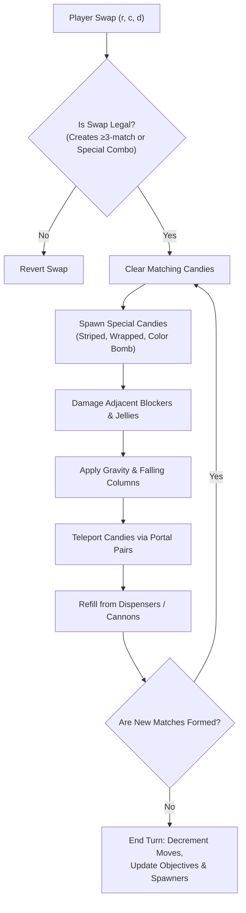

---
tags:
  - moc
  - mechanics
title: "Game Engine & Mechanics Reverse Engineering MOC"
created: 2026-10-25
status: complete
aliases:
  - Mechanics MOC
---

# ⚙️ Game Engine & Mechanics Reverse Engineering MOC

> [!NOTE] Mechanical Fidelity
> AlphaCandy's physics engine (`core/reverse_engine.py`) reproduces King's official production C++ game dynamics with exact state transitions, cascade evaluation, falling gravity, non-Euclidean portals, and multi-phase blocker interactions.

---

## 📑 Core Mechanics Notes

- **Physics, Percolation & Criticality:**
  - **[[Dispensers_Portals_and_Non_Euclidean_Board_Topology]]**: Formulating board flow as Directed Acyclic Graphs (DAG), topological sorting of infill, dispenser cannons (`ammoCannons`), and wormhole connectivity.
  - **[[Percolation_Theory_and_Cascade_Physics]]**: Grid hypergraph representation, weak proper colorings, branching processes ($R_0$), and self-organized criticality in cascade chains.
  - **[[King_Engine_Core_Physics]]**: Deterministic falling physics, sliding diagonal infill, cascade propagation order, and grid masking.
  - **[[Dispenser_Refill_and_RNG_Distribution]]**: Pseudo-random number generator seeding, color distribution tables, dispenser choking, and column refill precedence.
  - **[[Portals_and_Teleporters_Topology]]**: Directed graph mapping of non-Euclidean board connections, entrance-exit momentum conservation, and drop cascades across voids.
- **Level Design & Telemetry Architecture:**
  - **[[King_Level_Design_Pillars_and_Telemetry]]**: The 4 Design Pillars (GDC), Complexity Staircase, Level Completion Rate (LCR), and automated AI playtest calibration.
- **Blockers & Obstacles:**
  - **[[Blocker_Hierarchy_and_Damage_Phases]]**: Complete breakdown of Chocolate, Licorice Swirls, Multi-hit Frosting, Toffee Swirls, Magic Mixers, Cake Bombs, Popcorn, and Frogs.
- **Specials & Combinations:**
  - **[[Special_Candies_and_Combinations]]**: Creation requirements (4-match, T/L-shape, 5-in-a-row) and 10 canonical combination interactions (e.g. Color Bomb + Striped, Wrapped + Wrapped).
  - **[[Encyclopedia_of_Grandmaster_Candy_Crush_Tactics]]**: Complete tactical encyclopedia of 14 grandmaster human Candy Crush techniques, mathematical reward terms, synthetic micro-puzzles, and bottleneck level breakdowns (Levels 65, 70, 147, 148, 201, 235, 272, 300).
- **Objectives & Victory Conditions:**
  - **[[Objective_Types_and_Evaluation]]**: Mechanics of Jelly clearing (single/double), Ingredients delivery, Target Score, Order fulfillment, and Mixed objectives.

---

## 🔗 Related Notes
- Return to: **[[00_Home_MOC]]**
- Jump to: **[[01_Architecture_MOC]]** | **[[04_Level_Database_and_EDA_MOC]]**
