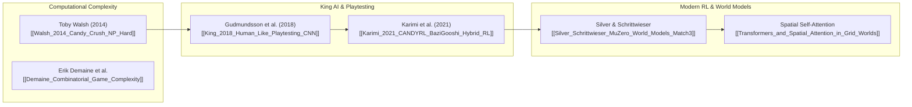

---
tags:
  - moc
  - research
title: "Academic Research & Literature Map of Content"
created: 2026-10-25
status: complete
aliases:
  - Research Papers MOC
  - Literature MOC
---

# 📚 Academic Research & Literature Map of Content

> [!NOTE] Literature Anchors
> Candy Crush and Match-3 puzzles have been analyzed extensively across computational complexity theory, telemetry-driven deep learning, and hybrid reinforcement learning.

---

## 📑 Core Research Notes

- **Theoretical Complexity & NP-Hardness:**
  - **[[Walsh_2014_Candy_Crush_NP_Hard]]**: *Candy Crush is NP-hard* (arXiv:1403.1911). Reduction from 3-SAT to match-3 grid gadgets (Variable, Clause, and Wire gadgets).
  - **[[Guala_2014_Bejeweled_Candy_Crush_NP_Hard]]**: *Bejeweled, Candy Crush and other match-three games are (NP-)hard* (arXiv:1403.5830). Planar wire crossovers, tile clearing target complexity, and survival intractability.
  - **[[Demaine_Combinatorial_Game_Complexity]]**: MIT combinatorial game theory, tile-matching gadgets, and computational lower bounds across discrete puzzle games.
- **King AI Playtesting & Supervised Learning:**
  - **[[King_2018_Human_Like_Playtesting_CNN]]**: *Human-Like Playtesting with Deep Learning* (IEEE CIG 2018). Supervised CNNs trained on telemetry data for difficulty prediction and player churn prevention.
  - **[[Fragkedaki_2026_GAT_vs_BERT_Human_Like_Playtesting]]**: *Comparative Analysis of GAT and BERT for Human-Like Playtesting* (arXiv:2607.11501). Proving Transformers & Graph Attention Networks outperform standard CNNs on non-Euclidean board layouts.
- **Deep Reinforcement Learning in Match-3:**
  - **[[Kamaldinov_2019_Deep_Reinforcement_Learning_Match3]]**: *Deep Reinforcement Learning in Match-3 Game* (IEEE CoG 2019). The foundational `gym-match3` benchmark, 144-action swap masking, and Double DQN with PER.
  - **[[Napolitano_2020_Testing_Match3_Dueling_DQN]]**: *Testing match-3 video games with Deep Reinforcement Learning* (arXiv:2007.01137). Dueling DQN architecture decoupling scalar board quality $V(s)$ from action advantage $A(s, a)$.
  - **[[Karimi_2021_CANDYRL_BaziGooshi_Hybrid_RL]]**: *CANDYRL / BaziGooshi: A Hybrid Reinforcement Learning Model for Generalization in Gameplay* (IEEE ToG 2021/2024). Intrinsic vs. extrinsic reward shaping and dynamic multi-agent ensemble mixtures.
- **World Models & Modern Architectures:**
  - **[[DeepMind_Stochastic_MuZero_Afterstates_Match3]]**: *Planning in Stochastic Environments with a Learned Model* (Antonoglou et al., DeepMind 2022). Factoring deterministic afterstates $s^{\text{after}}$ from stochastic dispenser refills for match-3 tree search.
  - **[[Sanford_2023_Higher_Order_Attention_Match3_Complexity]]**: *Representational Strengths and Limitations of Transformers on Relational Tasks* (Sanford et al., 2023). Proving why standard single-layer attention fails on Match-3 triplets and why multi-stage attention is mathematically required.
  - **[[Silver_Schrittwieser_MuZero_World_Models_Match3]]**: Adapting DeepMind's MuZero latent dynamics function $g_\theta(s_t, a_t) \to s_{t+1}$ and value estimation to stochastic puzzle manifolds.
  - **[[Transformers_and_Spatial_Attention_in_Grid_Worlds]]**: Multi-Head Spatial Self-Attention on discrete 2D manifolds with voids, non-Euclidean topologies, and teleporters.

---

## 🔗 Related Notes
- Return to: **[[00_Home_MOC]]**
- Jump to: **[[01_Architecture_MOC]]** | **[[05_Campaign_and_Benchmarks_MOC]]**
