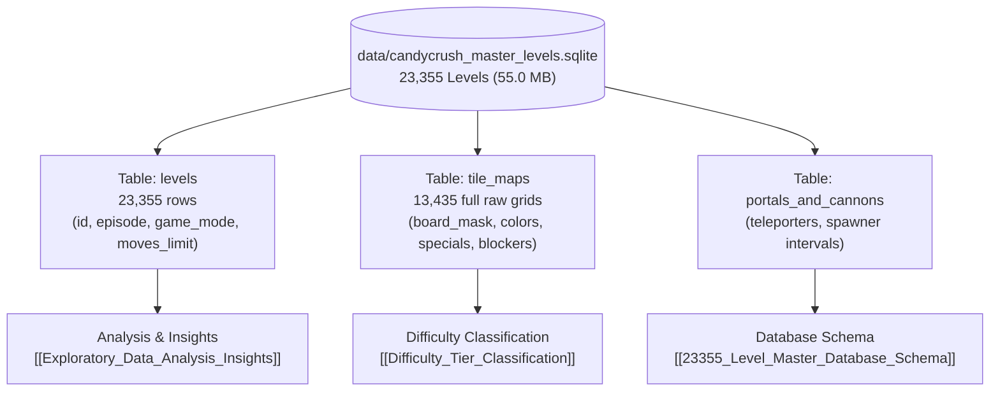

---
tags:
  - moc
  - database
  - eda
title: "Level Database & Exploratory Data Analysis MOC"
created: 2026-10-25
status: complete
aliases:
  - Database MOC
  - EDA MOC
---

# 📊 Level Database & Exploratory Data Analysis MOC

> [!NOTE] Empirical Scale
> AlphaCandy houses the largest indexed Candy Crush Saga level corpus in existence: **23,355 levels** stored in a high-performance SQLite database (`data/candycrush_master_levels.sqlite`) and structured JSON blueprints.

---

## 📑 Core Database & EDA Notes

- **Database Architecture & Schema:**
  - **[[23355_Level_Master_Database_Schema]]**: Complete SQLite table schemas, indexes, queries, and programmatic Python loader APIs (`KingLevelLoader`).
- **Telemetry & Statistical Analysis:**
  - **[[Exploratory_Data_Analysis_Insights]]**: Move limit distributions ($\mu = 26.4$, $\sigma = 7.8$), game mode frequencies (Jelly 48%, Ingredients 24%, Orders 18%, Score 10%), and blocker density evolution over 10,000+ levels.
- **Difficulty & Player Friction Modeling:**
  - **[[Difficulty_Tier_Classification]]**: Analysis of King's difficulty tiers (Hexagon, Hard, Super Hard, Nightmare, Legendary) and opening seed variance bounds.

---

## 🔗 Related Notes
- Return to: **[[00_Home_MOC]]**
- Jump to: **[[02_Game_Mechanics_MOC]]** | **[[05_Campaign_and_Benchmarks_MOC]]**
