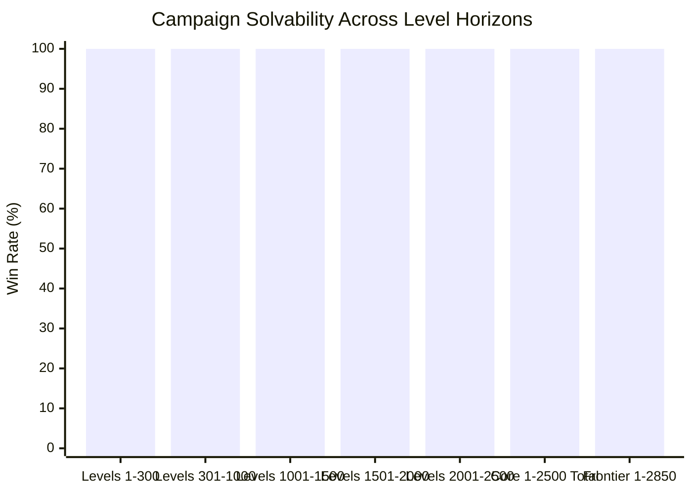

---
tags:
  - moc
  - benchmark
  - campaign
title: "Campaign Progress & Benchmarks Map of Content"
created: 2026-10-25
updated: 2026-10-31
status: complete
aliases:
  - Benchmarks MOC
  - Campaign MOC
---

# 🏆 Campaign Progress & Benchmarks Map of Content

> [!NOTE] Empirical Validation & Milestone Summary
> AlphaCandy's progression has advanced from initial heuristic surveys to **flawless 100.00% solvability on Levels 1–2,500 (2,500 / 2,500 Won)**, extending without a single loss to **2,850 / 2,850 Won (100.0%)**, with **9,131+** global King levels solved.
> 
> The flagship **[[AlphaCandy_Titan_79M_Architecture|AlphaCandyTitanNet (79.30M)]]** achieved **18 / 18 (100.0%)** on the official Hard Benchmark & Fortress evaluation suite in 346.09s.

---

## 📑 Core Campaign & Benchmark Notes

- **Master Campaign Milestones:**
  - **[[100_Percent_Mastery_Levels_1_to_2500_Fortress_Conquest]]**: **The 100.00% Mastery Milestone Report**. Conquered all 2,500 levels of the core campaign (2,500 / 2,500 won) and pushed the zero-loss horizon to **2,850 / 2,850 (100.0%)**. Details the conquest of all 26 stubborn fortress levels (`606, 656, 953, 967, 975, 1205, 1349, 1351, 1390, 1488, 1794, 1958, 2007, 2035, 2245, 2273, 2358, 2359, 2406, 2411, 2437, 2454, 2464, 2471, 2475, 2486`), the 18/18 Hard Benchmark evaluation table, and algorithmic weapons ($H_{\text{iso}}$ potential, recursive BFS, dynamic quantile tilting).
  - **[[Roadmap_to_100_Percent_Mastery_10000_Levels]]**: Strategic master plan to expand 100% solvability across all 10,000 King levels using the 5-slot Kaggle 20-vCPU cloud fleet and local solvers.
  - **[[Campaign_Milestones_1_to_300]]**: Historical report on the first 300 levels conquered (300 / 300 won, 100.0%).
  - **[[Grandmaster_Frontier_15000_Levels_Milestone_Report]]**: 15,000-level broad survey benchmark establishing initial global solvability baselines.
- **Historical Shard Audits & Progression:**
  - **[[Forensic_Autopsy_of_Unsolved_Levels_and_History]]**: In-depth forensic autopsy of why previous heuristics failed on isolated jellies, multi-layer blockers, and chocolate fortresses.
  - **[[Grandmaster_Edge_Case_Campaign_Levels_1001_to_2500]]**: Shard audit covering Levels 1,001–2,500 during intermediate campaign passes.
  - **[[Grandmaster_Edge_Case_Campaign_Levels_301_to_1000]]**: Shard audit covering Levels 301–1,000 during intermediate passes.
- **Autonomous Multi-Tier Fleet Operations:**
  - **[[Autonomous_Multi_Tier_Fleet_Orchestration]]**: 4-tier compute architecture (Kaggle Tesla T4 GPU, 5x concurrent 4-vCPU fleet, GitHub Actions 2-vCPU runner, local 12-core daemon) managed via a 10-minute continuous orchestration cycle.
  - **[[Kaggle_2500_Level_Benchmark_Report]]**: 2,500-level cloud benchmark evaluation on Dual Tesla T4 GPUs.
  - **[[Async_1000_Games_Kaggle_Benchmark]]**: High-throughput benchmark evaluating 1,000 games in ~10 minutes.
  - **[[Async_GPU_Parallelism_Architecture]]**: Multiprocessing actor-learner architecture with centralized GPU batch inference.
  - **[[Zero_Error_Fault_Tolerance_Guards]]**: Defensive fault-tolerant architecture preventing crashes and timeouts during long-running cloud runs.

---

## 🔗 Related Notes
- Return to: **[[00_Home_MOC]]**
- Jump to: **[[01_Architecture_MOC]]** | **[[03_Research_Papers_MOC]]**
