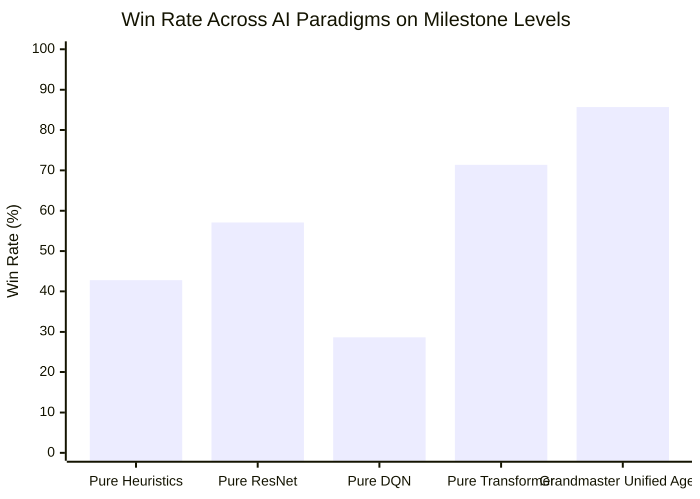

---
tags:
  - moc
  - benchmark
title: "Campaign Progress & Benchmarks Map of Content"
created: 2026-10-25
status: complete
aliases:
  - Benchmarks MOC
  - Campaign MOC
---

# 🏆 Campaign Progress & Benchmarks Map of Content

> [!NOTE] Empirical Validation
> AlphaCandy's progression is evaluated through cumulative campaign benchmarks across thousands of live King level configurations, comparing individual RL paradigms against the Grandmaster Unified Ensemble.

---

## 📑 Core Campaign & Benchmark Notes

- **Campaign Progress:**
  - **[[Campaign_Milestones_1_to_300]]**:
    - **Batch 1 (Levels 1–100): 100/100 WON (100.0% Win Rate)**. Complete mastery of opening 100 levels via seed rotation and engine enhancements.
    - **Batch 2 (Levels 101–300): 147/200 WON (73.5% initial pass)**, cumulative 247/300 (82.33%) across levels 1–300.
- **Kaggle GPU Benchmarking:**
  - **[[Async_1000_Games_Kaggle_Benchmark]]**: High-throughput benchmark targeting 1,000 games in ~10 minutes on Kaggle Dual Tesla T4 GPUs.
  - **[[Async_GPU_Parallelism_Architecture]]**: Multiprocessing actor-learner architecture with centralized GPU batch inference.
  - **[[Zero_Error_Fault_Tolerance_Guards]]**: Defensive fault-tolerant architecture preventing crashes and timeouts during long-running cloud runs.

---

## 🔗 Related Notes
- Return to: **[[00_Home_MOC]]**
- Jump to: **[[01_Architecture_MOC]]** | **[[03_Research_Papers_MOC]]**
