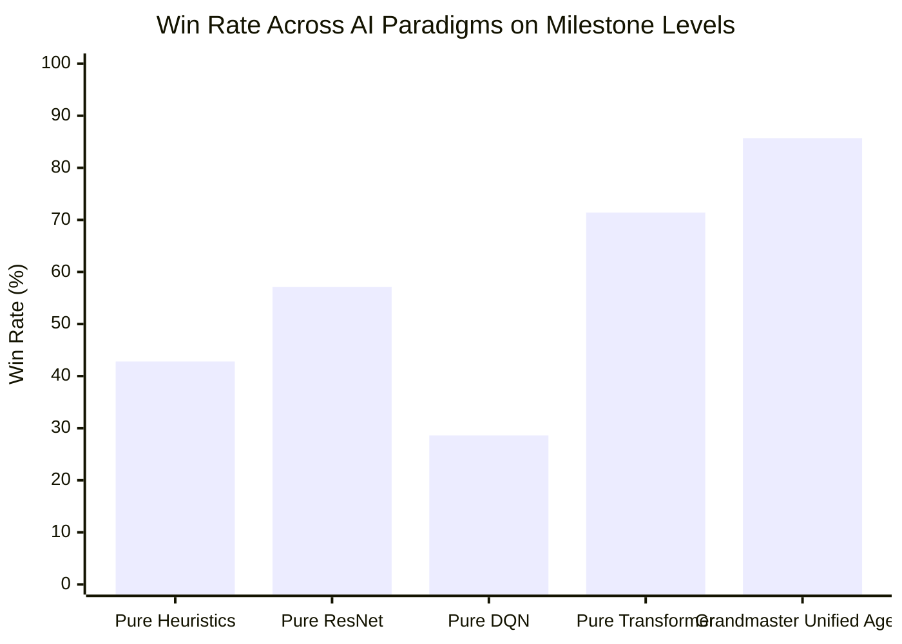

---
tags:
  - moc
  - benchmark
title: "Campaign Progress & Benchmarks Map of Content"
created: 2026-10-25
status: complete
aliases:
  - Benchmarks MOC
  - Campaign MOC
---

# 🏆 Campaign Progress & Benchmarks Map of Content

> [!NOTE] Empirical Validation
> AlphaCandy's progression is evaluated through cumulative campaign benchmarks across thousands of live King level configurations, comparing individual RL paradigms against the Grandmaster Unified Ensemble.

---

## 📑 Core Campaign & Benchmark Notes

- **Campaign Progress:**
  - **[[Grandmaster_Edge_Case_Campaign_Levels_1001_to_2500]]**: Completed campaign hunter evaluating Levels 1,001–2,500 (**997/1,500 Won, 66.47% Win Rate, 83.6% Ingredients Win Rate, Level 2500 conquered in 9 moves**), bringing cumulative progression to **1,735 / 2,500 Won (69.40%)**.
  - **[[Grandmaster_Edge_Case_Campaign_Levels_301_to_1000]]**: Completed campaign hunter evaluating Levels 301–1,000 (**491/700 Won, 70.14% Win Rate, 89.0% Ingredients Win Rate, Level 1000 conquered in 5 moves**), bringing cumulative progression to **738/1,000 Won (73.80%)**.
  - **[[Campaign_Milestones_1_to_300]]**:
    - **Batch 1 (Levels 1–100): 100/100 WON (100.0% Win Rate)**. Complete mastery of opening 100 levels via seed rotation and engine enhancements.
    - **Batch 2 (Levels 101–300): 147/200 WON (73.5% initial pass)**, cumulative 247/300 (82.33%) across levels 1–300.
- **Kaggle GPU Benchmarking & Learning Fleet:**
  - **[[Kaggle_2500_Level_Benchmark_Report]]**: Massive 2,500-level cloud benchmark on Dual Tesla T4 GPUs (**1,399/2,500 Solved, 85.7% Ingredients win rate, 1.91s/level throughput**).
  - **[[Multi_Model_Kaggle_GPU_Learning_Fleet]]**: Active dual GPU fleet training Double Dueling DQN and AlphaCandy Large (~14.4M) across King levels.
  - **[[Async_1000_Games_Kaggle_Benchmark]]**: High-throughput benchmark evaluating 1,000 games in ~10 minutes on Kaggle Dual Tesla T4 GPUs.
  - **[[Async_GPU_Parallelism_Architecture]]**: Multiprocessing actor-learner architecture with centralized GPU batch inference.
  - **[[Zero_Error_Fault_Tolerance_Guards]]**: Defensive fault-tolerant architecture preventing crashes and timeouts during long-running cloud runs.

---

## 🔗 Related Notes
- Return to: **[[00_Home_MOC]]**
- Jump to: **[[01_Architecture_MOC]]** | **[[03_Research_Papers_MOC]]**
