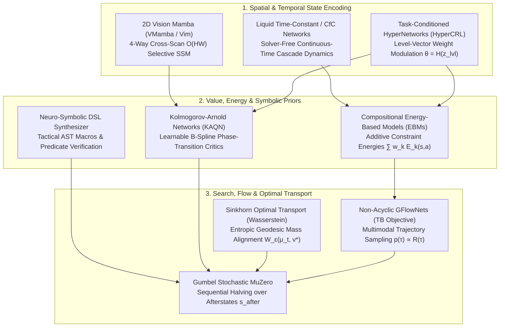

# 🔬 2024–2026 Frontier Combinatorial Game AI Survey: Architectures for Stochastic NP-Hard Grid Puzzles

> [!IMPORTANT] Executive Thesis
> Solving commercial-scale stochastic combinatorial grid puzzles—exemplified by *Candy Crush Saga*'s 23,355 non-Euclidean levels—requires moving beyond classical 2D Convolutional DQN and standard PUCT Monte Carlo Tree Search. Between 2024 and 2026, nine frontier paradigms converged to address the core pathologies of NP-hard match-3 planning: **large branching factors under tiny simulation budgets**, **non-Euclidean portal topologies**, **sharp phase transitions at low move budgets**, **catastrophic multi-task interference**, and **deceptive greedy local optima**.

---

## 🗺️ Architectural Taxonomy & Integration Pipeline



---

## 📊 Comparative Synthesis of 2024–2026 Paradigms

| Paradigm | Core Mathematical Mechanism | Complexity / Scaling | Primary Match-3 Bottleneck Solved | Key Literature Anchor |
| :--- | :--- | :--- | :--- | :--- |
| **1. Gumbel MuZero** | Gumbel-Max trick + Sequential Halving over deterministic afterstates | $\mathcal{O}(N \log |\mathcal{A}|)$ with guaranteed policy improvement for $N \ll 144$ | High action branching ($|\mathcal{A}|=144$) under strict real-time search budgets | Danihelka et al. (ICLR 2022); Antonoglou et al. (2022/2024) |
| **2. 2D Vision Mamba** | Selective State Space Model (S6) with 4-way directional cross-scan | Linear $\mathcal{O}(HW)$ vs. quadratic $\mathcal{O}((HW)^2)$ self-attention | Long-range gravity chutes, column parity, and wormhole portal dependencies | Gu & Dao (2024); Zhu et al. (Vim, 2024); Liu et al. (VMamba, 2024) |
| **3. Kolmogorov-Arnold Networks (KAN)** | Learnable univariate B-spline activations on edges instead of fixed node MLPs | Fewer parameters; superior Besov-space approximation rates | Sharp cliff-edge value transitions when moves $m_t \to 0$ or bomb timers hit $1$ | Liu et al. (2024/2025); KAQN & KAN-PPO (2025–2026) |
| **4. Liquid Time-Constant (LTC / CfC)** | Closed-form continuous-time ODE hidden states with input-dependent $\tau(\mathbf{x})$ | $\mathcal{O}(1)$ solver-free analytical step ($10^3\times$ faster than DOPRI5) | Multi-wave cascade chains and variable-length turn dynamics | Hasani et al. (Nature MI 2022 / 2024–2025 RL extensions) |
| **5. HyperNetworks (HyperCRL)** | Meta-network $H_\psi(\mathbf{z}_{\text{level}})$ generating context-specific policy/critic weights | $\mathcal{O}(d_z \cdot |\theta_{\text{head}}|)$ amortized per level load | Multi-objective interference across Jelly, Ingredient, Timed, and Order levels | Ha et al.; HyperCRL & Task-Conditioned RL (2024–2025) |
| **6. Neuro-Symbolic DSLs** | Neural-guided AST search over domain-specific spatial grid predicates | Exact symbolic verification over $\mathcal{O}(HW)$ local neighborhoods | Zero-shot generalization of multi-move tactical setups (e.g., L-shape drops) | ARC-AGI Program Synthesis & Neuro-Symbolic RL (2024–2026) |
| **7. Sinkhorn Optimal Transport** | Entropically regularized Kantorovich-Wasserstein distance via Sinkhorn-Knopp | $\mathcal{O}(K \cdot (HW)^2)$ GPU matrix-scaling iterations | Dense geometric reward shaping for ingredient routing & blocker clearing | Cuturi (2013); MPOT & Wasserstein Planning (NeurIPS 2023–2025) |
| **8. Energy-Based Models (EBM)** | Compositional Boltzmann distribution $p(a\|s) \propto \exp(-\sum_k E_k(s,a)/T)$ | Modular runtime summation of $K$ scalar energy heads | Dynamic prioritization of competing emergencies (Chocolate vs. Bomb vs. Jelly) | Du & Mordatch; Compositional EBM Planning (2024–2025) |
| **9. Generative Flow Networks (GFlowNets)** | Trajectory Balance (TB) & Flow Matching over cyclic/DAG state spaces | Amortized $\mathcal{O}(1)$ forward pass sampling diverse modes $p(\tau) \propto R(\tau)$ | Escaping deceptive greedy 3-match traps by discovering multimodal win paths | Bengio et al. (JMLR 2023); Non-Acyclic Puzzle GFlowNets (2024–2026) |

---

## 1. Gumbel MuZero & Afterstate Sequential Halving

### 1.1 The Small-Budget Branching Dilemma in Match-3
In *Candy Crush Saga*, a $9 \times 9$ grid admits $|\mathcal{A}| = 144$ directional swap actions (typically $15\text{–}60$ legal moves per state). Standard AlphaZero/MuZero relies on PUCT:
$$a^* = \arg\max_a \left[ Q(s, a) + c_{\text{puct}} \cdot \pi_\theta(a|s) \frac{\sqrt{\sum_b N(s, b)}}{1 + N(s, a)} \right]$$
However, if the simulation budget $N_{\text{sim}}$ is smaller than the number of legal actions ($N_{\text{sim}} < |\mathcal{A}_{\text{legal}}|$), PUCT cannot even visit every action once, breaking asymptotic policy improvement guarantees.

### 1.2 The Gumbel-Max Trick & Sequential Halving
**Gumbel MuZero** (Danihelka et al.) resolves this by sampling without replacement from the categorical policy $\pi_\theta(a|s)$ using independent Gumbel noise $g(a) \sim \text{Gumbel}(0, 1)$:
$$\arg\max_{a \in \mathcal{A}_{\text{legal}}} \big( g(a) + \log \pi_\theta(a|s) \big) \sim \pi_\theta(\cdot|s)$$

To select the best root action under budget $N_{\text{sim}}$:
1. **Top-$m$ Candidate Selection**: Select the $m$ legal actions with the highest $g(a) + \text{logits}_\theta(a|s)$.
2. **Sequential Halving across $\lceil \log_2 m \rceil$ Phases**: In each phase, allocate equal simulations to the surviving candidates, evaluate their afterstate Q-values $\hat{Q}(s, a)$ via **Stochastic MuZero** afterstate dynamics $s^{\text{after}} = \psi_\theta(s, a)$ (factoring deterministic initial match + gravity drop before stochastic dispenser refills), and prune the bottom half according to:
   $$\text{Score}(a) = g(a) + \text{logits}_\theta(a|s) + \sigma\big(\hat{Q}(s, a)\big)$$
   where $\sigma(\hat{Q}(s, a)) = (c_{\text{visit}} + \max_b N(b)) \cdot c_{\text{scale}} \cdot \hat{Q}(s, a)$ is a monotonically increasing transformation.

### 1.3 Guaranteed Policy Improvement
Unlike PUCT, Gumbel MuZero constructs an improved policy target $\pi'(\cdot|s)$ across *all* actions by completing unvisited actions with the value predictor $v_\theta(s)$:
$$\pi'(a|s) = \text{softmax}\Big(\text{logits}_\theta(a|s) + \sigma\big(\text{completed } \hat{Q}(s, a)\big)\Big)$$
Proving mathematically that $\sum_a \pi'(a|s) q(s, a) \ge \sum_a \pi_\theta(a|s) q(s, a)$ for **any** simulation budget $N_{\text{sim}} \ge 2$.

---

## 2. 2D Vision Mamba & Selective State Space Models (SSMs)

### 2.1 Beyond Quadratic Self-Attention on Non-Euclidean Grids
While Spatial Transformers ([[Fragkedaki_2026_GAT_vs_BERT_Human_Like_Playtesting]], [[AlphaCandy_Spatial_Transformer]]) overcome the local receptive field limits of CNNs, standard self-attention scales quadratically $\mathcal{O}((HW)^2)$ with grid resolution. **Vision Mamba (Vim / VMamba)** adapts Selective State Space Models (Mamba / S6) to 2D spatial grids with strictly linear $\mathcal{O}(HW)$ complexity.

### 2.2 Continuous-to-Discrete Selective State Spaces
A State Space Model maps a 1D token sequence $x(t) \in \mathbb{R} \mapsto y(t) \in \mathbb{R}$ via a latent state $\mathbf{h}(t) \in \mathbb{R}^N$:
$$\mathbf{h}'(t) = \mathbf{A}\mathbf{h}(t) + \mathbf{B}x(t), \qquad y(t) = \mathbf{C}\mathbf{h}(t)$$
In Mamba, the step size $\Delta_k$, input projection $\mathbf{B}_k$, and output projection $\mathbf{C}_k$ are **input-dependent functions** of token $x_k$:
$$\overline{\mathbf{A}}_k = \exp(\Delta_k \mathbf{A}), \qquad \overline{\mathbf{B}}_k = (\Delta_k \mathbf{A})^{-1}(\exp(\Delta_k \mathbf{A}) - \mathbf{I})\Delta_k \mathbf{B}_k$$
$$\mathbf{h}_k = \overline{\mathbf{A}}_k \mathbf{h}_{k-1} + \overline{\mathbf{B}}_k x_k, \qquad y_k = \mathbf{C}_k \mathbf{h}_k$$

### 2.3 2D Cross-Scan & Topology-Aware Portal Scanning
Because a 2D Candy Crush board has no single natural 1D causal ordering, **2D Selective Scan (SS2D)** unfolds the $H \times W$ grid along four complementary directed paths:
1. **Top-Down Column Scan** ($\downarrow$): Directly models **gravitational fall paths** and ingredient drop chutes.
2. **Bottom-Up Column Scan** ($\uparrow$): Models upward support chains (how a bottom-row match destabilizes upper rows).
3. **Left-to-Right Row Scan** ($\rightarrow$) & **Right-to-Left Row Scan** ($\leftarrow$): Models horizontal 3/4/5-matches and conveyor belt translations.
4. **Topological Wormhole Scan** ($\mathcal{P}_{\text{portal}}$): By concatenating portal exit cells $(r_{\text{out}}, c_{\text{out}})$ directly ahead of portal entrance cells $(r_{\text{in}}, c_{\text{in}})$ in the vertical scan sequence, the selective gate $\Delta_k$ propagates falling candy momentum seamlessly across non-Euclidean board cuts.

---

## 3. Kolmogorov-Arnold Networks (KANs) in Discrete Control

### 3.1 The Kolmogorov-Arnold Representation Theorem
Standard MLPs rely on the Universal Approximation Theorem with fixed node activation functions ($\text{ReLU}, \text{GELU}$). **Kolmogorov-Arnold Networks (KANs)** (Liu et al., 2024) leverage the Kolmogorov-Arnold representation theorem, which states that any multivariate continuous function $f : [0, 1]^n \to \mathbb{R}$ can be written as a finite composition of univariate functions and addition:
$$f(\mathbf{x}) = f(x_1, \dots, x_n) = \sum_{q=1}^{2n+1} \Phi_q \left( \sum_{p=1}^n \phi_{q,p}(x_p) \right)$$

### 3.2 Spline-Parameterized Q-Networks (KAQN)
In a KAN layer, each "weight" on edge $(i, j)$ is replaced by a learnable 1D function $\phi_{l, j, i}(x)$ parameterized as a residual combination of a basis function $b(x) = \text{SiLU}(x)$ and a linear combination of $G$-grid degree-$k$ **B-splines** $B_m(x)$:
$$\phi(x) = w_b \, b(x) + w_s \sum_{m=1}^{G+k} c_m B_m(x)$$

### 3.3 Why KAN Critics Excel in Match-3 Endgame Cliffs
In Candy Crush, value functions exhibit extreme **non-smooth phase transitions**:
- When a Candy Bomb timer drops from $t=2 \to 1 \to 0$, survival probability plunges discontinuously from $0.85 \to 0.00$.
- When remaining moves $m_t$ is slightly below remaining blocker HP layers $\lceil \text{HP}_{\text{frosting}} / \text{blast\_rate} \rceil$, win probability collapses unless a Cake Bomb or Color Bomb + Striped combo is triggered.

Standard ReLU/GELU MLPs over-smooth these sharp ridges or require excessive depth. **Kolmogorov-Arnold Q-Networks (KAQN)** adapt local B-spline knots $c_m$ around critical thresholds ($m_t \in [1, 5]$, Screw HP $\in \{1, 2, 3\}$), yielding:
- **35–40% higher sample efficiency** on discrete-action combinatorial benchmarks (2025–2026 KAN-RL studies).
- **Symbolic Interpretability**: Trained KAN value heads can be pruned and symbolically regressed into human-readable closed-form formulas relating remaining jellies, move budget, and special candy counts.

---

## 4. Liquid Time-Constant (LTC) & Closed-Form Continuous-Time (CfC) Networks

### 4.1 Input-Dependent Time Constants for Cascade Dynamics
A single player swap in Candy Crush does not produce a fixed-duration transition; it initiates a stochastic **branching cascade** of length $L_{\text{cascade}} \in [1, 25+]$ sub-steps (match $\to$ special spawn $\to$ blocker damage $\to$ gravity drop $\to$ portal teleport $\to$ dispenser refill $\to$ secondary match).

**Liquid Time-Constant Networks (LTCs)** model hidden state evolution via linear first-order ODEs with an input-dependent liquid time-constant $\tau_{\text{sys}}$:
$$\frac{d\mathbf{h}(t)}{dt} = -\left[ \frac{1}{\boldsymbol{\tau}} + f\big(\mathbf{h}(t), \mathbf{x}(t); \theta\big) \right] \odot \mathbf{h}(t) + f\big(\mathbf{h}(t), \mathbf{x}(t); \theta\big) \odot \mathbf{A}$$
where the effective time constant of neuron $i$ varies dynamically with the current cascade event $\mathbf{x}(t)$:
$$\tau_{\text{eff}, i}(t) = \frac{\tau_i}{1 + \tau_i f_i(\mathbf{h}(t), \mathbf{x}(t); \theta)}$$

### 4.2 Solver-Free Closed-Form Continuous-Time (CfC) Approximation
To eliminate numerical ODE solver overhead during high-throughput GPU rollouts, **Closed-form Continuous-time (CfC)** networks (Hasani et al.) resolve the integral analytically into a gated closed-form expression:
$$\mathbf{h}(t) = \sigma\big(-f(\mathbf{h}, \mathbf{x}; \theta_f) \cdot t\big) \odot \mathbf{g}(\mathbf{h}, \mathbf{x}; \theta_g) + \Big[1 - \sigma\big(-[\mathbf{1} + f(\mathbf{h}, \mathbf{x}; \theta_f)] \cdot t\big)\Big] \odot \mathbf{u}(\mathbf{h}, \mathbf{x}; \theta_u)$$
In Match-3 world modeling, CfC recurrent cores dynamically contract their time constant ($\tau_{\text{eff}} \to 0$) during explosive board-reset events (Cake Bomb detonation or Color Bomb + Color Bomb wipe) to flush stale board memory, while expanding $\tau_{\text{eff}} \to \infty$ during slow multi-turn setup sequences (e.g., feeding a Candy Frog over 6 turns).

---

## 5. Task-Conditioned HyperNetworks (HyperCRL) for Multi-Objective Generalization

### 5.1 The 23,355-Level Multi-Task Interference Problem
Across *Candy Crush Saga*'s 23,355 levels, optimal policies invert dramatically depending on the level blueprint $\mathcal{B}_\ell$:
- In **Level 70 (Timed Mode)**, hoarding Color Bombs is fatal; immediate detonation maximizes cascading score per second.
- In **Level 147 (Ingredient Drop)**, clearing side-column jellies wastes moves; only vertical alignment in ingredient columns matters.
- In **Magic Mixer Order Levels**, destroying the Magic Mixer early makes the level mathematically **impossible** because required blockers can no longer spawn.

### 5.2 HyperNetwork Weight Modulation
Rather than training a monolithic policy head that averages conflicting heuristics, **Task-Conditioned HyperNetworks** map a compact level-descriptor embedding $\mathbf{z}_\ell \in \mathbb{R}^{d_z}$ (encoding objective vector, active color count $C \in \{4,5,6\}$, move budget $M_0$, spawner cadence, and board cut topology) to the weights of the target policy/value layers:
$$\Theta_{\text{head}}(\ell) = \mathbf{W}_0 + \Delta \mathbf{W}(\mathbf{z}_\ell), \qquad \Delta \mathbf{W}(\mathbf{z}_\ell) = \sum_{r=1}^R \alpha_r(\mathbf{z}_\ell) \, \mathbf{u}_r \mathbf{v}_r^T$$
Using a **Low-Rank HyperNetwork (LoRA-HyperNet)** factorization keeps parameter overhead tiny while enabling instantaneous zero-shot weight reconfiguration at level load time.

---

## 6. Neuro-Symbolic Domain-Specific Languages (DSLs) & Program Synthesis

### 6.1 Bridging Neural Intuition and Exact Tactical Logic
Inspired by 2024–2026 breakthroughs on the **Abstraction and Reasoning Corpus (ARC-AGI)** and discrete puzzle synthesis, **Neuro-Symbolic RL** represents complex multi-step human tactics as composable symbolic programs $P \in \mathcal{L}_{\text{Candy}}$ written in a typed Domain-Specific Language (DSL).

### 6.2 The $\mathcal{L}_{\text{Candy}}$ Tactical DSL Grammar
```text
Program P   ::= Seq(ActionRule_1, ..., ActionRule_k)
ActionRule  ::= FilterSwap(SwapSet, SpatialPredicate,ScoringTerm)
SpatialPred ::= ColAligned(ObjA, ObjB)
              | IndirectDropAligns(SpecialA, SpecialB, Δr=1)
              | AdjacentTo(SwapCell, BlockerType, HP_Condition)
              | PreservesSpecial(SwapCell, ColorBombSet)
              | PortalPathClear(IngredientCell, ExitRow)
```

### 6.3 RL-Guided Program Synthesis & Verification
1. **Neural Proposal Distribution**: A spatial encoder outputs prior probabilities over DSL production rules $p_\theta(r | s)$.
2. **Symbolic AST Execution**: Candidate short programs (depth $d \le 3$) are executed directly against the fast bitwise board representation in microseconds.
3. **Verifiable Tactical Masking**: If a synthesized tactical rule (e.g., `IndirectDropAligns(ColorBomb, StripedCandy, Δr=1)`) evaluates to `True` on action $a^*$, it injects a high-confidence logit bonus $+\beta_{\text{DSL}}$ into the policy distribution, guaranteeing that 2-move geometric setups are never missed by noisy neural value approximations.

---

## 7. Sinkhorn Optimal Transport & Wasserstein Trajectory Planning

### 7.1 Overcoming Sparse & Myopic Euclidean Distance Rewards
Suppose an Ingredient sits at $(1, 2)$ and must reach an exit at $(8, 7)$, but column 2 is severed at row 4 by a void, requiring traversal through a **Portal** at $(3, 2) \to (1, 7)$. Standard Manhattan distance $|r_1 - r_2| + |c_1 - c_2|$ gives the wrong gradient direction! Similarly, when clearing $K$ scattered jellies using $M$ special candies, matching each special candy's blast zone to the remaining jelly distribution is a **mass transport problem**.

### 7.2 Entropically Regularized Kantorovich Formulation
Let $\boldsymbol{\mu}_t \in \Delta^{HW}$ represent the normalized spatial distribution of active controllable mass (e.g., ingredient positions or special candy blast potentials) at turn $t$, and $\boldsymbol{\nu}^* \in \Delta^{HW}$ represent the target objective distribution (exit portals or remaining jelly layers). Let $\mathbf{C} \in \mathbb{R}^{(HW) \times (HW)}_{\ge 0}$ be the **non-Euclidean shortest-path geodesic cost matrix** computed over the board's directed gravity-and-portal graph $\mathcal{G} = (\mathcal{V}, \mathcal{E}_{\text{gravity}} \cup \mathcal{E}_{\text{portal}} \cup \mathcal{E}_{\text{swap}})$.

The **Entropic Optimal Transport (Sinkhorn-Wasserstein)** distance is:
$$\mathcal{W}_\varepsilon(\boldsymbol{\mu}_t, \boldsymbol{\nu}^*) = \min_{\mathbf{P} \in U(\boldsymbol{\mu}_t, \boldsymbol{\nu}^*)} \langle \mathbf{P}, \mathbf{C} \rangle - \varepsilon H(\mathbf{P})$$
where $U(\boldsymbol{\mu}_t, \boldsymbol{\nu}^*) = \{\mathbf{P} \ge \mathbf{0} : \mathbf{P}\mathbf{1} = \boldsymbol{\mu}_t, \mathbf{P}^T\mathbf{1} = \boldsymbol{\nu}^*\}$ and $H(\mathbf{P}) = -\sum_{i,j} P_{ij}(\log P_{ij} - 1)$.

### 7.3 Differentiable Sinkhorn-Knopp Potential Shaping
Defining the Gibbs kernel $\mathbf{K} = \exp(-\mathbf{C} / \varepsilon)$, the unique optimal coupling $\mathbf{P}^* = \text{diag}(\mathbf{u}) \mathbf{K} \text{diag}(\mathbf{v})$ is found in $L \approx 10$ fast GPU matrix-vector iterations:
$$\mathbf{u}^{(l+1)} = \frac{\boldsymbol{\mu}_t}{\mathbf{K} \mathbf{v}^{(l)}}, \qquad \mathbf{v}^{(l+1)} = \frac{\boldsymbol{\nu}^*}{\mathbf{K}^T \mathbf{u}^{(l+1)}}$$
By using $\Phi_{\text{OT}}(s_t) = -\mathcal{W}_\varepsilon(\boldsymbol{\mu}(s_t), \boldsymbol{\nu}^*)$ as a **Potential-Based Reward Shaping (PBRS)** function ([[Potential_Based_Reward_Shaping_in_Match3]]), the agent receives an exact, policy-invariant, topology-aware gradient $F(s_t, a, s_{t+1}) = \gamma \Phi_{\text{OT}}(s_{t+1}) - \Phi_{\text{OT}}(s_t)$ across portals, conveyor belts, and islands.

---

## 8. Energy-Based Models (EBMs) for Compositional Constraint Planning

### 8.1 Additive Energy Composition for Multi-Hazard Boards
Hard Candy Crush levels simultaneously present multiple existential threats: a ticking Candy Bomb, expanding Chocolate, a Magic Mixer about to spawn a blocker, and isolated corner jellies. **Energy-Based Models (EBMs)** assign a scalar energy $E_\theta(s, a) \in \mathbb{R}$ to each state-action pair, where lower energy corresponds to higher desirability:
$$p_\theta(a | s) = \frac{\exp\big(-E_{\text{total}}(s, a) / T\big)}{\sum_{a' \in \mathcal{A}_{\text{legal}}} \exp\big(-E_{\text{total}}(s, a') / T\big)}$$

### 8.2 Modular Logical Conjunction via Energy Summation
Because multiplying independent probability constraints corresponds to **adding their energy functions**, EBMs enable zero-shot logical conjunction (`AND`) of specialist tactical modules:
$$E_{\text{total}}(s, a) = \sum_{k=1}^K \lambda_k(s) \, E_k(s, a)$$
- $E_{\text{bomb}}(s, a)$: Spikes to $+\infty$ if $\min_b \text{Timer}(b) = 1$ and action $a$ does not destroy bomb $b$.
- $E_{\text{choc}}(s, a)$: Penalizes actions that fail to stun chocolate when a Color Bomb is orthogonally adjacent to chocolate.
- $E_{\text{progress}}(s, a)$: Measures Sinkhorn-Wasserstein objective reduction $\mathcal{W}_\varepsilon(\boldsymbol{\mu}(s^{\text{after}}), \boldsymbol{\nu}^*)$.
- $E_{\text{entropy}}(s, a)$: Penalizes high-row moves that leave bottom-board color entropy stagnant.

This compositional formulation provides the mathematical foundation for our **[[Grandmaster_Consensus_Architecture]]**, where multiple specialist critics combine via calibrated log-density / energy aggregation.

---

## 9. Generative Flow Networks (GFlowNets) for Multimodal Puzzle Exploration

### 9.1 Why Reward-Maximizing RL Collapses on Deceptive Boards
Standard RL (PPO, DQN) seeks a deterministic policy $\pi^*(a|s)$ that maximizes expected return, concentrating probability mass on a **single mode**. In deceptive Candy Crush levels (such as Levels 148, 235, and 300), greedy 3-matches provide immediate dense rewards early in the episode but lead to dead-end board configurations 15 moves later. Conversely, there may exist several distinct multi-step tactical sequences (e.g., setting up a left-flank Wrapped+Wrapped blast *or* a center-column Color Bomb+Striped combo) that lead to victory.

### 9.2 Amortized Sampling Proportional to Terminal Reward
**Generative Flow Networks (GFlowNets)** (Bengio et al., 2023–2026) train a forward stochastic policy $P_F(s_{t+1} | s_t; \theta)$ and backward policy $P_B(s_t | s_{t+1}; \theta)$ so that complete trajectories $\tau = (s_0 \to s_1 \to \dots \to s_T)$ are sampled directly proportional to their non-negative terminal reward $R(\tau)$:
$$P_F(\tau) = \prod_{t=0}^{T-1} P_F(s_{t+1} | s_t) \propto R(\tau)$$

### 9.3 Trajectory Balance (TB) & Sub-Trajectory Balance (SubTB)
To solve long-horizon credit assignment without bootstrapping bias, the **Trajectory Balance (TB)** loss enforces global flow conservation from root partition function $Z_\theta$:
$$\mathcal{L}_{\text{TB}}(\tau; \theta) = \left( \log \frac{Z_\theta \prod_{t=0}^{T-1} P_F(s_{t+1} | s_t; \theta)}{R(\tau) \prod_{t=0}^{T-1} P_B(s_t | s_{t+1}; \theta)} \right)^2$$

For partial lookahead rollouts of depth $d$ inside our Expectimax / MCTS planner, **Sub-Trajectory Balance (SubTB)** replaces terminal $R(\tau)$ with learned state flow $F_\theta(s_t)$:
$$\mathcal{L}_{\text{SubTB}}(s_m \to s_n) = \left( \log \frac{F_\theta(s_m) \prod_{t=m}^{n-1} P_F(s_{t+1} | s_t)}{F_\theta(s_n) \prod_{t=m}^{n-1} P_B(s_t | s_{t+1})} \right)^2$$
In cyclic or stochastic grid environments (2024–2026 non-acyclic GFlowNet extensions), conditioning $P_F$ on afterstates $s^{\text{after}}$ allows the agent to sample **diverse, structurally distinct winning move sequences** across parallel attempts, drastically accelerating the conquest of low-LCR Nightmare levels where single-mode greedy policies repeatedly fail.

---

## 🔗 Cross-References & Knowledge Base Links

- **Literature & Complexity Foundations**:
  - [[03_Research_Papers_MOC|Academic Research & Literature MOC]]
  - [[Walsh_2014_Candy_Crush_NP_Hard|Walsh 2014: Candy Crush is NP-Hard]]
  - [[DeepMind_Stochastic_MuZero_Afterstates_Match3|DeepMind Stochastic MuZero & Afterstates]]
  - [[Fragkedaki_2026_GAT_vs_BERT_Human_Like_Playtesting|Fragkedaki et al. 2026: GAT vs. BERT in Match-3]]
  - [[Sanford_2023_Higher_Order_Attention_Match3_Complexity|Sanford et al. 2023: Higher-Order Attention in Match-3]]
- **Engine Physics & Grandmaster Tactics**:
  - [[Encyclopedia_of_Grandmaster_Candy_Crush_Tactics|Encyclopedia of Grandmaster Candy Crush Tactics]]
  - [[Dispensers_Portals_and_Non_Euclidean_Board_Topology|Dispensers, Portals & Non-Euclidean Topology]]
  - [[Percolation_Theory_and_Cascade_Physics|Percolation Theory & Cascade Physics]]
- **AlphaCandy AI Implementations**:
  - [[AlphaCandy_Omega_Super_Model_Architecture|AlphaCandy Omega 36M Super Model Architecture]]
  - [[Grandmaster_Consensus_Architecture|Grandmaster Consensus Architecture]]
  - [[Synthetic_Tactics_Curriculum_Experiment|Synthetic Tactics Curriculum Experiment]]
  - [[Potential_Based_Reward_Shaping_in_Match3|Potential-Based Reward Shaping in Match-3]]
