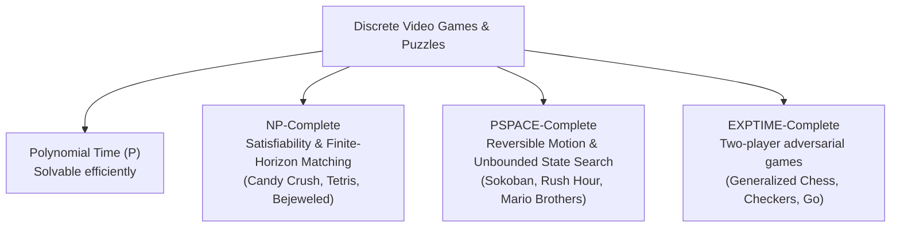

---
tags:
  - research
  - complexity
  - combinatorics
  - mit
title: "Combinatorial Game Complexity and Hardness Reductions in Tile Puzzles (Erik Demaine et al.)"
created: 2026-10-25
status: complete
aliases:
  - Demaine Game Complexity
  - Combinatorial Game Hardness
---

# 📚 Combinatorial Game Complexity in Tile Puzzles (Erik Demaine et al.)

> [!IMPORTANT] Academic Context
> **Key Figure:** Erik Demaine (Professor of Computer Science, MIT CSAIL)  
> **Primary References:**  
> - *Games, Puzzles, & Computation* (Hearn & Demaine, A K Peters / CRC Press)  
> - MIT 6.890 / 6.892: *Algorithmic Lower Bounds: Fun with Hardness Proofs*  
> - *Tetris is NP-complete* (Breukelaar, Demaine, Hohenberger, et al.)  
> **Relevance:** Theoretical framework establishing why discrete sliding and tile-matching games resist global optimization and demand heuristic-guided neural approximation.

---

## 1. Complexity Landscape of Discrete Video Games

Combinatorial game theory establishes formal computational lower bounds for classic puzzle mechanics:

---

## 2. Gadget-Based Reduction Framework

Demaine's foundational contribution to game complexity is the formalization of **logic gadgets**:

| Gadget Type | Functional Purpose in Reduction | Match-3 Physical Implementation |
| :--- | :--- | :--- |
| **Variable Gadget** | Encodes a Boolean choice ($x_i \in \{0, 1\}$) | Mutually exclusive 3-match swap with non-recoverable gravity lock |
| **Wire Gadget** | Transmits truth state across space | Unstable alternating column $(A, B, A, B)$ that cascades sequentially |
| **Wire Turn Gadget** | Redirects state propagation by $90^\circ$ | Diagonal cascade channel with angled drop tile |
| **Wire Crossover** | Allows two wires to cross without interference | Delayed timing delay gadget or bridge drop mechanism |
| **Clause Gadget** | Evaluates Boolean disjunction $(l_1 \lor l_2 \lor l_3)$ | Funnel tile requiring $\ge 1$ falling candy to trigger match |
| **Garbage Collector** | Disposes of surplus drops to prevent spurious matches | Deep bottom void with isolated non-matching blocker ring |

---

## 3. Stochastic Transitions & Markov Decision Processes (MDPs)

While deterministic tile matching on static boards is NP-complete, adding King's stochastic dispenser refills shifts the theoretical classification:
- **Partially Observable Markov Decision Process (POMDP):** Because dispensers draw from non-deterministic pseudo-random seed sequences and unknown hidden queues, optimal decision-making under infinite horizon transitions escalates beyond NP-complete towards PSPACE or EXPTIME limits.
- **The Finite-Horizon Approximation:** Real Candy Crush levels enforce strict finite move limits ($T \in [15, 35]$). Under finite moves, the effective state-action graph is a finite Directed Acyclic Graph (DAG), enabling expectimax and Monte Carlo search techniques.

---

## 4. How Demaine's Bounds Shape AlphaCandy's Design

1. **Abandoning Global Completeness:** Attempting to prove a global win path from move 1 is mathematically intractable for NP-hard games.
2. **Local Manifold Optimization:** AlphaCandy treats the game as a sequence of local topological transformations. The [[AlphaCandy_Spatial_Transformer]] learns local invariants (e.g. 2-step setup patterns) that transfer universally across levels.
3. **Information-Theoretic Pruning:** By bounding branching factors via policy priors, the agent navigates the combinatorially explosive tree within practical sub-second compute budgets.

---

## 🔗 Related Notes
- [[Walsh_2014_Candy_Crush_NP_Hard]]
- [[Single_Model_Continual_Learning_Proof]]
- [[Adaptive_Expectimax_Lookahead]]
- Back to: [[03_Research_Papers_MOC]]
