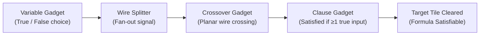

# Bejeweled, Candy Crush and other Match-Three Games are (NP-)Hard

**Authors:** Luciano Gualà, Stefano Leucci, Emanuele Natale  
**Publication:** arXiv:1403.5830 (2014) / IEEE Conference on Computational Intelligence and Games (CIG)  
**Domain:** Computational Complexity, Theoretical Computer Science, Combinatorial Puzzles, NP-Hardness  

---

## 1. Executive Summary & Overview

Alongside Toby Walsh's concurrent work in 2014, Luciano Gualà, Stefano Leucci, and Emanuele Natale presented a rigorous, constructive proof that tile-matching Match-3 games (specifically formalizations encompassing *Bejeweled*, *Candy Crush Saga*, and *Shariki*) are **NP-hard**.

While Walsh focused on score thresholds within $k$ swaps, Gualà et al. analyzed multiple fundamental decision problems across parameterized $N \times M$ grids:
1. **$\text{Match-3}_{\text{ReachTarget}}$**: Can a player reach an arbitrary target score $S$ within $k$ moves? (NP-hard)
2. **$\text{Match-3}_{\text{ClearItem}}$**: Can a player destroy a designated target tile at location $(r, c)$ within $k$ moves? (NP-hard)
3. **$\text{Match-3}_{\text{Survival}}$**: Can the player survive for $k$ moves without entering a terminal stalemate? (NP-hard)

---

## 2. Theoretical Framework & The 3-SAT Reduction

The NP-hardness is established by constructing a polynomial-time reduction from the classical **3-CNF Satisfiability (3-SAT)** problem to an instance of a Match-3 board.

Given a 3-CNF formula $\phi = \bigwedge_{j=1}^m C_j$ with variables $x_1, \dots, x_n$ and clauses $C_j = (l_{j,1} \vee l_{j,2} \vee l_{j,3})$, the authors construct a planar Match-3 board composed of modular candy "gadgets".

### The Core Mechanical Gadgets:

1. **Variable Gadget (Truth Assignment)**:
   - Contains a localized configuration where a single swap forces a choice between two mutually exclusive cascades:
     - Assigning $x_i = \text{True}$ propagates a falling cascade down Wire $T_i$.
     - Assigning $x_i = \text{False}$ propagates a cascade down Wire $F_i$.
   - The move budget restricts the player to exactly one swap per variable gadget.

2. **Transmission Wire**:
   - A vertical or horizontal channel of alternating candy pairs that transmits an activation signal.
   - When a match occurs at the wire entrance, gravity causes candies to drop by 1 position, triggering an automatic cascade that propagates along the wire with zero additional moves required.

3. **Splitter Gadget (Fan-out)**:
   - Duplicates a variable's truth signal so a variable $x_i$ can appear in multiple independent clauses.

4. **Planar Crossover Gadget**:
   - The critical requirement for planar reductions. Allows two transmission wires to cross at right angles without interfering with each other's signal propagation.
   - Gualà et al. designed a sophisticated clockwork arrangement of candy clusters where signal $A$ passes through horizontally and signal $B$ passes vertically without cross-contamination.

5. **Clause Gadget (OR Gate)**:
   - An arrangement representing clause $C_j = (l_1 \vee l_2 \vee l_3)$.
   - A designated obstacle or locked candy within the clause gadget can only be cleared if at least one of the three incoming literal wires drops an activating candy.

6. **Validation & Win Gadget (AND Gate)**:
   - All clause outputs feed into a master cascade that only destroys the designated target tile if *every single clause* is satisfied.

---

## 3. Mathematical Implications for AI Agents

The proof of NP-hardness yields profound mathematical insights for constructing AI solvers:

### 1. Intractability of Pure Optimal Planning
Because Match-3 is NP-hard, no exact polynomial-time algorithm exists to find the optimal sequence of moves on arbitrary boards unless $\text{P} = \text{NP}$.
- Brute-force tree search (e.g. Minimax, Expectimax) suffers from exponential explosion $\mathcal{O}(B^d)$, where $B \approx 20\text{--}40$ is the branching factor.
- An agent cannot guarantee optimal play across long horizons ($d > 5$) through tree search alone.

### 2. Necessity of Neural Heuristic Guidance
To achieve superhuman performance without intractable search times:
- Deep neural networks (like AlphaCandy's Spatial Transformer) act as learned polynomial-time approximations $\pi(a|s) \approx \arg\max Q(s, a)$.
- The neural network acts as a **guided heuristic pruner**, collapsing the search space from $B^d$ to top-$k$ candidate branches ($k \le 4$).

---

## 4. Comparison: Walsh (2014) vs. Gualà et al. (2014)

| Feature | Toby Walsh (arXiv:1403.1911) | Gualà, Leucci, Natale (arXiv:1403.5830) |
|---|---|---|
| **Primary Target Problem** | Target score reachability | Target tile clearing + Survival + Score |
| **Reduction Origin** | 3-SAT to Score Threshold | 3-SAT to Board Topology via Wires |
| **Crossover Handling** | Assumes board boundaries | Explicit planar crossover gadget design |
| **Cascade Dynamics** | Simplified discrete falls | Full gravity-cascade simulation dynamics |
| **Generality** | Specific to Candy Crush score rule | Covers Candy Crush, Bejeweled, and general Match-3 |

---

## 5. References & Cross-Links
- **Related Papers**:
  - [[Walsh_2014_Candy_Crush_NP_Hard|Walsh 2014: Candy Crush is NP-Hard]]
  - [[Demaine_Combinatorial_Game_Complexity|Demaine & Hearn: Combinatorial Game Complexity]]
  - [[Sanford_2023_Higher_Order_Attention_Match3_Complexity|Sanford et al. 2023: Higher-Order Attention in Match-3 Complexity]]
- **Architectural Countermeasures**:
  - [[Pure_AlphaCandy_Large_Agent|AlphaCandy Large Spatial Policy Prior]]
  - [[Grandmaster_Consensus_Architecture|Grandmaster Consensus Architecture]]
