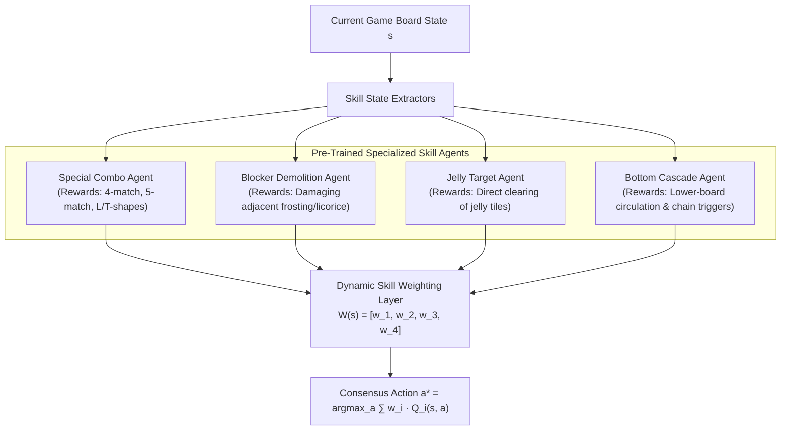

---
tags:
  - research
  - reinforcement-learning
  - king
  - hybrid-rl
  - generalization
title: "CANDYRL & BaziGooshi: Hybrid Reinforcement Learning for Match-3 Generalization (Karimi et al., 2021)"
created: 2026-10-25
status: complete
aliases:
  - Karimi 2021
  - CANDYRL
  - BaziGooshi
---

# 📚 CANDYRL & BaziGooshi: Hybrid Reinforcement Learning (Karimi et al., 2021)

> [!IMPORTANT] Academic Citation
> **Papers:**  
> 1. *CandyRL: A Hybrid Reinforcement Learning Model for Gameplay* (Presented at ICMLA 2020)  
> 2. *BaziGooshi: A Hybrid Model of Reinforcement Learning for Generalization in Gameplay* (Published in *IEEE Transactions on Games*, 2021)  
> **Authors:** Sara Karimi, Sahar Asadi, Francesco Lorenzo, Amir H. Payberah (Collaborative research between King Digital Entertainment and KTH Royal Institute of Technology)  
> **Core Contribution:** Introduced the first hybrid reinforcement learning framework capable of zero-shot generalization to unseen Candy Crush levels by decomposing gameplay into modular intrinsic skills.

---

## 1. The Generalization Dilemma in Match-3 RL

Standard model-free reinforcement learning algorithms (like DQN or PPO) face severe limitations when applied directly to Candy Crush:
1. **Extremely Sparse Rewards:** The true objective (winning the level) provides a binary reward $r \in \{0, 1\}$ only after 20–35 moves. If an agent fails, it receives zero learning signal.
2. **Catastrophic Overfitting:** An agent trained end-to-end on Level 5 memorizes the specific geometry and tile distribution. When placed on Level 6 (which introduces licorice and voids), performance drops to 0%.
3. **Massive Non-Stationary State Space:** With 81 cells and up to 10 distinct entities per cell, the state space exceeds $10^{50}$ configurations with non-deterministic dispenser refills.

---

## 2. The CANDYRL / BaziGooshi Architecture

To solve these challenges, Karimi et al. developed a **hybrid hierarchical model** that decouples high-level objective management from low-level tactical skills:

---

## 3. Mathematical Formulation

### A. Intrinsic vs. Extrinsic Reward Signals
Instead of relying solely on the sparse extrinsic win reward $R_{\text{ext}} \in \{0, 1\}$, each specialized skill agent $i$ optimizes its own dense intrinsic reward $r_{\text{int}}^{(i)}$:
- **Special Candy Skill:**
  $$r_{\text{int}}^{(\text{special})}(s, a) = 50 \cdot \mathbf{1}_{\text{striped}} + 100 \cdot \mathbf{1}_{\text{wrapped}} + 250 \cdot \mathbf{1}_{\text{color\_bomb}}$$
- **Blocker Clearing Skill:**
  $$r_{\text{int}}^{(\text{blocker})}(s, a) = \sum_{b \in \text{blockers}} \Delta \text{layers}(b) \times \text{weight}(b)$$
- **Jelly Objective Skill:**
  $$r_{\text{int}}^{(\text{jelly})}(s, a) = 100 \cdot \Delta \text{jellies\_cleared}$$
- **Cascade Inducer Skill:**
  $$r_{\text{int}}^{(\text{cascade})}(s, a) = \text{row}(a) \times 10 + 20 \times \text{chain\_length}$$

### B. Dynamic Skill Weighting (Meta-Controller)
The composite Q-value for any candidate swap action $a$ is a dynamically weighted convex combination of the component Q-functions:
$$Q_{\text{composite}}(s, a) = \sum_{i=1}^{K} w_i(s) \cdot Q_i(s, a)$$
where $\sum_i w_i(s) = 1$. The weights $w_i(s)$ are determined by the meta-controller based on:
1. **Game Phase & Urgency:** If $\frac{\text{objectives\_remaining}}{\text{moves\_left}} > 2.0$, blocker and jelly weights surge to $0.45$.
2. **Board Clutter Density:** If the board has $> 25$ blockers, the Blocker Demolition agent dominates.
3. **Special Alignment Potential:** If adjacent specials exist, the Special Combo agent takes priority.

---

## 4. Key Experimental Results

- **Zero-Shot Transfer:** BaziGooshi achieved a **4x improvement in win rate** on previously unseen levels compared to standard monolithic DQN and PPO baselines.
- **Sample Efficiency:** Because individual skill agents learn reusable low-level physics, they required $70\%$ fewer training samples than monolithic architectures.

---

## 5. Implementation in AlphaCandy

AlphaCandy integrates and upgrades the CANDYRL philosophy within [models/candyrl_ensemble.py](file:///home/hammad/Antigravity_Workspace/Candy-Crush-AI/models/candyrl_ensemble.py) and [models/grandmaster_unified_agent.py](file:///home/hammad/Antigravity_Workspace/Candy-Crush-AI/models/grandmaster_unified_agent.py):
1. **Heuristic & Neural Synergy:** Rather than using standalone tabular agents, AlphaCandy implements vectorized tactical skill evaluators that run in parallel with the [[Double_Dueling_DQN_PER]] and [[AlphaCandy_Spatial_Transformer]].
2. **Multi-Phase State Machine:** Dynamic switching across 3 game phases (Opening Breaker, Midgame Engine, Endgame Closer).

---

## 🔗 Related Notes
- [[King_2018_Human_Like_Playtesting_CNN]]
- [[Grandmaster_Unified_Agent]]
- [[Double_Dueling_DQN_PER]]
- Back to: [[03_Research_Papers_MOC]]
