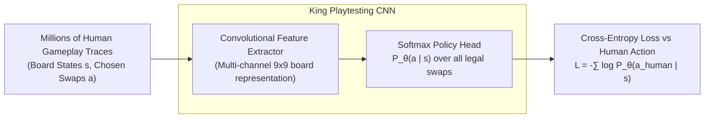

---
tags:
  - research
  - king
  - playtesting
  - deep-learning
  - cnn
title: "Human-Like Playtesting with Deep Learning (King AI R&D, 2018)"
created: 2026-10-25
status: complete
aliases:
  - King 2018
  - Gudmundsson 2018
  - Human-Like Playtesting
---

# 📚 Human-Like Playtesting with Deep Learning (King AI R&D, 2018)

> [!IMPORTANT] Academic Citation
> **Paper:** *Human-Like Playtesting with Deep Learning*  
> **Authors:** Stefan Freyr Gudmundsson, Philipp Eisen, Erik Poromaa, Alex Nodet, Sami Purmonen, Bartlomiej Kozakowski, Richard Meurling, Lele Cao (AI R&D team at King Digital Entertainment)  
> **Conference:** IEEE Conference on Computational Intelligence and Games (CIG), 2018  
> **Industrial Impact:** Official production paper detailing how King uses Convolutional Neural Networks (CNNs) trained on millions of player telemetry events to automatically test and balance new Candy Crush Saga levels before release.

---

## 1. The Core Industrial Problem

King releases tens to hundreds of new Candy Crush levels every week across its game franchises. Balancing these levels involves a critical trade-off:
- **Too Easy:** Players finish quickly, leading to boredom and churn.
- **Too Hard:** Players run out of moves repeatedly without feeling agency, leading to frustration and abandonment.
- **The Playtesting Bottleneck:** Human playtesting requires weeks of play sessions and hundreds of human QA hours per level.
- **Why Traditional Bots (MCTS) Failed:** Standard Monte Carlo Tree Search (MCTS) or pure heuristic optimization bots play *too mechanically* or *too omnisciently*. An MCTS bot will discover obscure, non-human 8-step cascade traps that a real player would never see, resulting in a **poor correlation ($r < 0.4$)** with real human failure rates and attempts-per-success.

---

## 2. The Deep Learning Solution: Imitating Human Play

Instead of training an agent purely to optimize win probability via reinforcement learning, King trained a **Convolutional Neural Network (CNN)** on actual historical player telemetry:

### Representation & Tensor Channels
The input board state was encoded into a multi-channel spatial grid $(C \times H \times W)$:
- Regular candy colors (one-hot channels).
- Specials (Striped horizontal/vertical, Wrapped, Color Bomb).
- Obstacle layers (Frosting, Licorice, Chocolate).
- Playable tile mask.

---

## 3. Key Findings & Empirical Results

1. **Prediction of Level Difficulty:**
   - Level difficulty is defined as the mean number of attempts required by a human player to complete a level:
     $$\text{Difficulty} = \mathbb{E}[\text{Attempts per Win}]$$
   - When King's CNN playtesting bot simulated playthroughs across hundreds of candidate levels, its predicted attempt count achieved a **Pearson correlation $r > 0.82$** with live production human telemetry, drastically outperforming MCTS ($r \approx 0.38$).

2. **Computational Speedup:**
   - A single CNN forward pass executes in milliseconds, enabling the bot to play thousands of simulated games in seconds—providing level designers with immediate real-time feedback during level design in King's level editor tools.

3. **Human Error Modeling:**
   - Because the network learned the policy distribution $P_\theta(a|s)$ directly from humans, it naturally exhibited human cognitive traits: prioritizing obvious bottom matches, favoring special combo triggers over obscure edge clears, and suffering from local perceptual tunnel-vision on complex boards.

---

## 4. How AlphaCandy Adopts & Extends King's Work

AlphaCandy leverages King's core insights while transitioning from **human-like playtesting** to **superhuman level conquest**:

| Architectural Dimension | King Playtesting CNN (2018) | AlphaCandy Grandmaster (2026) |
| :--- | :--- | :--- |
| **Objective** | Predict human failure rates & friction | Conquer 100% of all 23,355 levels |
| **Feature Extraction** | Standard Euclidean CNN convolutions | 4-Head Spatial Self-Attention ([[AlphaCandy_Spatial_Transformer]]) |
| **Non-Euclidean Topologies** | Struggled with voids and isolated islands | Graph token attention across voids & portals |
| **Policy Formulation** | Pure supervised imitation $\pi_\theta(a \mid s)$ | Fused DQN advantages + Transformer + GRPO |
| **Search Mechanism** | Greedy or $\epsilon$-sampling from CNN | Adaptive Expectimax Lookahead on top candidates |

---

## 🔗 Related Notes
- [[Karimi_2021_CANDYRL_BaziGooshi_Hybrid_RL]]
- [[AlphaCandy_Spatial_Transformer]]
- [[Difficulty_Tier_Classification]]
- Back to: [[03_Research_Papers_MOC]]
