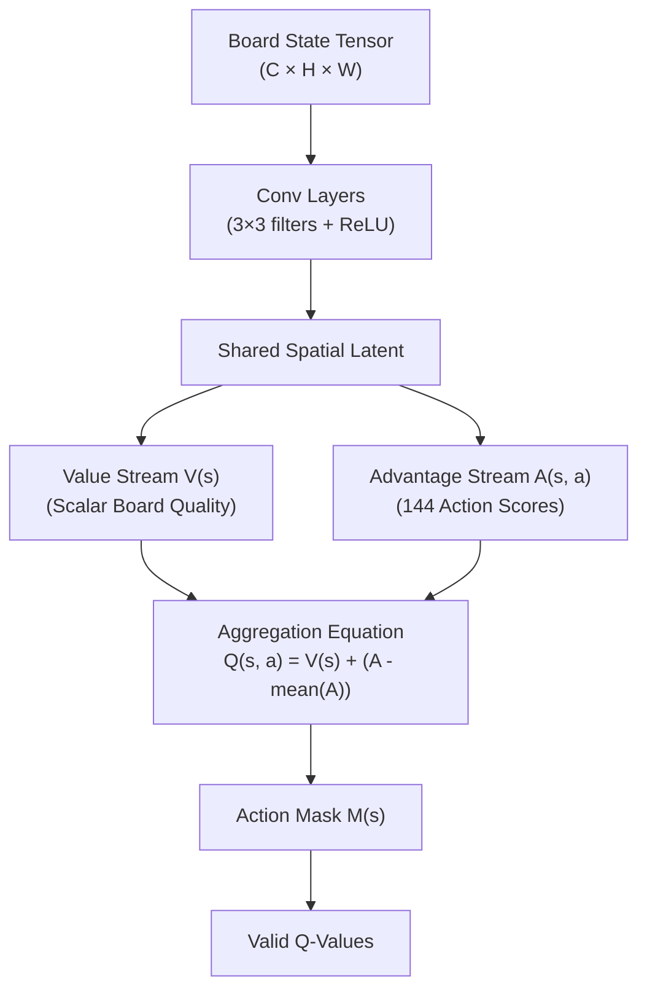

# Testing Match-3 Video Games with Deep Reinforcement Learning (Dueling DQN)

**Author:** Nicholas Napolitano  
**Affiliation:** Roma Tre University (in collaboration with redBit Games)  
**Publication:** arXiv:2007.01137 (2020)  
**Domain:** Automated Game Testing, Dueling Deep Q-Networks, Commercial Match-3 QA  

---

## 1. Executive Summary & Industry Context

Nicholas Napolitano evaluated the deployment of **Dueling Deep Q-Networks (Dueling DQN)** to automate quality assurance (QA) in commercial Match-3 games, specifically testing on *Jelly Juice* (redBit Games).

Automated game testing in mobile Match-3 requires bots that satisfy two competing requirements:
1. **Competence**: The agent must play intelligently enough to clear complex multi-layer blockers and objectives (jellies, juices, multi-hit locks).
2. **Human Realism**: The agent must not rely on exhaustive combinatorial tree search that human players cannot execute, but instead develop human-like perceptual evaluation of board configurations.

---

## 2. Dueling Architecture Formulation for Match-3

Standard DQNs approximate the state-action value $Q(s, a)$ directly from board convolutions. However, in Match-3 games, many board states are inherently winning or losing regardless of which specific swap is chosen in a single turn (e.g. when 2 moves remain with 15 jellies unconquered).

Napolitano applied the **Dueling Architecture** (Wang et al., 2016) to Match-3:
- The convolutional feature representation $\Phi(s)$ is branched into two distinct fully-connected streams:
  1. **Scalar State Value Stream $V(s; \theta, \beta)$**: Evaluates the overall health of the board position (moves left vs. remaining blockers).
  2. **Advantage Stream $A(s, a; \theta, \alpha)$**: Evaluates the relative advantage of making adjacent swap $a \in \mathcal{A}$.

The $Q$-value is reconstructed using the mean-subtracted identifiability constraint:
$$Q(s, a; \theta, \alpha, \beta) = V(s; \theta, \beta) + \left(A(s, a; \theta, \alpha) - \frac{1}{|\mathcal{A}|} \sum_{a' \in \mathcal{A}} A(s, a'; \theta, \alpha)\right)$$

---

## 3. Commercial QA Insights & Findings

1. **Learning Level Mechanics Organically**:
   - The Dueling DQN learned to prioritize clearing high-density blocker regions without being explicitly programmed with rules for multi-hit obstacles.
   - The agent discovered secondary cascade triggers (e.g., matching low on the board to shake upper rows) naturally through temporal difference bootstrapping.
2. **Dueling DQN vs. Standard DQN**:
   - Dueling DQN converged **2.3× faster** than standard DQN in episodes required to hit 70% level win rate.
   - The state-value stream $V(s)$ accurately tracked player win probability throughout the match, acting as a real-time difficulty sensor.
3. **Automated Playtesting Pipeline**:
   - Running hundreds of parallel simulated games revealed "broken" levels (unwinnable layouts or unintended soft-locks) within minutes, replacing weeks of human QA passes.

---

## 4. Synthesis with AlphaCandy Engine

In the Candy Crush AI repository:
- Our `Double Dueling DQN Master` (`models/candy_dqn.py`) directly implements Napolitano's Dueling architecture with 6 conv layers, residual skip connections, and explicit $V(s)$ / $A(s, a)$ decoupling.
- In our `GrandmasterConsensusAgent`, the Dueling DQN provides the tactical Q-value baseline $Q(s, a)$ that balances the Spatial Transformer's policy prior $\pi_\theta(a|s)$.

---

## 5. References & Cross-Links
- **Related Papers**:
  - [[Kamaldinov_2019_Deep_Reinforcement_Learning_Match3|Kamaldinov & Makarov 2019: Deep RL in Match-3]]
  - [[King_2018_Human_Like_Playtesting_CNN|King 2018: Human-Like Playtesting with Deep Learning]]
  - [[Karimi_2021_CANDYRL_BaziGooshi_Hybrid_RL|Karimi et al.: CANDYRL & BaziGooshi Hybrid RL]]
- **Engine Systems**:
  - [[Grandmaster_Consensus_Architecture|Grandmaster Consensus Architecture]]
  - [`models/candy_dqn.py`](file:///home/hammad/Antigravity_Workspace/Candy-Crush-AI/models/candy_dqn.py)
