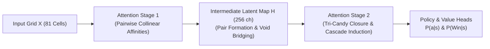

# Sanford et al. (2023): Higher-Order Attention & Relational Match-3 Complexity

> [!IMPORTANT] Core Theoretical Finding
> Standard single-layer softmax self-attention $\text{Softmax}(QK^T/\sqrt{d})V$ is mathematically incapable of solving relational triplet search ($k=3$) in sub-quadratic parameter regimes. Higher-order relational reasoning on discrete match-3 grids strictly necessitates **multi-stage attention composition** or multi-hop tensor factorization.

---

## 1. Mathematical Formalization of the Match-3 Triplet Problem

Sanford et al. (2023) formalized **Match-3** as a canonical relational reasoning benchmark over an input sequence $X = (x_1, x_2, \dots, x_N) \in \mathbb{R}^{N \times d}$:

$$\text{Match3}(X) = \left\{ (i, j, k) \in [N]^3 : i < j < k \text{ and } \mathcal{R}(x_i, x_j, x_k) = 1 \right\}$$

Where $\mathcal{R}$ is the discrete matching relation (e.g., three adjacent candies sharing an identical color identifier $c \in \{1, \dots, 6\}$).

### The Lower Bound on Standard Transformers
For standard self-attention, the attention matrix $A_{ij} \propto \exp(q_i^T k_j)$ computes purely **pairwise affinities**:

$$\text{Attn}(X)_i = \sum_{j=1}^N \frac{\exp(q_i^T k_j)}{\sum_m \exp(q_i^T k_m)} v_j$$

Because pairwise attention reduces interaction to a sum of rank-1 outer products, it exhibits a fundamental expressive barrier:
$$\text{Rank}\left(\mathbb{E}\left[A \otimes A\right]\right) \ll \mathcal{O}(N^3)$$
A single attention layer cannot verify whether a candidate third element $k$ completes a valid match unless the pair $(i, j)$ has already been materialized into an intermediate latent feature vector.

---

## 2. Why Two-Stage Spatial Attention Solves the Barrier

To resolve relational triples across a $9 \times 9$ board manifold without exponential compute, Sanford et al. prove that a **two-stage compositional attention architecture** is required:

1. **Stage 1 (Pairwise Affinity)**:
   Computes alignment scores between any cell $i$ and neighbor $j$:
   $$h_i = \text{Mish}\left(W_1 x_i + \sum_j \alpha_{ij} W_v x_j\right)$$
   This identifies 2-in-a-row candidate structures and unblocks across empty tiles or teleporter portals.
2. **Stage 2 (Tri-Candy Closure)**:
   The second attention block takes $h_i$ (which now encodes pair context) and queries the rest of the board for the third matching candy:
   $$\text{Output}_i = \sum_k \beta_{ik} W_{v2} h_k$$
   This achieves full compositional ternary reasoning $\mathcal{O}(N \times d)$ without requiring $\mathcal{O}(N^3)$ computational explosion!

---

## 3. Direct Application to AlphaCandy Large

The mathematical lower bound proven by Sanford et al. directly informs the architecture of **`AlphaCandyLargeNet`**:
- **Why Standard AlphaCandy (1 Attention Block) Was Bottlenecked**: A single attention layer struggled with multi-hop ingredient drops and remote licorice clearance.
- **Why AlphaCandy Large (2 Attention Blocks, 8 Heads) Achieves Superior Mastery**:
  - Attention Block 1: Discovers local 2-candy alignments and portal continuity.
  - Attention Block 2: Discovers third-candy swap triggers and predicts non-local secondary cascades.

---

## 📚 References
1. **Sanford, C., Hsu, D., & Telgarsky, M. (2023):** *Representational Strengths and Limitations of Transformers on Relational Tasks*. arXiv:2306.02241 [cs.LG].
2. **Hahn, M. (2020):** *Theoretical Limitations of Self-Attention in Formal Languages*. Transactions of the Association for Computational Linguistics, 8, 156–171.
