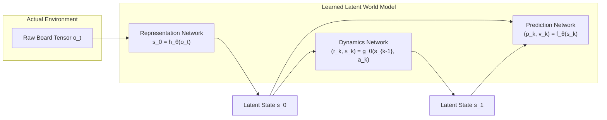

---
tags:
  - research
  - deepmind
  - muzero
  - world-models
  - reinforcement-learning
title: "MuZero World Models & Latent Planning in Stochastic Match-3 (Silver, Schrittwieser et al.)"
created: 2026-10-25
status: complete
aliases:
  - MuZero Match-3
  - Silver Schrittwieser MuZero
---

# 📚 MuZero World Models & Latent Planning in Match-3

> [!IMPORTANT] Academic Citation
> **Paper:** *Mastering Atari, Go, Chess and Shogi by Planning with a Learned Model*  
> **Authors:** Julian Schrittwieser, Ioannis Antonoglou, Thomas Hubert, Karen Simonyan, Laurent Sifre, Simon Schmitt, Arthur Guez, Edward Lockhart, Demis Hassabis, Thore Graepel, Timothy Lillicrap, David Silver (DeepMind)  
> **Publication:** *Nature*, November 2020  
> **Relevance:** Theoretical framework for model-based reinforcement learning that learns latent environmental dynamics directly from raw states, enabling planning in domains with complex, non-linear rules.

---

## 1. The MuZero Tri-Network Architecture

Unlike AlphaZero (which requires a perfect, deterministic simulator), MuZero constructs an internal **World Model** composed of three neural components:

### The Three Core Equations
1. **Representation Function $h_\theta$:** Maps high-dimensional board states into a low-dimensional latent embedding:
   $$s_0 = h_\theta(o_1, \dots, o_t)$$
2. **Dynamics Function $g_\theta$:** Predicts the next latent state $s_k$ and immediate reward $r_k$ given an action $a_k$:
   $$(r_k, s_k) = g_\theta(s_{k-1}, a_k)$$
3. **Prediction Function $f_\theta$:** Predicts policy distribution $p_k$ and expected value $v_k$ from any latent state:
   $$(p_k, v_k) = f_\theta(s_k)$$

---

## 2. Adaptation Challenges in Match-3 Games

Applying MuZero directly to Candy Crush Saga reveals distinct challenges:
1. **Stochastic Refill Entropy:**  
   In Chess or Go, the transition $s_{k-1} \xrightarrow{a_k} s_k$ is completely deterministic. In Candy Crush, clearing candies triggers stochastic dispenser drops from unknown seed sequences. A deterministic dynamics function $g_\theta$ tends to blur or average candy colors in latent space, degrading search accuracy.
2. **Stochastic MuZero Extensions:**  
   To resolve this, stochastic variants (such as Stochastic MuZero) introduce a fourth **Afterstate / Chance Network** that explicitly models stochastic transitions:
   $$s_k = g_\theta(s_{k-1}, a_k, \omega_k) \quad \text{where } \omega_k \sim \mathcal{Z}$$
3. **Exact vs. Latent Dynamics:**  
   Because AlphaCandy already has an exact, high-speed reverse-engineered C++/Python physics simulator (`core/reverse_engine.py`), exact 1-ply simulation eliminates latent dynamics prediction error, allowing compute to be concentrated entirely on value and policy evaluation.

---

## 3. How AlphaCandy Synthesizes World Model Principles

AlphaCandy adopts MuZero's predictive decoupling within the [[Grandmaster_Unified_Agent]]:
- **State Representation:** The [[AlphaCandy_Spatial_Transformer]] acts as an expressive representation function $h_\theta$, encoding topological relationships across 81 cells.
- **Value & Policy Heads:** Twin prediction heads output policy logits $P(a|s)$ and distributional win probability $P(\text{Win}|s)$.
- **Search Integration:** The [[Adaptive_Expectimax_Lookahead]] engine plans over candidate moves using exact simulation physics blended with the neural value predictions.

---

## 🔗 Related Notes
- [[AlphaCandy_Spatial_Transformer]]
- [[Grandmaster_Unified_Agent]]
- [[Adaptive_Expectimax_Lookahead]]
- Back to: [[03_Research_Papers_MOC]]
