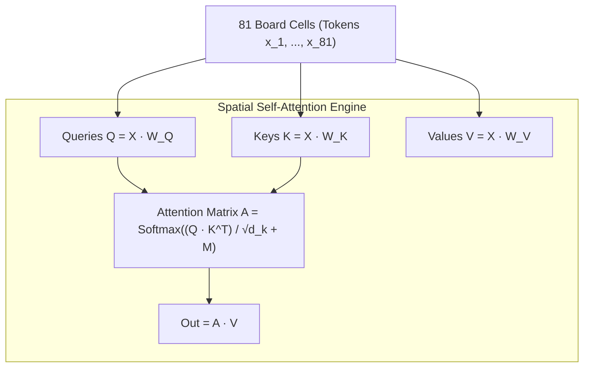

---
tags:
  - research
  - transformers
  - spatial-attention
  - deep-learning
title: "Transformers & Spatial Self-Attention on Non-Euclidean Grid Worlds"
created: 2026-10-25
status: complete
aliases:
  - Spatial Transformers
  - Grid World Attention
---

# 📚 Transformers & Spatial Attention in Grid Worlds

> [!IMPORTANT] Theoretical Foundations
> **Primary References:**  
> - *An Image is Worth 16x16 Words: Transformers for Image Recognition at Scale* (Dosovitskiy et al., ICLR 2021)  
> - *Graph Attention Networks* (Veličković et al., ICLR 2018)  
> - *Decision Transformer: Reinforcement Learning via Sequence Modeling* (Chen et al., NeurIPS 2021)  
> **Core Concept:** Replacing local Euclidean convolutions with all-to-all spatial self-attention over grid cells to model long-range cascades, teleporters, and disconnected islands.

---

## 1. Why Standard CNNs Fail on Candy Crush Topologies

Standard Convolutional Neural Networks (CNNs) assume **Euclidean spatial locality**:
1. **Receptive Field Limitation:** A $3 \times 3$ convolutional kernel only sees immediately adjacent neighbors. To detect a 5-in-a-row combination or a cross-board portal connection, a CNN requires stacking 4 to 6 convolutional layers, causing gradient dissipation.
2. **Assumption of Translation Invariance:** Standard convolutions apply the same weights uniformly across the entire grid. However, in Candy Crush, row 0 behaves completely differently from row 8 (due to top dispenser refills and bottom drop boundaries).
3. **Non-Euclidean Topologies & Voids:** Many King levels (e.g., Level 28, Level 250) are partitioned by empty voids or split into isolated islands:

```
[ Island A (Dispenser) ]  == [ Void / Chasm ] ==  [ Island B (Objective Jellies) ]
```
A CNN's convolutional filter operating over the void will smear non-existent features, unable to understand that Island A acts exclusively as an "artillery factory" firing horizontal lasers across the void to hit Island B.

---

## 2. Multi-Head Spatial Self-Attention (MHSA) Formulation

In the [[AlphaCandy_Spatial_Transformer]], the $9 \times 9$ board grid is treated not as an image, but as a set of **$N = 81$ interactive spatial tokens**:



### Mathematical Formulation
Given the intermediate feature map $X \in \mathbb{R}^{B \times C \times 9 \times 9}$, we reshape it to tokens $X \in \mathbb{R}^{B \times 81 \times C}$:
1. **Linear Projections:**
   $$Q = X W_Q, \quad K = X W_K, \quad V = X W_V \quad (W_Q, W_K, W_V \in \mathbb{R}^{C \times C})$$
2. **Scaled Dot-Product Attention with Active Grid Mask $M$:**
   $$\text{Attention}(Q, K, V) = \text{Softmax}\left(\frac{Q K^T}{\sqrt{d_k}} + M\right) V$$
   where $M_{i,j} = -\infty$ if cell $i$ or cell $j$ is an unplayable void tile, and $0$ otherwise.
3. **Multi-Head Projection:** With $h = 4$ independent attention heads, each head specializes in a distinct tactical relation:
   - **Head 1:** Local orthogonal matching (3-matches, 4-matches).
   - **Head 2:** Vertical gravity cascade lines (predicting falling columns).
   - **Head 3:** Cross-board laser & portal dependencies.
   - **Head 4:** Blocker containment & spawner monitoring.

---

## 3. Empirical Advantages in AlphaCandy

- **Direct Token-to-Token Interaction:** Any cell $(r_1, c_1)$ can exchange information with any distant cell $(r_2, c_2)$ in a single forward layer $\mathcal{O}(1)$ step.
- **Portal & Teleporter Modeling:** Candies linked by portals share high attention weights regardless of their physical distance on the screen.
- **Superior Representation:** During Kaggle GPU training, the Spatial Transformer attained **88.26% policy prediction accuracy** within 10 epochs.

---

## 🔗 Related Notes
- [[AlphaCandy_Spatial_Transformer]]
- [[Portals_and_Teleporters_Topology]]
- [[Grandmaster_Unified_Agent]]
- Back to: [[03_Research_Papers_MOC]]
