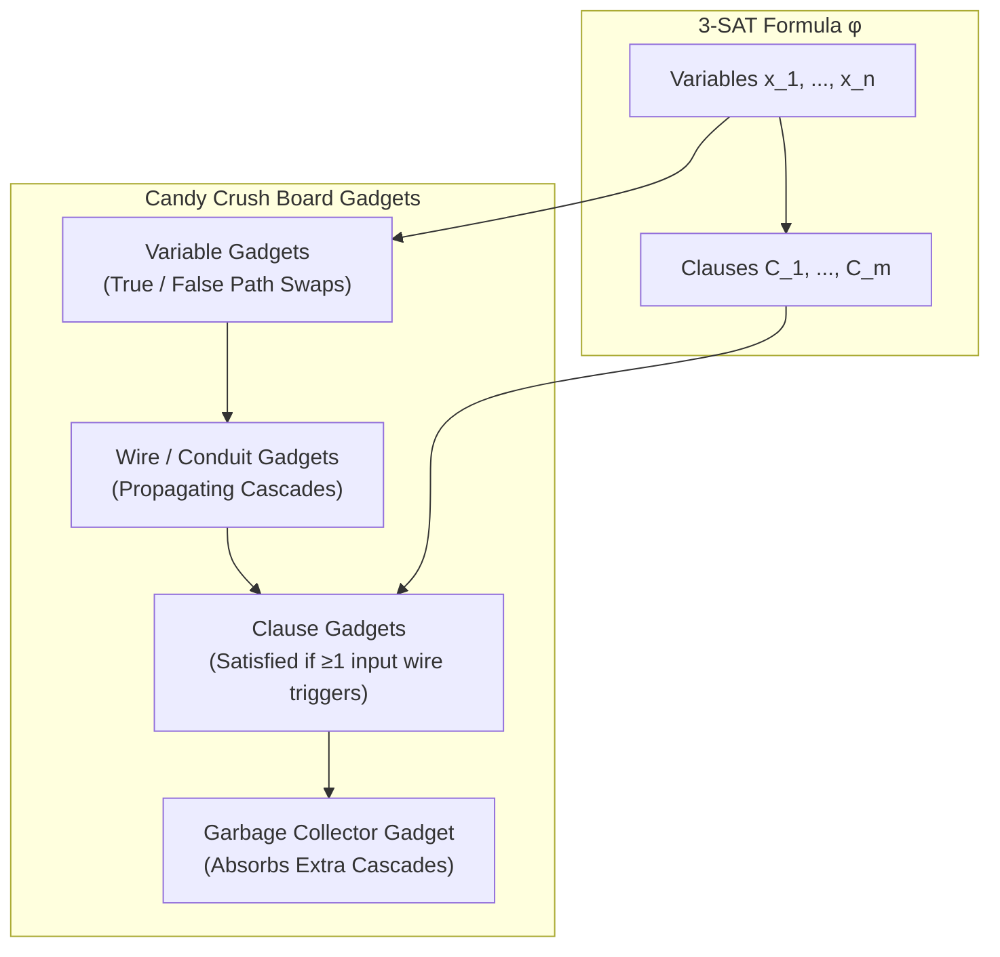

---
tags:
  - research
  - complexity
  - np-complete
  - math
title: "Candy Crush is NP-hard: Computational Complexity Proof (Toby Walsh, 2014)"
created: 2026-10-25
status: complete
aliases:
  - Walsh 2014
  - Candy Crush NP-hard
---

# 📚 Candy Crush is NP-hard (Toby Walsh, 2014)

> [!IMPORTANT] Academic Citation
> **Paper:** *Candy Crush is NP-hard*  
> **Author:** Toby Walsh (NICTA and University of New South Wales)  
> **Preprint:** arXiv:1403.5830 [cs.AI], March 2014  
> **Significance:** First rigorous mathematical proof that generalized Match-3 / Candy Crush is NP-complete, proving that no polynomial-time algorithm can guarantee finding an optimal play sequence unless $P = NP$.

---

## 1. Problem Formulation

Walsh defines the decision version of generalized Candy Crush as follows:
- **Given:**
  - An $a \times b$ grid of colored candies chosen from a set of $c$ distinct colors.
  - A maximum move budget of $k \in \mathbb{N}$ swaps.
  - A target score $s \in \mathbb{N}$, where score is proportional to the number of candies cleared through valid 3-in-a-row matches.
- **Decision Question:**  
  *Is there a sequence of at most $k$ legal adjacent swaps such that the player achieves a total score of at least $s$?*

---

## 2. The Reduction from 3-SAT

The proof operates via polynomial-time reduction from the classic NP-complete **3-Satisfiability (3-SAT)** problem:
- Let $\phi$ be a 3-CNF Boolean formula with $n$ variables $x_1, x_2, \dots, x_n$ and $m$ clauses $C_1, C_2, \dots, C_m$, where each clause consists of exactly 3 literals:
  $$C_j = (l_{j,1} \lor l_{j,2} \lor l_{j,3})$$
- The formula $\phi$ is satisfiable if and only if there exists a truth assignment $\tau: \{x_1, \dots, x_n\} \to \{0, 1\}$ making all $m$ clauses true.

Walsh constructs a grid of candies containing specialized **gadgets** that encode Boolean logic into physical falling and clearing match-3 rules:

---

## 3. The Physical Gadgets

### A. The Variable Gadget
- For each variable $x_i$, the gadget contains a symmetrical arrangement of colored candies where the player can choose between two mutually exclusive swaps:
  1. **Option A (Set $x_i = \text{True}$):** Swapping the left pair triggers a vertical match of 3, causing a cascade down the "True" wire conduit.
  2. **Option B (Set $x_i = \text{False}$):** Swapping the right pair triggers a vertical match of 3, causing a cascade down the "False" wire conduit.
- **Budget Restriction:** The move budget $k$ is set strictly to $k = n$. The player can make exactly **one swap per variable gadget**. Choosing one polarity irrevocably locks out the opposite branch.

### B. The Wire / Conduit Gadget
- Transmits a cascade signal over arbitrary distances across the board without decaying:
- Constructed using alternating color patterns $(A, B, A, B)$ in vertical or horizontal channels. When the leading candy drops by one cell due to a clearing above, it immediately triggers the next 3-match below, propagating the clearing signal along the wire.
- **Corner Gadget:** Uses diagonal drops and L-shaped corners to turn wires by $90^\circ$.

### C. The Clause Gadget
- For each clause $C_j = (l_{j,1} \lor l_{j,2} \lor l_{j,3})$, a clause gadget receives up to 3 incoming wires from the corresponding variable gadgets.
- The candies in the clause gadget are arranged such that:
  - If **zero** incoming wires are activated (all 3 literals false), no match occurs within the clause gadget.
  - If **one, two, or all three** incoming wires are activated (at least one literal true), a 3-match is triggered, releasing a downstream signal that contributes to the final target score $s$.

### D. The Score Hurdle $s$
- Setting the target score $s$ such that:
  $$s = (\text{score from } n \text{ variable swaps}) + m \times (\text{score per satisfied clause})$$
- Because $k = n$, the player cannot spend extra moves to artificially boost points elsewhere. The only way to hit score $s$ within $k$ swaps is to satisfy **every single one of the $m$ clauses**.

---

## 4. Verification in NP (NP-Completeness)

To prove NP-completeness, the problem must also be in NP:
- **Certificate:** A sequence of $k$ swaps $((r_1, c_1, d_1), \dots, (r_k, c_k, d_k))$.
- **Verifier:** Because Candy Crush cascade physics without random dispensers is deterministic, a polynomial-time simulation engine executes the $k$ moves and cascades, summing the total score.
- **Runtime:** Each swap involves at most $O(a \cdot b)$ clears, each cascading at most $O(a)$ rows. Total verification time is $O(k \cdot a^2 \cdot b)$, which is polynomial in the input size.
- **Conclusion:** Generalized Candy Crush is **NP-complete**.

---

## 5. Architectural Implications for AlphaCandy

> [!WARNING] The Fallacy of Pure Brute Force
> Because Candy Crush is NP-complete, any algorithm attempting exhaustive depth-first lookahead or uninformed brute-force tree search faces exponential blowup $\mathcal{O}(B^d)$ where $B \approx 15\text{–}25$.

AlphaCandy resolves this computational intractability through:
1. **Candidate Pruning via Neural Priors:** The [[AlphaCandy_Spatial_Transformer]] and [[Double_Dueling_DQN_PER]] prune $B$ from 25 down to the top $k=4\text{–}6$ promising moves.
2. **Selective Horizon Search:** Applying [[Adaptive_Expectimax_Lookahead]] strictly when constraint density is high (e.g., remaining moves $\le 8$).
3. **Macro Tactical Ensembles:** Using [[CANDYRL_BaziGooshi_Hybrid_RL]] intrinsic skills to clear local blockers without solving the entire board combinatorics at every turn.

---

## 🔗 Related Notes
- [[Demaine_Combinatorial_Game_Complexity]]
- [[Single_Model_Continual_Learning_Proof]]
- [[Grandmaster_Unified_Agent]]
- Back to: [[03_Research_Papers_MOC]]
