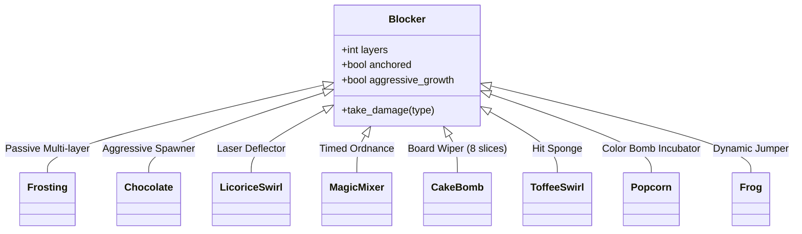

---
tags:
  - mechanics
  - blockers
  - obstacles
  - reverse-engineering
title: "Blocker Hierarchy & Damage Phases: Complete Reverse-Engineered Mechanics"
created: 2026-10-25
status: complete
aliases:
  - Blocker Hierarchy
  - Candy Crush Blockers
---

# ⚙️ Blocker Hierarchy & Damage Phases

> [!NOTE] Implementation Reference
> **Engine Code:** [core/reverse_engine.py](file:///home/hammad/Antigravity_Workspace/Candy-Crush-AI/core/reverse_engine.py) & [core/advanced_mechanics.py](file:///home/hammad/Antigravity_Workspace/Candy-Crush-AI/core/advanced_mechanics.py)

---

## 1. Blocker Taxonomy & Threat Matrix

King levels feature a rich hierarchy of blockers that escalate in durability and aggressiveness:

---

## 2. In-Depth Mechanics by Blocker Type

### A. Frosting / Meringue (Passive Multi-Layer)
- **Durability:** 1 to 5 layers.
- **Damage Condition:** Any adjacent match or special candy blast strips 1 layer.
- **Physics:** Anchored (does not fall); candies drop over it. When completely cleared, reveals either regular board space or an objective jelly.

### B. Chocolate (Aggressive Growth)
- **Growth Rule:** If no chocolate is destroyed during a player's move, one chocolate tile will consume an adjacent candy tile at the end of the turn.
- **Containment Strategy:** The agent must maintain a "suppression tax"—clearing at least one chocolate tile per move to stun the growth cycle until all chocolate is eliminated.

### C. Licorice Swirls (Laser Deflectors)
- **Unique Property:** Unlike frosting, licorice swirls fall under gravity.
- **Laser Absorption:** When a Striped Candy fires into a column or row containing licorice swirls, the laser **stops dead** at the first licorice swirl, destroying it but failing to penetrate behind it.

### D. Magic Mixers / Evil Spawners
- **Mechanics:** 3-hit durability. Every 3 turns, the mixer spews marmalade, frosting, or chocolate onto adjacent playable tiles.
- **Priority:** Must be targeted immediately; delaying demolition leads to complete board saturation.

### E. Cake Bombs ($2 \times 2$ Giant Blockers)
- **Durability:** 8 slices.
- **Demolition Effect:** When all 8 slices are destroyed, the Cake Bomb performs a **total board wipe**—clearing an entire layer of all blockers and jellies and triggering massive cascade scoring.

### F. Popcorn (Incubator Blockers)
- **Durability:** 3 hits.
- **Transformation:** On the 3rd hit, the popcorn pops and transforms into a **Color Bomb**, offering explosive endgame potential.

### G. The Candy Frog
- **Capacity:** Needs to feed on candies of its matching color (e.g. 6 candies).
- **Super Power:** When fully fed, the player can lift and drop the frog onto any $3 \times 3$ area on the board, immediately clearing all tiles beneath it.

---

## 3. AlphaCandy's Tactical Valuation

In [models/candyrl_ensemble.py](file:///home/hammad/Antigravity_Workspace/Candy-Crush-AI/models/candyrl_ensemble.py), blockers are valued dynamically based on pipeline criticality:
- **Feeder Column Blockers (beneath dispensers):** Multiplier $\times 3.0$ (critical bottleneck).
- **Magic Mixers & Cake Bombs:** Multiplier $\times 5.0$ (highest strategic urgency).
- **Perimeter Frostings:** Multiplier $\times 1.0$ (low flow impact).

---

## 🔗 Related Notes
- [[King_Engine_Core_Physics]]
- [[Portals_and_Teleporters_Topology]]
- [[Special_Candies_and_Combinations]]
- Back to: [[02_Game_Mechanics_MOC]]
