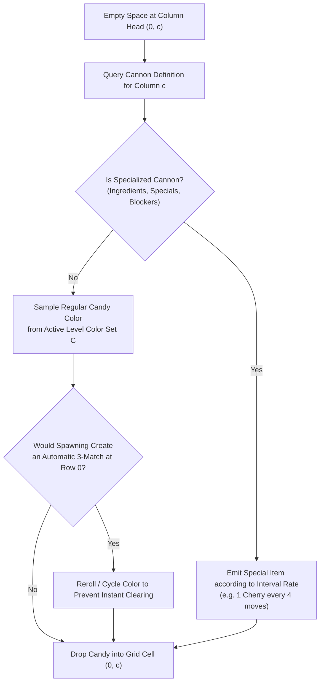

---
tags:
  - mechanics
  - rng
  - dispenser
  - probability
title: "Dispenser Refill & Pseudo-Random Seed Distribution"
created: 2026-10-25
status: complete
aliases:
  - Dispenser RNG
  - Seed Distribution
---

# ⚙️ Dispenser Refill & Pseudo-Random Seed Distribution

> [!NOTE] Stochastic Core
> While match detection and falling physics are 100% deterministic, candy generation from top dispensers operates via a deterministic Linear Congruential Generator (LCG) or Mersenne Twister pseudo-random stream.

---

## 1. Dispenser Architecture

At the top of each playable column (row $r=0$), a **Dispenser (Cannon)** injects new candies into the board as empty spaces are created by falling cascades:

---

## 2. Color Saturation & Natural Match Probability

The number of active colors $|C|$ configured for a level drastically dictates board circulation and natural match probability:

| Active Colors $|C|$ | Colors Active | Match-3 Probability per Cell ($P_{3}$) | Cascades Length $\mathbb{E}[L]$ | Difficulty Level |
| :---: | :--- | :---: | :---: | :--- |
| **4 Colors** | Red, Blue, Green, Yellow | $\sim 35.2\%$ | $4.8$ steps | Easy / Introduction |
| **5 Colors** | + Orange | $\sim 23.4\%$ | $2.3$ steps | Medium / Standard |
| **6 Colors** | + Purple | $\sim 14.1\%$ | $1.2$ steps | Hard / Nightmare |

> [!IMPORTANT] The 6-Color Chokepoint
> In 6-color levels, natural match probability drops to only $14.1\%$. Cascades die out almost immediately, and players cannot rely on lucky chain reactions. Optimal play requires strictly calculated 4-match and 5-match combo construction.

---

## 3. Seed Variance & Adaptive Rerolling (Free Resets)

Because King's live mobile client uses pseudo-random seeds:
1. **Opening Board Seed Variance:**  
   Some opening seeds create dense clusters of colors, immediately offering an opening Color Bomb or Striped Candy. Other seeds disperse colors uniformly, yielding zero useful setups and starving critical columns.
2. **The "Reroll Trick" in Competitive Human Play:**  
   Human grandmasters exploit King's game rules: opening a level and immediately quitting *before making the first move* costs zero lives and regenerates a fresh random seed.
3. **AlphaCandy's Multi-Attempt Seed Rotation:**  
   AlphaCandy mirrors this strategy through **Adaptive Seed Rotation** (`seed + attempt * 733`):
   - **Attempt 1:** Standard baseline seed.
   - **Attempt 2 & 3:** Rotated seeds, effectively executing free rerolls to escape dispenser starvation on Nightmare levels.

---

## 🔗 Related Notes
- [[King_Engine_Core_Physics]]
- [[Portals_and_Teleporters_Topology]]
- [[Difficulty_Tier_Classification]]
- Back to: [[02_Game_Mechanics_MOC]]
