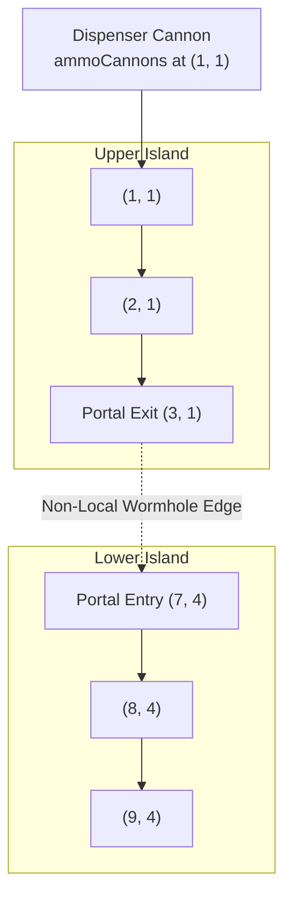

# Dispensers, Portals, and Non-Euclidean Board Topology

**Category:** Game Engine Reverse Engineering & Graph Physics  
**System:** Candy Crush Engine Architecture  
**Key Concepts:** Directed Acyclic Graphs (DAG), Non-Euclidean Gravity, Teleporters, Stream Dispensers, Topological Flow Sorting  

---

## 1. The Euclidean Illusion of Match-3 Boards

Casual players and early AI systems view a Match-3 board as a planar Cartesian grid $\mathbb{Z}^2 \cap [0, H-1] \times [0, W-1]$. Under this naïve assumption:
- Gravity is homogeneous and downward: $\vec{g} = (1, 0)$ (increasing row index).
- Spatial adjacency is strictly Euclidean 4-connectivity: $\mathcal{N}(r, c) = \{(r \pm 1, c), (r, c \pm 1)\}$.
- Convolutional kernels of size $3 \times 3$ or $5 \times 5$ are presumed sufficient to capture all spatial interactions.

In King's official level blueprints (from Level 100 through 23,355+), this assumption completely breaks down. Modern Candy Crush levels feature:
1. **Portals / Teleporters (`portals`)**: Physical wormholes that transport candies across disconnected regions.
2. **Directional Dispensers (`cannons`, `ammoCannons`, `evilSpawnerElements`)**: Spawn nodes that inject candies or blockers at arbitrary board positions at fixed turn intervals.
3. **Board Cutouts & L-Shaped Channels**: Gaps where candy cannot exist, forcing non-linear fluid flow.

Consequently, the Match-3 board is not a planar Euclidean grid; **it is an embedded Directed Acyclic Graph (DAG) with wormhole edge connections**.

---

## 2. Mathematical Formalization of Topological Flow

Let $\mathcal{C}$ be the set of active cells on the board. We construct the **Gravity Transport Graph** $\mathcal{G}_{\text{flow}} = (\mathcal{C}, \mathcal{E}_{\text{fall}})$:

$$\mathcal{E}_{\text{fall}} = \mathcal{E}_{\text{vertical}} \cup \mathcal{E}_{\text{portal}} \cup \mathcal{E}_{\text{diagonal}}$$



### 1. Vertical Gravity Edges:
For standard adjacent cells where $(r+1, c)$ is active and unblocked:
$$(r, c) \to (r+1, c) \in \mathcal{E}_{\text{vertical}}$$

### 2. Portal Wormhole Edges:
If cell $(r_{\text{src}}, c_{\text{src}})$ is designated as a portal exit and $(r_{\text{dst}}, c_{\text{dst}})$ is designated as its paired portal entry:
$$(r_{\text{src}}, c_{\text{src}}) \to (r_{\text{dst}}, c_{\text{dst}}) \in \mathcal{E}_{\text{portal}}$$
Notice that $\|(r_{\text{src}}, c_{\text{src}}) - (r_{\text{dst}}, c_{\text{dst}})\|_2$ can be arbitrarily large (e.g. crossing from row 0 to row 8 across opposite corners).

### 3. Diagonal Slide Edges (Corner Spillover):
When cell $(r+1, c)$ directly below is an unfillable obstacle (e.g. solid stone or cutout), candies spill diagonally left or right if available:
$$(r, c) \to (r+1, c \pm 1) \in \mathcal{E}_{\text{diagonal}}$$

### 4. Acyclicity Guarantee:
In any valid King level configuration, the transport graph $\mathcal{G}_{\text{flow}}$ must be a **Directed Acyclic Graph (DAG)**. If a cycle existed ($u \to v \to \dots \to u$), candies would enter an infinite falling loop, causing the game engine to freeze or soft-lock.

---

## 3. Reverse-Engineered Dispenser Blueprint Schema

Examining King's official level JSONs (`configs_v1.208.json` and master SQLite database):
```json
{
  "cannons": [
    {
      "pos": [0, 2],
      "spawns": ["blue", "green", "red", "yellow"],
      "probability": [0.25, 0.25, 0.25, 0.25]
    }
  ],
  "ammoCannons": [
    {
      "pos": [0, 6],
      "type": "striped_horizontal",
      "interval": 3,
      "charge": 1
    }
  ],
  "evilSpawnerElements": [
    {
      "pos": [4, 4],
      "element": "chocolate",
      "spawnAmount": 1,
      "spawnInterval": 2
    }
  ],
  "portals": [
    { "from": [3, 1], "to": [6, 7] },
    { "from": [3, 2], "to": [6, 8] }
  ]
}
```

### Algorithmic Processing Order:
1. **Match Detection**: All collinear $\ge 3$ sequences are marked and destroyed simultaneously.
2. **Topological Refill Sort**: The game engine computes the topological sort of $\mathcal{G}_{\text{flow}}$:
   $$v_1, v_2, \dots, v_n \quad \text{such that if } (u, v) \in \mathcal{E}_{\text{fall}}, \text{ then } \text{index}(u) < \text{index}(v)$$
3. **Falling Cascade Propagation**: Processing cells in reverse topological order ($v_n$ up to $v_1$) guarantees that candies fall down and across portals in a single linear pass without race conditions.
4. **Dispenser Injection**: Source nodes with in-degree 0 in $\mathcal{G}_{\text{flow}}$ query their assigned dispenser streams (`cannons` or `ammoCannons`) to generate replacement candies.

---

## 4. Why Standard 2D CNNs Fail & Transformers Excel

### The Receptive Field Bottleneck in CNNs:
- A standard CNN with kernel size $3 \times 3$ has an effective receptive field that grows by $2$ per layer ($3 \times 3 \to 5 \times 5 \to 7 \times 7$).
- If a portal links $(2, 1)$ to $(8, 7)$, a CNN requires at least 4–6 convolutional layers before features from the entry cell can influence the exit cell.
- Crucially, intermediate convolutional weights are forced to pass through irrelevant spatial pixels that lie between the portal endpoints, injecting noise.

### The Spatial Transformer Advantage:
- In `AlphaCandyLargeNet` (and BERT architectures), self-attention computes pairwise dot-product affinity between **every pair of cells $(i, j)$ simultaneously in Layer 1**:
  $$\text{Attention}(Q_i, K_j) = \frac{q_i^T k_j}{\sqrt{d}}$$
- If clearing candies at $(8, 7)$ pulls critical color bomb pieces from $(2, 1)$ through the portal, the attention mechanism places high attention weight on $W_{ij}$ immediately, regardless of spatial distance on the grid.

---

## 5. References & Cross-Links
- **Theoretical Foundations**:
  - [[Fragkedaki_2026_GAT_vs_BERT_Human_Like_Playtesting|Fragkedaki et al. 2026: GAT vs BERT Playtesting]]
  - [[Percolation_Theory_and_Cascade_Physics|Percolation Theory & Cascade Criticality]]
  - [[King_Level_Design_Pillars_and_Telemetry|King Level Design Pillars & Telemetry]]
- **Engine Systems**:
  - [`core/reverse_engine_board.py`](file:///home/hammad/Antigravity_Workspace/Candy-Crush-AI/core/reverse_engine_board.py)
  - [`models/spatial_transformer_net.py`](file:///home/hammad/Antigravity_Workspace/Candy-Crush-AI/models/spatial_transformer_net.py)
