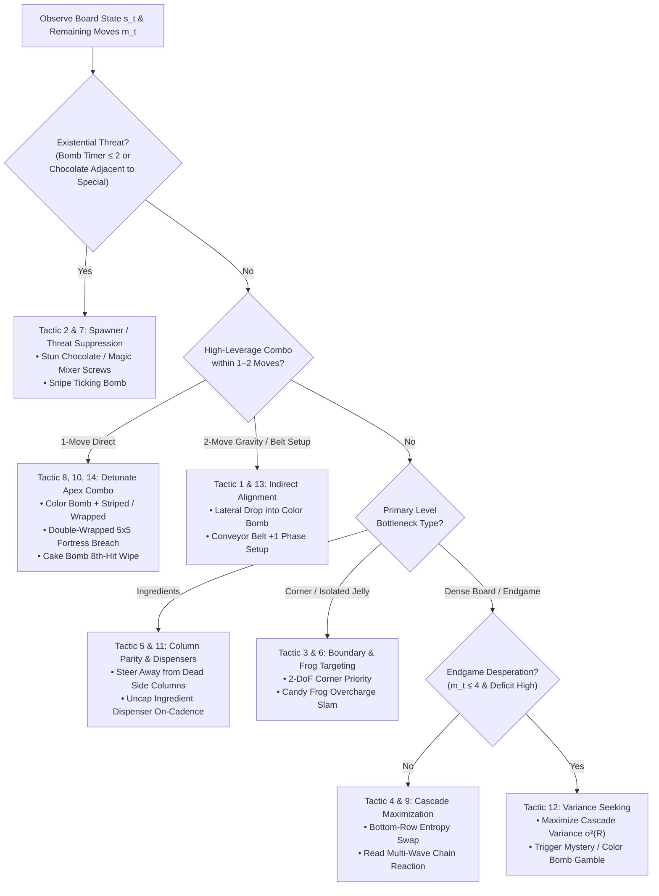

# ♟️ Encyclopedia of Grandmaster Candy Crush Tactics: Mechanics, Reward Formulations & Micro-Puzzles

> [!IMPORTANT] From Greedy Heuristics to Grandmaster Calculation
> Standard greedy Match-3 bots fail on King's "Nightmare" bottleneck levels (e.g., Levels 65, 70, 147, 148, 201, 235, 272, 300) because they evaluate swaps strictly by immediate 1-step tile clears. Elite human players and speedrunners treat *Candy Crush Saga* as a **stochastic combinatorial physics engine**—exploiting turn-lock flags, dispenser spawn cooldowns, non-local gravity drops, and risk-sensitive endgame variance. This encyclopedia formalizes **14 canonical grandmaster tactics**, mapping each directly to its **underlying C++/Python engine physics**, **exact mathematical reward/energy term**, and **synthetic Tsumego micro-puzzle specification**.

---

## 🧭 Tactical Hierarchy & Decision Priority Flowchart

---

## ⚡ Deep Mechanics Reference: Detonation Order & Blocker Physics

Before cataloging the 14 tactics, two critical engine distinctions govern high-level play:

### 1. Color Bomb + Striped vs. Color Bomb + Wrapped Detonation Physics
| Combo Type | Engine Execution Sequence | Blocker Interaction Profile | Optimal Tactical Use Case |
| :--- | :--- | :--- | :--- |
| **Color Bomb + Striped** | 1. Identifies all tiles of target color $c^*$. 2. Converts each into a Striped Candy with alternating H/V orientation (or deterministic scan parity). 3. Fires all line blasts in a single synchronized wave before gravity settles. | **Stopped/Absorbed by Licorice Swirls** after 1 tile of penetration along the beam path; pierces completely through Frosting, Jelly, and Licorice Locks. | Open or frosting-heavy boards; multi-column Ingredient drops (Levels 147, 148, 300); stripping multiple Magic Mixer screws across the board. |
| **Color Bomb + Wrapped** | 1. Converts all tiles of color $c^*$ into Wrapped Candies. 2. **Wave 1**: Detonates all $3 \times 3$ blasts simultaneously. 3. **Inter-Wave Gravity**: Remaining candies and blockers drop into evacuated cavities. 4. **Wave 2**: Secondary $3 \times 3$ explosions fire at the post-gravity coordinates, followed by a massive 6-color refill cascade. | Bypasses Licorice Swirl beam-blocking; delivers **two separate damage ticks** separated by gravity, stripping 2 layers of Frosting/Jelly and generating new Color Bombs during the massive post-wave refill. | Licorice Swirl-flooded boards; thick double-jelly clusters; setting up secondary natural Color Bombs when move count is low. |

### 2. Licorice Swirl vs. Licorice Lock (Cage) Mechanics
- **Licorice Swirl (Mobile Passive Blocker)**: Occupies a cell $(r, c)$, falls under gravity, can be swapped with adjacent candies (if the other candy forms a match), and **absorbs Striped Candy laser beams** (halting the beam at the swirl's coordinate). Cleared by 1 adjacent match or special blast.
- **Licorice Lock / Cage (Immobilizing Overlay)**: Sits *on top* of an existing candy or special piece. Prevents the trapped piece from moving, swapping, or falling under gravity. However, it **does not block Striped Candy beams**—a single Striped beam passes completely through a row of Licorice Locks, unlocking every trapped candy in the line simultaneously (critical on **Level 235**).

---

## 🏛️ The 14 Grandmaster Tactics: Physics, Math & Micro-Puzzles

---

### Tactic 1: Indirect Drop Alignment (`INDIRECT_DROP_ALIGNMENT`)
* **Human Speedrunner Principle**: Never detonate a standalone Color Bomb or Striped Candy when a single intermediate clearing move in the column below will drop a second special candy into orthogonal adjacency.
* **Engine Physics**: Let a Color Bomb sit at $(r_cb, c)$ and a Striped/Wrapped candy sit above it at $(r_s, c - \Delta c)$ with $\Delta c \in \{0, \pm 1\}$ and vertical gap $\Delta r = r_{cb} - r_s - k$. Removing $k$ tiles below $(r_s, c - \Delta c)$ via a horizontal match updates the post-gravity coordinate $r'_s = r_s + k$, creating a 1-norm distance $\| (r'_s, c - \Delta c) - (r_{cb}, c) \|_1 = 1$ on turn $t+1$.
* **Mathematical Reward / Potential Term**:
  $$\Phi_{\text{align}}(s) = \max_{u \in \mathcal{S}_{\text{CB}}, \, v \in \mathcal{S}_{\text{spec}}} \left[ \mathbb{I}(\|u - v\|_1 = 1) \cdot \beta_{\text{adj}} + \mathbb{I}(|c_u - c_v| \le 1 \land 1 < r_u - r_v \le 3) \cdot \frac{\beta_{\text{setup}}}{r_u - r_v} \right]$$
* **Synthetic Micro-Puzzle Blueprint (`COLOR_BOMB_STRIPED_ALIGNMENT`)**:
  - **Budget**: $M = 2$ moves. **Target**: Clear 18 scattered Double Jellies.
  - **Setup**: Color Bomb at $(4, 4)$, Striped Candy at $(2, 4)$, normal Red candy at $(3, 4)$ flanked by Red candies at $(3, 2)$ and $(3, 6)$ (only 1 legal horizontal match at row 3).
  - **Solution**: Turn 1 swaps $(3, 3) \leftrightarrow (3, 4)$ to clear row 3, dropping the Striped Candy to $(3, 4)$. Turn 2 swaps $(3, 4) \leftrightarrow (4, 4)$ for a full-board Rainbow Laser sweep.

---

### Tactic 2: Chocolate Turn-Lock Suppression (`CHOCOLATE_TURN_LOCK_SUPPRESSION`)
* **Human Speedrunner Principle**: Chocolate spawners obey a strict global turn-lock flag: if **any** single piece of regular or dark chocolate is destroyed anywhere on the board during turn $t$ (either by direct swap or cascade), the entire board's chocolate expansion is **completely frozen** at the end of turn $t$.
* **Engine Physics**: At end-of-turn step `UpdateSpawners()`, the engine evaluates `if (chocolateClearedThisTurn == 0) SpawnOneAdjacentChocolate()`. Furthermore, chocolate prioritizes eating adjacent regular candies, *unless* trapped beside a Special Candy, in which case an un-suppressed turn destroys the player's hard-earned Color Bomb or Striped Candy.
* **Mathematical Reward / Potential Term**:
  $$R_{\text{choc}}(s, a, s^{\text{after}}) = \lambda_{\text{stun}} \cdot \mathbb{I}\big(\Delta N_{\text{choc}}(s \to s^{\text{after}}) < 0\big) - \lambda_{\text{fatal}} \sum_{u \in \mathcal{S}_{\text{special}}(s^{\text{after}})} \mathbb{I}\big(\Delta N_{\text{choc}} = 0 \land \mathcal{N}_1(u) \cap \mathcal{C}_{\text{choc}} \ne \emptyset\big)$$
* **Synthetic Micro-Puzzle Blueprint (`CHOCOLATE_CONTAINMENT`)**:
  - **Budget**: $M = 2$ moves. **Target**: Clear all Jellies.
  - **Setup**: A Color Bomb + Striped pair sits at $(7, 1)\text{–}(7, 2)$ but is locked behind 1 layer of cage; Chocolate at $(6, 1)$ threatens to eat the Color Bomb if not stunned on Turn 1. A 3-match at $(5, 1)$ clears the Chocolate and unlocks the combo for Turn 2.

---

### Tactic 3: Corner Degree-of-Freedom Priority (`CORNER_DOF_PRIORITY`)
* **Human Speedrunner Principle**: Always clear bottom corners and jutting peninsula cells *first*, even when central board matches offer higher immediate cascade scores.
* **Engine Physics**: An interior cell $(r, c) \in [2, H-3] \times [2, W-3]$ participates in **12 possible 3-match templates** (6 horizontal, 6 vertical) and receives falling cascades from $r$ rows above. A bottom-corner cell $(H-1, 0)$ has only **2 orthogonal neighbors** (2 Degrees of Freedom), participates in only **2 possible 3-match templates**, and experiences zero pass-through gravity (candies stop at row $H-1$ rather than streaming past it).
* **Mathematical Reward / Potential Term**:
  Let $\text{DoF}(r, c) = |\mathcal{N}_{\text{playable}}(r, c)| \in \{1, 2, 3, 4\}$ be the topological degree of cell $(r, c)$. Each objective layer at $(r, c)$ is weighted inversely to its combinatorial accessibility:
  $$R_{\text{corner}}(s, a, s^{\text{after}}) = \sum_{(r, c) \in \mathcal{G}} \Delta \text{Jelly}(r, c) \cdot \left( \frac{4}{\max(1, \text{DoF}(r, c))} \right)^2 \cdot \left( 1 + \alpha_{\text{depth}} \frac{r}{H-1} \right)$$
* **Synthetic Micro-Puzzle Blueprint (`CORNER_JELLY_SNIPE`)**:
  - **Budget**: $M = 1$ move. **Target**: 1 Double Jelly trapped in a 1-DoF alcove at $(8, 0)$.
  - **Solution**: Ignore 5 distractor central matches; trigger the remote horizontal Striped Candy at $(8, 6)$ to snipe $(8, 0)$ across the row.

---

### Tactic 4: Bottom-Row Entropy Maximization (`BOTTOM_ROW_ENTROPY`)
* **Human Speedrunner Principle**: When no tactical combo or urgent blocker strike is available, always execute the lowest-row horizontal match available to maximize gravitational column displacement and stochastic cascade branching $R_0$.
* **Engine Physics**: Clearing 3 horizontal candies at row $r$ displaces $3 \times (r + 1)$ tiles under gravity. At $r = 0$ (top row), only 3 new tiles spawn (3 displaced tiles). At $r = 8$ (bottom row), **27 tiles shift downward**, creating up to 27 new local adjacency boundaries where secondary auto-matches and accidental Color Bombs form by percolation ([[Percolation_Theory_and_Cascade_Physics]]).
* **Mathematical Reward / Potential Term**:
  $$R_{\text{gravity}}(s, a) = \gamma_{\text{row}} \left( \frac{\bar{r}(a)}{H - 1} \right) \cdot |\text{ColsSpanned}(a)| + \gamma_{\text{H}} \big( H_{\text{Shannon}}(s^{\text{after}}) - H_{\text{Shannon}}(s) \big)$$
  where $\bar{r}(a)$ is the mean row index of action $a$ and $|\text{ColsSpanned}(a)| \in \{1, 3\}$ favors horizontal bottom clears ($3$ columns shifted) over vertical bottom clears ($1$ column shifted).
* **Synthetic Micro-Puzzle Blueprint (`BOTTOM_CASCADE_TRIGGER`)**:
  - **Budget**: $M = 1$ move. **Target**: Form a Color Bomb via deterministic 2-wave gravity cascade.
  - **Setup**: Top rows contain a trivial 3-match; row 8 contains a horizontal 3-match that shifts 3 columns by 1 tile, bringing 5 Blue candies at row 4 into a contiguous 5-in-a-row formation.

---

### Tactic 5: Column Parity Ingredient Steering (`COLUMN_PARITY_INGREDIENT_STEERING`)
* **Human Speedrunner Principle**: Never allow an Ingredient (Hazelnut / Cherry) to slide diagonally into a dead side column that lacks an exit portal, and prioritize vertical matches strictly inside the active ingredient column.
* **Engine Physics**: In `core/reverse_engine.py`, when a void or multi-layer frosting blocks vertical fall at $(r+1, c)$, an ingredient at $(r, c)$ attempts diagonal slide into $(r+1, c-1)$ or $(r+1, c+1)$ if empty. On notorious levels like **Level 147** and **Level 272**, columns $c \in \{0, 8\}$ terminate in non-exit dead ends. Once an ingredient slides into $c=0$, the player must spend $2+$ lateral swap moves to extract it.
* **Mathematical Reward / Potential Term**:
  Using the non-Euclidean geodesic distance $d_{\mathcal{G}}(u, \mathcal{E}_{\text{exit}})$ from ingredient $u = (r_u, c_u)$ to the nearest exit portal:
  $$\Phi_{\text{ing}}(s) = -\sum_{u \in \mathcal{I}(s)} \left[ w_{\text{geo}} \, d_{\mathcal{G}}(u, \mathcal{E}_{\text{exit}}) + w_{\text{trap}} \, \mathbb{I}\big(c_u \notin \mathcal{C}_{\text{exit}}\big) + w_{\text{col}} \sum_{r' = r_u + 1}^{r_{\text{exit}}} \text{BlockerHP}(r', c_u) \right]$$
* **Synthetic Micro-Puzzle Blueprint (`INGREDIENT_COLUMN_STEERING`)**:
  - **Budget**: $M = 2$ moves. **Target**: Deliver 1 Cherry from $(5, 4)$ to exit $(8, 4)$.
  - **Setup**: Making a match in column 3 causes the Cherry to slide diagonally into dead-end column 3; firing a Vertical Striped Candy in column 4 drops it straight through 2 Frosting layers into exit $(8, 4)$.

---

### Tactic 6: Candy Frog Overcharge & Color Bomb Slam (`CANDY_FROG_OVERCHARGE_RESET`)
* **Human Speedrunner Principle**: Feed the Candy Frog via cascades or Color Bomb pairing, then manually relocate its $3 \times 3$ landing smash onto the board's highest-HP isolated fortress (or directly onto a Cake Bomb / corner Double Jelly) rather than wasting the jump on open areas.
* **Engine Physics**: The Candy Frog has a color $c_{\text{frog}} \in \{1..6\}$ and an internal stomach counter $n_{\text{fed}} \in [0, N_{\text{max}}]$ (typically $N_{\text{max}} = 12$ candies). When $n_{\text{fed}} \ge N_{\text{max}}$, the Frog enters the `FROGFULL` state and can be targeted onto *any* playable coordinate $(r^*, c^*)$, executing a $3 \times 3$ Wrapped-equivalent blast centered at $(r^*, c^*)$ and resetting to a new color. Swapping a Frog directly with a Color Bomb instantly fills the Frog and clears all candies of $c_{\text{frog}}$.
* **Mathematical Reward / Potential Term**:
  $$R_{\text{frog}}(s, a) = w_{\text{feed}} \cdot \Delta n_{\text{fed}}(s \to s^{\text{after}}) + \mathbb{I}(a \text{ relocates Frog to } u^*) \cdot \sum_{v \in \mathcal{N}_{3\times 3}(u^*)} \big( 3 \cdot \text{Jelly}(v) + 2 \cdot \text{BlockerHP}(v) \big)$$
* **Synthetic Micro-Puzzle Blueprint (`FROG_OVERCHARGE_SLAM`)**:
  - **Budget**: $M = 2$ moves. **Target**: Destroy a $3 \times 3$ isolated island at $(0..2, 0..2)$ unreachable by gravity or normal swaps.
  - **Solution**: Turn 1 matches 4 Red candies with the Red Frog to reach `FROGFULL`; Turn 2 jumps the Frog into $(1, 1)$ to obliterate the island.

---

### Tactic 7: Magic Mixer (Evil Spawner) Screw-Stun Cadence (`MAGIC_MIXER_STUN_CADENCE`)
* **Human Speedrunner Principle**: Hit active Magic Mixers once every $K_{\text{spawn}} - 1$ turns to reset their internal spawn charge and loosen a corner screw—**unless** the level is an Order level whose target blockers are exclusively generated by the Mixer!
* **Engine Physics**: A Magic Mixer has $\text{HP}_{\text{mixer}} = 5$ (4 corner screws + 1 core body) and a spawn period $P_{\text{mixer}} \in \{3, 4\}$ turns. Each adjacent match or special candy hit:
  1. Decrements $\text{HP}_{\text{mixer}} \leftarrow \text{HP}_{\text{mixer}} - 1$.
  2. Stuns the mixer for the current turn (preventing blocker generation).
  3. Upon reaching $\text{HP}_{\text{mixer}} = 0$, the mixer explodes in a $3 \times 3$ blast clearing surrounding blockers.
  *Crucial Exception*: If Objective Order requires collecting $Q_{\text{target}}$ items of type $B$ (e.g., Chocolate or Licorice Swirls) and $B_{\text{board}} + B_{\text{collected}} < Q_{\text{target}}$, destroying the last Magic Mixer causes an **automatic soft-lock loss**!
* **Mathematical Reward / Potential Term**:
  Let $\text{NeedSpawn}(s) = \mathbb{I}(Q_{\text{rem}}(B) > N_{\text{board}}(B))$. Then:
  $$R_{\text{mixer}}(s, a, s^{\text{after}}) = \begin{cases} -\infty & \text{if } \text{NeedSpawn}(s) = 1 \land N_{\text{mixers}}(s^{\text{after}}) = 0 \\ +\lambda_{\text{screw}} \cdot \Delta \text{HP}_{\text{mixer}} & \text{if } \text{NeedSpawn}(s) = 0 \end{cases}$$
* **Synthetic Micro-Puzzle Blueprint (`MAGIC_MIXER_STUN_CADENCE`)**:
  - **Budget**: $M = 3$ moves. **Target**: Prevent Magic Mixer at $(4, 4)$ from spawning a 1-turn Bomb while reducing its HP from $3 \to 0$ to clear adjacent 3-layer Frosting via its death explosion.

---

### Tactic 8: Color Bomb Preservation & Abundance Pairing (`COLOR_BOMB_PRESERVATION`)
* **Human Speedrunner Principle**: Never fire a Color Bomb on a raw single-color match unless (a) it wins the level immediately, or (b) it clears the dominant board color $c^* = \arg\max_c N_c(s)$ to reduce effective board colors from $6 \to 5$ and trigger secondary special candy cascades.
* **Engine Physics**: When a Color Bomb is swapped with a regular candy of color $c$, all $N_c(s)$ candies of color $c$ are removed. The probability of generating a new 4-match or 5-match during the resulting gravity collapse scales non-linearly with the vacancy fraction $\rho_c = N_c(s) / |\mathcal{V}_{\text{playable}}|$. However, pairing that same Color Bomb with a Striped or Wrapped candy multiplies total tile damage by $4.5\times\text{–}7.2\times$.
* **Mathematical Reward / Potential Term**:
  $$R_{\text{CB}}(s, a) = \begin{cases} -w_{\text{waste}} & \text{if } a \text{ swaps CB with regular color } c \text{ and } N_c(s) < \tau_{\text{abund}} \text{ and } \neg\text{IsWinning}(s^{\text{after}}) \\ +w_{\text{combo}} \cdot N_{c_{\text{partner}}}(s) & \text{if } a \text{ swaps CB with Striped/Wrapped of color } c_{\text{partner}} \end{cases}$$
* **Synthetic Micro-Puzzle Blueprint (`COLOR_BOMB_PRESERVATION`)**:
  - **Budget**: $M = 2$ moves. **Target**: Clear 24 Jellies.
  - **Setup**: Color Bomb at $(6, 4)$ is adjacent to a regular Blue candy (which only clears 5 Blue tiles and loses). Making a 4-match of Green candies at row 5 creates a Green Striped Candy adjacent to $(6, 4)$, which converts 14 Green tiles into lasers on Turn 2.

---

### Tactic 9: Cascade Chain-Reaction Reading (`CASCADE_DETONATION_ORDER`)
* **Human Speedrunner Principle**: When multiple Special Candies lie in each other's blast paths, calculate the directed detonation graph $\mathcal{G}_{\text{det}}$ before swapping: triggering a horizontal stripe into a vertical stripe at $(r, c)$ fires a perpendicular cross at $(r, c)$, whereas swapping them directly fires the cross at the swap destination!
* **Engine Physics**: During a cascade, if Special Candy $A$ hits Special Candy $B$:
  - **Striped hits Striped**: $B$ detonates along its *own* stored orientation (H or V) at $B$'s current coordinate.
  - **Striped/Wrapped hits Color Bomb**: The Color Bomb does *not* combine with the Striped candy; instead, it randomly picks one of the 6 colors and zaps all candies of that single color (a massive loss of value compared to a direct Color Bomb + Striped swap!).
* **Mathematical Reward / Potential Term**:
  $$R_{\text{chain}}(s, a, s^{\text{after}}) = \sum_{k=1}^{L_{\text{cascade}}} \gamma_{\text{wave}}^{k-1} \, r_{\text{wave}, k} - \lambda_{\text{collateral}} \cdot \mathbb{I}\big(\text{ColorBomb hit by blast wave in } s \to s^{\text{after}}\big)$$
* **Synthetic Micro-Puzzle Blueprint (`CASCADE_DETONATION_ORDER`)**:
  - **Budget**: $M = 1$ move. **Target**: Clear Jellies without accidentally blowing up an un-paired Color Bomb sitting in row 4.

---

### Tactic 10: Double-Wrapped $5 \times 5$ Fortress Breaching (`DOUBLE_WRAPPED_BREACH`)
* **Human Speedrunner Principle**: Against 4- and 5-layer Frosting fortresses, Popcorn blockers, or dense Licorice Lock cages (e.g., **Level 235**), a single Striped candy barely scratches the surface; prioritize synthesizing and swapping two adjacent Wrapped Candies (`Wrapped + Wrapped`).
* **Engine Physics**: Swapping two Wrapped Candies at $(r, c)$ executes a **dual-stage $5 \times 5$ area explosion** (covering up to 25 tiles centered on the swap coordinate):
  - **Blast 1**: Deals 1 damage to all 25 tiles in $[r-2..r+2] \times [c-2..c+2]$.
  - **Gravity Settlement**: Upper candies and blockers fall into the $5 \times 5$ crater.
  - **Blast 2**: Deals a second $5 \times 5$ damage wave, stripping a second layer off every stationary blocker in the radius and launching a massive 5-column cascade.
* **Mathematical Reward / Potential Term**:
  $$R_{\text{WW}}(s, a) = \mathbb{I}(a \in \mathcal{A}_{\text{Wrapped}+\text{Wrapped}}) \cdot \sum_{v \in \mathcal{N}_{5\times 5}(a)} \min\big(2, \, \text{BlockerHP}(v) + \text{JellyLayers}(v)\big) \cdot w_{\text{fortress}}$$
* **Synthetic Micro-Puzzle Blueprint (`WRAPPED_DUAL_BLAST`)**:
  - **Budget**: $M = 1$ move. **Target**: Clear a $5 \times 5$ block of Double Jellies (50 total jelly hits) in a single turn.

---

### Tactic 11: Dispenser Cap Clearing & Licorice Cannon Throttling (`DISPENSER_CAP_THROTTLING`)
* **Human Speedrunner Principle**: Know the exact spawn cadence $K_{\text{cannon}}$ of overhead Candy Cannons: open the tile directly beneath an Ingredient dispenser on the exact turn the ingredient is ready to spawn, and deliberately destroy 1 Licorice Swirl when you want to **pause** a Licorice Cannon for 1 turn!
* **Engine Physics** ([[Dispensers_Portals_and_Non_Euclidean_Board_Topology]]):
  - **Ingredient Cannons**: Track `movesSinceLastIngredient`. Once `movesSinceLastIngredient >= spawnInterval`, the cannon injects an Ingredient into $(0, c_{\text{cannon}})$ on the *first* gravity frame in which $(0, c_{\text{cannon}})$ is vacated. If $(0, c_{\text{cannon}})$ remains blocked by Frosting or stationary candies, the ingredient queue stalls completely.
  - **Licorice Swirl Cannons**: Have a board cap `maxLicoriceOnBoard` and a **1-turn destruction cooldown**: if the player destroys $\ge 1$ Licorice Swirl on turn $t$, the Licorice Cannon is inhibited from spawning new swirls during the refill phase of turn $t$.
* **Mathematical Reward / Potential Term**:
  $$R_{\text{cannon}}(s, a, s^{\text{after}}) = \lambda_{\text{uncap}} \sum_{c \in \mathcal{C}_{\text{ing\_ready}}} \mathbb{I}\big(\text{Vacated}(0, c)\big) + \lambda_{\text{throttle}} \cdot \mathbb{I}\big(N_{\text{swirl\_cannons}} > 0 \land \Delta N_{\text{swirl}} < 0\big)$$
* **Synthetic Micro-Puzzle Blueprint (`DISPENSER_CAP_THROTTLING`)**:
  - **Budget**: $M = 2$ moves. **Target**: Spawn and drop the final Hazelnut from capped cannon $(0, 4)$ before move limit expires.

---

### Tactic 12: Endgame Desperation Variance Seeking (`ENDGAME_VARIANCE_SEEKING`)
* **Human Speedrunner Principle**: When $m_t \le 3$ moves remain and the remaining objective deficit $\Delta O_t$ cannot be cleared by deterministic 3-matches, abandon risk-neutral expected value $\mathbb{E}[R]$ and maximize **upper-tail variance** (detonating Mystery Candies, zapping the most abundant single color with a standalone Color Bomb, or breaking bottom columns to gamble on a 1% skyfall miracle cascade).
* **Engine Physics & Risk-Sensitive Bellman Equation**: Let $\text{Deficit}(s_t) = \sum \text{ObjectivesRemaining}(s_t)$. When $\text{Deficit}(s_t) > 3 \cdot m_t$, any low-variance deterministic move has win probability $P(\text{Win} | s_t, a_{\text{safe}}) = 0$. Under an exponential risk-seeking utility $U_\beta(G) = \exp(\beta G)$ with $\beta > 0$:
  $$Q_{\text{desperation}}(s_t, a) = \frac{1}{\beta} \log \mathbb{E}_{\omega}\Big[\exp\big(\beta V(s_{t+1}^\omega)\big)\Big] \approx \mathbb{E}[V(s_{t+1})] + \frac{\beta}{2} \text{Var}\big(V(s_{t+1})\big)$$
  By shifting $\beta > 0$ dynamically when $\frac{\text{Deficit}(s_t)}{m_t} > \tau_{\text{crit}}$, the Expectimax planner explicitly favors actions with massive stochastic refill variance $\text{Var}(V(s_{t+1}))$.
* **Synthetic Micro-Puzzle Blueprint (`ENDGAME_VARIANCE_SEEKING`)**:
  - **Budget**: $M = 1$ move. **Target**: 12 Jellies remaining across the board.
  - **Setup**: Action $A$ clears 2 Jellies deterministically (guaranteed loss: 10 Jellies left). Action $B$ pops a Mystery Candy / zaps the dominant board color, yielding a $35\%$ chance of a multi-wave board clear.

---

### Tactic 13: Conveyor Belt Phase-Shift Pre-Alignment (`CONVEYOR_PHASE_ALIGNMENT`)
* **Human Speedrunner Principle**: Never evaluate special candy alignments on a Conveyor Belt using static coordinates $(r, c)$; project every belt tile forward by $+1$ step along the belt vector $\vec{v}_{\text{belt}}(r, c)$ at the end of the turn.
* **Engine Physics**: At the end of every player turn (after all gravity cascades terminate), each Conveyor Belt segment translates its occupant $(r, c) \mapsto \mathcal{T}_{\text{belt}}(r, c)$ (wrapping around from the belt tail to the belt head). A Color Bomb sitting on a static tile $(4, 3)$ and a Striped Candy sitting on a belt tile $(2, 4)$ moving downward ($\mathcal{T}_{\text{belt}}(2, 4) = (3, 4)$) will automatically become adjacent after 1 turn *without* needing any gravity match in column 4!
* **Mathematical Reward / Potential Term**:
  $$\Phi_{\text{belt}}(s) = \Phi_{\text{align}}\big(\mathcal{T}_{\text{belt}}(s)\big)$$
  Evaluating tactical adjacency potentials on the **post-translation board state** $\mathcal{T}_{\text{belt}}(s)$ allows 0-depth critics to anticipate conveyor alignments effortlessly.
* **Synthetic Micro-Puzzle Blueprint (`CONVEYOR_PHASE_ALIGNMENT`)**:
  - **Budget**: $M = 2$ moves. **Target**: Make a safe waiting move on Turn 1 so the Conveyor Belt carries a Wrapped Candy into a Color Bomb for Turn 2 detonation.

---

### Tactic 14: Cake Bomb Pre-Staging & Two-Wave Wipe (`CAKE_BOMB_PRE_STAGING`)
* **Human Speedrunner Principle**: Before delivering the 8th and final hit to a $2 \times 2$ Cake Bomb, spend 1 turn forming Special Candies if easily available—because the Cake Bomb's party-popper board wipe removes 1 layer from every blocker *and* automatically triggers all Special Candies on the board for a second damage wave!
* **Engine Physics**: A Cake Bomb occupies a $2 \times 2$ quadrant with $8$ total wedges ($\text{HP}_{\text{cake}} \in [1, 8]$). When $\text{HP}_{\text{cake}}$ reaches $0$:
  1. The $2 \times 2$ footprint vacates, opening 4 central grid squares for future cascades.
  2. A global wave strips 1 layer from **every** blocker, jelly, and candy on the board.
  3. Any Special Candies present on the board at the moment of the 8th hit detonate during the wipe, delivering a **2nd layer of damage** in their blast zones before the board refills from scratch.
* **Mathematical Reward / Potential Term**:
  $$R_{\text{cake}}(s, a, s^{\text{after}}) = w_{\text{wedge}} \cdot \Delta \text{HP}_{\text{cake}} + \mathbb{I}\big(\text{HP}_{\text{cake}}(s^{\text{after}}) = 0\big) \cdot \left( W_{\text{wipe}} + \sum_{u \in \mathcal{S}_{\text{special}}(s)} \text{BlastValue}(u) \right)$$
* **Synthetic Micro-Puzzle Blueprint (`CAKE_BOMB_PRE_STAGING`)**:
  - **Budget**: $M = 2$ moves. **Target**: Clear 2-layer Double Jellies across the board using a 1-HP Cake Bomb plus a pre-staged Striped/Wrapped candy.

---

## 🔥 Anatomy of Iconic Bottleneck Levels (Why Humans Get Stuck & How AI Solves Them)

| Level | Primary Archetype | Why It Is a Legendary Human Roadblock | Winning Grandmaster Tactics Required |
| :---: | :--- | :--- | :--- |
| **Level 65** | **Jelly + Chocolate + Frosting Lattice** (64 Double Jellies) | Divided by a central Frosting cross with expanding Chocolate and 4 isolated corner zones. Greedy central play lets Chocolate overrun the board while bottom-corner Double Jellies remain untouched. | **Tactic 2** (Chocolate Turn-Lock Suppression), **Tactic 3** (Corner 2-DoF Priority), and **Tactic 8** (Color Bomb + Striped cross-board sweep). |
| **Level 70** | **Timed Score Blitz** + Bottom Chocolate Spawners | Strict real-time clock where hoarding specials wastes time, while bottom-row Chocolate seals off cascade columns. | **Tactic 4** (Bottom-Row Entropy Maximization) + **Task-Conditioned HyperNet** override: detonate Specials *immediately* to maximize score-per-move cascade chains. |
| **Level 147** | **Ingredient Drop** + Narrow Locked Lattice | Ingredients spawn above a checkered lattice where diagonal slides trap cherries inside dead-end side columns with no exit portals. | **Tactic 5** (Column Parity Ingredient Steering) + Vertical Striped sniping strictly inside the active ingredient column. |
| **Level 148** | **High-Density Double Jelly** + Restricted Opening | Massive Double Jelly quota with cramped opening space; 1-step greedy 3-matches run out of moves with 8–12 edge jellies left. | **Tactic 1** (Indirect Drop Alignment) + **Tactic 8** (Color Bomb + Striped / Wrapped synthesis) + **Tactic 4** (Bottom-row cascade farming). |
| **Level 201** | **Milestone Boss: Chocolate Spawners + Multi-Layer Frosting** | Episode 20 gatekeeper featuring aggressive chocolate spawners and thick 4–5 layer meringue barriers that choke board flow. | **Tactic 2** (Continuous Chocolate Stun Cadence) + **Tactic 10** (Double-Wrapped $5 \times 5$ Breach to crack open central real estate early). |
| **Level 235** | **Fortress of Licorice Locks & Double Jelly** | Almost the entire lower board is immobilized under Licorice Locks (Cages) over Double Jelly, leaving only a tiny top strip for legal swaps. | **Tactic 9 & 10**: Exploiting the fact that **Licorice Locks do not stop Striped beams**—firing vertical/horizontal Striped combos and `Wrapped + Wrapped` blasts into the cage fortress. |
| **Level 272** | **Isolated Pocket Ingredient Drop** | Ingredients must navigate past side pockets and heavy blockers; one wrong diagonal drop traps an ingredient permanently in an outer alcove. | **Tactic 5** (Sinkhorn Geodesic Ingredient Routing) + **Tactic 11** (Dispenser Cap Timing). |
| **Level 300** | **Milestone Boss: Full-Board Double Jelly Marathon** | Tight move budget against 5-layer frosting barriers and edge jellies; requires clearing $>2.5$ jelly layers per move on average. | **Tactic 1** (2-Move Combo Setup), **Tactic 8** (Color Bomb Preservation for Striped pairing), and **Tactic 12** (Endgame Desperation Variance Seeking when moves $\le 3$). |

---

## 🔗 Cross-References & Knowledge Base Links

- **Game Engine Physics & Reverse Engineering**:
  - [[02_Game_Mechanics_MOC|Game Engine & Mechanics Reverse Engineering MOC]]
  - [[King_Engine_Core_Physics|King Engine Core Physics]]
  - [[Blocker_Hierarchy_and_Damage_Phases|Blocker Hierarchy & Damage Phases]]
  - [[Special_Candies_and_Combinations|Special Candies & Combinations]]
  - [[Dispensers_Portals_and_Non_Euclidean_Board_Topology|Dispensers, Portals & Non-Euclidean Topology]]
  - [[Percolation_Theory_and_Cascade_Physics|Percolation Theory & Cascade Physics]]
  - [[King_Level_Design_Pillars_and_Telemetry|King Level Design Pillars & Telemetry]]
- **AI Architectures & Training Curricula**:
  - [[2024_2026_Frontier_Combinatorial_Game_AI_Survey|2024–2026 Frontier Combinatorial Game AI Survey]]
  - [[Synthetic_Tactics_Curriculum_Experiment|Synthetic Tactics Curriculum Experiment]]
  - [[Potential_Based_Reward_Shaping_in_Match3|Potential-Based Reward Shaping in Match-3]]
  - [[AlphaCandy_Omega_Super_Model_Architecture|AlphaCandy Omega 36M Super Model Architecture]]
  - [[Grandmaster_Consensus_Architecture|Grandmaster Consensus Architecture]]
- **Campaign Benchmarks**:
  - [[Campaign_Milestones_1_to_300|Campaign Milestones: Levels 1 to 300]]
  - [[Grandmaster_Frontier_15000_Levels_Milestone_Report|Grandmaster Frontier 15,000 Levels Milestone Report]]
