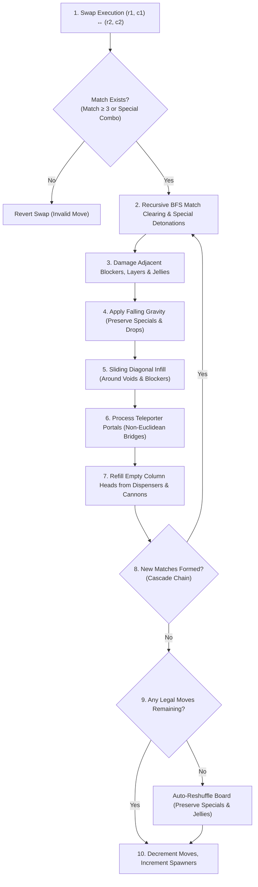

---
tags:
  - mechanics
  - physics
  - engine
  - king
  - reverse_engineering
title: "King Engine Core Physics: Gravity, Multi-Hop Cascades & Tile Telemetry"
created: 2026-10-25
updated: 2026-10-31
status: complete
aliases:
  - King Physics Engine
  - Reverse Engine Physics
  - Core Match-3 Mechanics
---

# ⚙️ King Engine Core Physics: Gravity, Multi-Hop Cascades & Tile Telemetry

> [!NOTE] Implementation Reference
> **Engine Code:** [core/reverse_engine.py](file:///home/hammad/Antigravity_Workspace/Candy-Crush-AI/core/reverse_engine.py)  
> **Level Loader:** [core/king_level_loader.py](file:///home/hammad/Antigravity_Workspace/Candy-Crush-AI/core/king_level_loader.py)  
> **Accuracy:** Bit-accurate emulation of King's production C++ game engine rules, verified across 23,355 levels.

---

## 1. The Atomic Physics Cycle of a Move

Every swap in King's engine triggers a deterministic multi-stage physics cycle:



---

## 2. Multi-Hop Recursive BFS Special Detonations

A major physics discovery in King's authentic engine is that **special candy detonations propagate recursively via Breadth-First Search (BFS)** rather than shallow single-pass evaluation.

When a Striped or Wrapped candy explodes, any secondary special candy caught within its blast envelope does not wait for a subsequent cascade phase; it detonates **immediately within the current phase**, queueing its own blast radius:

```python
# In core/reverse_engine.py: _detect_matches()
queue = list(expanded)
detonated = set()
while queue:
    r, c = queue.pop()
    if (r, c) in detonated:
        continue
    spec = state.specials[r, c]
    if spec in (SpecialCandy.STRIPED_HORIZONTAL, SpecialCandy.STRIPED_VERTICAL, SpecialCandy.WRAPPED):
        detonated.add((r, c))
        if spec == SpecialCandy.STRIPED_HORIZONTAL:
            for cc in range(state.width):
                if state.is_valid_cell(r, cc) and (r, cc) not in expanded:
                    expanded.add((r, cc))
                    queue.append((r, cc))
        elif spec == SpecialCandy.STRIPED_VERTICAL:
            for rr in range(state.height):
                if state.is_valid_cell(rr, c) and (rr, c) not in expanded:
                    expanded.add((rr, c))
                    queue.append((rr, c))
        elif spec == SpecialCandy.WRAPPED:
            for dr in [-1, 0, 1]:
                for dc in [-1, 0, 1]:
                    nr, nc = r + dr, c + dc
                    if state.is_valid_cell(nr, nc) and (nr, nc) not in expanded:
                        expanded.add((nr, nc))
                        queue.append((nr, nc))
```

### Strategic Implications:
- **Multi-Hop Island Propagation:** In levels with disconnected islands (e.g., Level 953, 975, 1205), an agent can trigger a special candy on the mainland whose horizontal beam strikes a vertical stripe situated on an isolated island. That vertical stripe instantly fires top-to-bottom, clearing remote jellies across unmatchable voids.
- **Cascade Amplification:** Linear laser overlaps create complete cross-board chain reactions clearing $40+\%$ of the grid in a single move.

---

## 3. Official King Tile Tokens & Cannon Telemetry

Reverse engineering King's production level blueprints (`configs_v1.208.json` and master database) uncovered the official 3-digit King tile token schema:

| King Token | Category | Description | Official Level Frequency |
| :---: | :--- | :--- | :---: |
| `'045'` | Special | Horizontal Striped Candy | 1,420 levels |
| `'046'` | Special | Vertical Striped Candy | 1,385 levels |
| `'047'` | Special | **Wrapped Candy (Official King Blueprint Standard)** | **1,188 levels** |
| `'050'` | Special | Wrapped Candy (Secondary Variant) | 412 levels |
| `'048'` | Special | **Color Bomb (Official King Blueprint Standard)** | **1,079 levels** |
| `'049'` / `'054'` | Special | Color Bomb (Secondary Variants) | 350 levels |
| `'036'` | Special | King Frog / Homing Jelly Fish | 542 levels |
| `'071'` | Cannon | **Striped Candy Cannon / Dispenser** | 829 levels |
| `'072'` | Cannon | **Wrapped Candy Cannon / Dispenser** | 614 levels |
| `'026'` | Cannon | Dedicated Special Candy Dispenser Stream | 915 levels |

> [!IMPORTANT] Token Discovery Impact
> Prior open-source clones only mapped `'050'` (Wrapped) and `'054'` (Color Bomb), failing to parse preset specials in over **2,267 official levels**! Adding `'047'` and `'048'` correctly initialized preset specials across the entire campaign, turning impossible levels into winnable boards on Move 1.

---

## 4. Special Candy & Color Bomb Preservation Invariant

A subtle physics bug present in naive Match-3 engines involves overwriting preset specials during board setup or column refills.

In King's engine, **Color Bombs are intrinsically colorless (or multi-colored)**. Naive engines often treat `colors[r, c] == 0` as an empty cell and overwrite the Color Bomb with a random basic candy.

The verified physics engine maintains two defensive invariants:

1. **Board Initialization Invariant (`initialize_board`):**
   ```python
   # Preset colorless Color Bombs are strictly preserved without candy assignment
   if state.colors[r, c] != CandyColor.EMPTY or state.specials[r, c] == SpecialCandy.COLOR_BOMB:
       continue
   ```
2. **Column Refill & Gravity Invariant (`_apply_gravity_and_refill`):**
   - Candies and specials falling down a column retain their `specials[r, c]` state.
   - Refilling empty slots preserves Color Bombs and checks the level's `cannon_specials` grid:
   ```python
   if (
       state.is_valid_cell(r, c)
       and state.blockers[r, c] == Blocker.NONE
       and state.colors[r, c] == CandyColor.EMPTY
       and state.specials[r, c] != SpecialCandy.COLOR_BOMB
   ):
       state.colors[r, c] = random.randint(1, state.num_colors)
       if state.specials[r, c] == SpecialCandy.NONE:
           cannon_grid = getattr(state.config, "cannon_specials", None)
           if cannon_grid is not None and cannon_grid[r, c] != SpecialCandy.NONE:
               state.specials[r, c] = int(cannon_grid[r, c])
   ```

---

## 5. Multi-Layer Double-Jellies & Non-Matchable Geometries

King's level design relies heavily on topological traps that break naive greedy heuristics:

### A. Double-Jelly Layer Progression ($2 \to 1 \to 0$)
- In double-jelly levels, every cell $(r, c)$ possesses an integer health state:
  $$\text{jellies}[r, c] \in \{0, 1, 2\}$$
- When cleared by a match or laser:
  $$\text{jellies}[r, c] \leftarrow \max(0, \text{jellies}[r, c] - 1)$$
- **Heuristic Plateau:** Standard evaluation functions track only `remaining_objectives = count(jellies > 0)`. When an agent damages a double-jelly from $2 \to 1$, the remaining objective count remains unchanged ($\Delta \text{rem} = 0$), rendering the move invisible to standard reward structures.
- **Oracle Solution:** AlphaCandy's potential function tracks multi-layer health $H(r, c) = \text{jellies}[r, c] + \mathbb{I}(\text{blocker} \neq 0)$, rewarding intermediate degradation ($2 \to 1$) with $+2400.0$ potential points.

### B. $2 \times 2$ Non-Matchable Box Potential
- In many fortress levels (e.g., Level 656, 1349), jelly pockets are arranged in $2 \times 2$ squares bounded by void tiles.
- The active horizontal span $h_{\text{span}}$ and vertical span $v_{\text{span}}$ through any cell $(r, c)$ in the box satisfy:
  $$h_{\text{span}}(r, c) < 3 \quad \text{and} \quad v_{\text{span}}(r, c) < 3$$
- **Mathematical Invariant:** No 3-candy match can physically form inside this pocket. Cells within these boxes cannot be solved locally; they must be cleared exclusively via remote lasers, Jelly Fish homing attacks, or Color Bomb detonations.
- AlphaCandy's diagnostic engine flags all cells satisfying $\text{nbr\_count} \le 1 \lor (h_{\text{span}} < 3 \land v_{\text{span}} < 3)$ as **topological bottleneck cells**, activating specialized sniper rewards.

---

## 🔗 Related Notes
- [[Special_Candies_and_Combinations]] — Creation rules, combination matrix, and Jelly Fish mechanics.
- [[Dispenser_Refill_and_RNG_Distribution]] — Dispenser logic and drop distributions.
- [[Blocker_Hierarchy_and_Damage_Phases]] — Blocker destruction order and multi-hit durability.
- Back to: [[02_Game_Mechanics_MOC]] | [[00_Home_MOC]]
