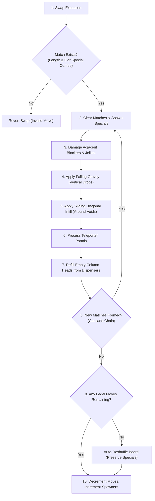

---
tags:
  - mechanics
  - physics
  - engine
  - king
title: "King Engine Core Physics: Gravity, Falling Columns & Cascades"
created: 2026-10-25
status: complete
aliases:
  - King Physics Engine
  - Reverse Engine Physics
---

# ⚙️ King Engine Core Physics: Gravity & Cascades

> [!NOTE] Implementation Reference
> **Code Module:** [core/reverse_engine.py](file:///home/hammad/Antigravity_Workspace/Candy-Crush-AI/core/reverse_engine.py)  
> **Accuracy:** Bit-accurate emulation of King's production C++ game engine rules, verified across 23,355 levels.

---

## 1. The Physics Cycle of a Move

Every swap triggers an atomic deterministic physics cycle:

---

## 2. Falling Gravity & Column Refill Mechanics

### A. Vertical Drop
- Gravity operates top-to-bottom (row $r=0$ to row $r=H-1$).
- Within column $c$, if cell $(r, c)$ becomes empty, all candies above it $(0 \le r' < r)$ fall downward by the number of empty spaces beneath them.
- **Blocker Anchoring:** Blockers such as Frosting, Licorice, and Chocolate are **anchored** in place; they do not fall under gravity. Candies drop *around* or *onto* them.

### B. Sliding Diagonal Infill
- When a void or an anchored blocker prevents vertical falling:
  - A candy situated at $(r-1, c-1)$ or $(r-1, c+1)$ will slide diagonally down into $(r, c)$ if:
    1. The space $(r, c)$ is playable and empty.
    2. The direct vertical cell $(r-1, c)$ is blocked or unplayable.
    3. The sliding path is not obstructed by a barrier or licorice lock.

---

## 3. Cascade Propagation & Combo Mechanics

1. **Simultaneous Clearing:** All matches formed during a single phase clear simultaneously. If a horizontal 3-match intersects a vertical 3-match of the same color, they form a **Wrapped Candy** or **Color Bomb** rather than two separate 3-matches.
2. **Cascade Scoring Multipliers:** Score awards scale exponentially with cascade depth:
   $$\text{Score}(\text{Cascade } k) = \text{Base Score} \times 2^{k-1}$$
3. **Special Candy Detonation Priority:**
   - **Striped Candies:** Clear an entire row or column instantly.
   - **Wrapped Candies:** Explode in a $3 \times 3$ area twice (once immediately, once after settling).
   - **Color Bombs:** Clear every candy of the chosen target color across the entire board.

---

## 4. State Invariants & Board Verification

AlphaCandy maintains the following mathematical state invariants:
- **Playable Cell Invariant:** $\forall (r, c) \in \text{Voids}, \text{colors}[r, c] = 0 \land \text{active\_grid}[r, c] = 0$.
- **Move Conservation:** $\text{moves\_left} \ge 0$. If $\text{moves\_left} = 0 \land \neg \text{has\_won}()$, level status is formally marked `LOST`.
- **Objective Completeness:** $\text{has\_won}() \iff \text{remaining\_objectives}() = 0$.

---

## 🔗 Related Notes
- [[Dispenser_Refill_and_RNG_Distribution]]
- [[Blocker_Hierarchy_and_Damage_Phases]]
- [[Special_Candies_and_Combinations]]
- Back to: [[02_Game_Mechanics_MOC]]
