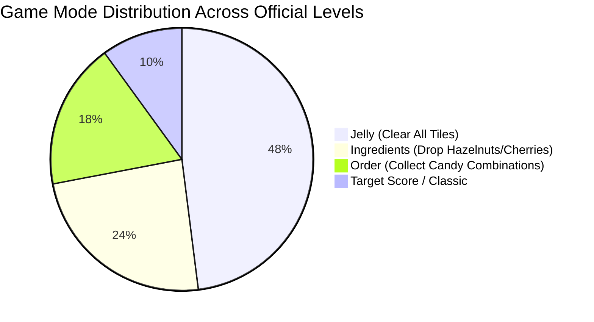

---
tags:
  - mechanics
  - objectives
  - game-modes
title: "Objective Types and Victory Evaluation Across Game Modes"
created: 2026-10-25
status: complete
aliases:
  - Game Modes
  - Objectives
---

# ⚙️ Objective Types and Victory Evaluation

> [!NOTE] Implementation Reference
> **Engine Code:** [core/reverse_engine.py](file:///home/hammad/Antigravity_Workspace/Candy-Crush-AI/core/reverse_engine.py) (`LevelType` enum)

---

## 1. Game Mode Taxonomy across 23,355 Levels

---

## 2. In-Depth Game Mode Mechanics

### A. Jelly Mode (`LevelType.JELLY`)
- **Objective:** Clear all jellies (single layer or double layer) embedded beneath board cells.
- **Victory Condition:** $\sum_{r,c} \text{jellies}[r, c] == 0$.
- **Tactical Strategy:** Prioritize corner and edge jellies early; bottom cascades will clear central jellies naturally.

### B. Ingredients Drop Mode (`LevelType.INGREDIENTS`)
- **Objective:** Guide Cherries and Hazelnuts from top dispensers down into designated bottom drop buckets.
- **Victory Condition:** All target ingredients reach drop buckets before move limit expires.
- **Tactical Strategy:** Preserve uninterrupted vertical fall channels; avoid horizontal swaps that divert ingredients into dead-end columns.

### C. Order Mode (`LevelType.ORDER`)
- **Objective:** Collect specific quantities of candy types (e.g. 50 Blue candies, 2 Color Bombs, or 3 Striped + Wrapped combos).
- **Tactical Strategy:** Track target quotas directly; moves that do not advance the order quota receive discounted utility.

### D. Target Score Mode (`LevelType.SCORE`)
- **Objective:** Reach a numerical point threshold (1, 2, or 3 stars) within $N$ moves.
- **Tactical Strategy:** Focus on high-cascade combos and multi-special detonations that maximize exponential cascade multipliers.

---

## 🔗 Related Notes
- [[King_Engine_Core_Physics]]
- [[Blocker_Hierarchy_and_Damage_Phases]]
- [[Exploratory_Data_Analysis_Insights]]
- Back to: [[02_Game_Mechanics_MOC]]
