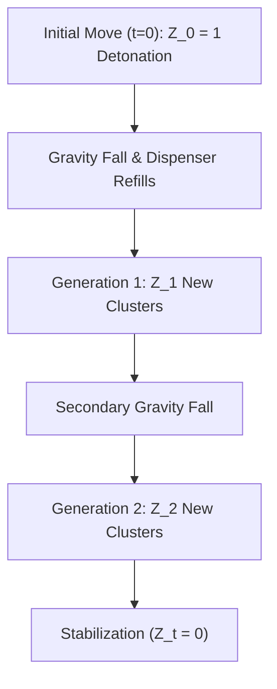

# Percolation Theory, Hypergraph Stability & Cascade Criticality

> [!NOTE] Physics Analogy
> Candy Crush match-3 cascades exhibit the hallmarks of **Self-Organized Criticality (SOC)** and **Bootstrap Percolation**, similar to sandpile avalanches and branching processes in nuclear physics.

---

## 1. Hypergraph Formalization of Stable Match-3 States

A Candy Crush board is mathematically represented as a **2D Grid Hypergraph** $\mathcal{H} = (V, \mathcal{E})$:
* **Vertices $V$**: Cell coordinates $(r, c) \in [1, H] \times [1, W]$.
* **Hyperedges $\mathcal{E}$**: All collinear contiguous triples:
  $$\mathcal{E} = \left\{ \{(r, c), (r, c+1), (r, c+2)\} \right\} \cup \left\{ \{(r, c), (r+1, c), (r+2, c)\} \right\}$$

### Stable Board State (Weak Proper Coloring)
A coloring function $\chi: V \to \{1, \dots, C\}$ (where $C \in [4, 6]$ is the active candy color palette) represents a **stable board state** if and only if **no hyperedge is monochromatic**:

$$\forall e \in \mathcal{E}, \quad |\chi(e)| > 1$$

If a swap produces a monochromatic hyperedge $|\chi(e)| = 1$, the hyperedge detonates, triggering a topological collapse of all cells directly above it.

---

## 2. Cascade Dynamics as Branching Processes

When a player swap detonates a cluster of $k$ candies, the gravity collapse and subsequent dispenser refills induce a stochastic **branching process**:

$$Z_{t+1} = \sum_{i=1}^{Z_t} \xi_{t, i}$$

Where $Z_t$ is the number of active matching clusters at cascade generation $t$, and $\xi$ is the offspring distribution of new matches formed by incoming falling tiles.

### The Reproduction Number $R_0 = \mathbb{E}[\xi]$:
1. **Subcritical Phase ($R_0 < 1$)**:
   - Standard moves with isolated blockers.
   - Cascades extinguish exponentially with mean length $\mathbb{E}[L] = \frac{1}{1 - R_0} \approx 1.2\text{–}1.4$ steps.
2. **Critical Phase ($R_0 \approx 1$, "Edge of Chaos")**:
   - Board size $\ge 8 \times 8$ with only 4 active candy colors.
   - Cascade lengths follow a **heavy-tailed power-law distribution**:
     $$P(L \ge \ell) \propto \ell^{-\gamma}, \quad \gamma \approx 1.5$$
   - A single swap can trigger an unpredictable 10-step runaway cascade wiping 80% of the board!
3. **Supercritical Phase ($R_0 > 1$)**:
   - Triggered intentionally by high-order combo detonations:
     - **Color Bomb + Striped Candy**: Converts all candies of color $c$ into striped lasers.
     - **Wrapped + Striped Combo**: 3-row $\times$ 3-column dual-axis cross blast.
   - Forces $R_0 \gg 1$, guaranteeing total board clearing.

---

## 3. Algorithmic Exploitation in AlphaCandy AI

Understanding cascade percolation enables our neural agents to make counter-intuitive master moves:
1. **Low-Entropy Setup Moves**:
   Instead of taking an immediate subcritical match-3 ($R_0 \approx 0.1$), `GrandmasterConsensusAgent` selects setup moves that compress color variance, deliberately nudging the local board patch into the critical threshold ($R_0 \to 1$).
2. **Dispenser Choke-Point Unblocking**:
   On levels with narrow 1-tile dispenser bottlenecks, clearing the bottleneck tile triggers a flood of new entropy, re-igniting percolation across dead board zones.

---

## 📚 References
1. **Bak, P., Tang, C., & Wiesenfeld, K. (1987):** *Self-organized criticality: An explanation of the 1/f noise*. Physical Review Letters, 59(4), 381.
2. **Chalupa, J., Leath, P. L., & Reich, G. R. (1979):** *Bootstrap percolation on a Bethe lattice*. Journal of Physics C: Solid State Physics, 12(1), L31.
3. **Lovász, L. (1975):** *Problems and results on 3-chromatic hypergraphs and some related questions*.
