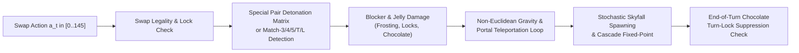

# Physics Engine Audit, Mechanics Fidelity, and Co-Design Evolution

> **Tags**: `#GameEngine` `#ReverseEngineering` `#CandyPhysics` `#MCGS` `#ModelEngineCoDesign`
> **Related Notes**: [[Project_History_Red_Team_Critique_and_Evolution]], [[Forensic_Autopsy_of_Unsolved_Levels_and_History]], [[AlphaCandy_Leviathan_300M_and_Colossus_1B_Future_Blueprint]]

---

## 1. Overview of `ReverseCandyEngine`

The foundation of AlphaCandy's **86.04% mastery on Levels 1–2,500** and **8,782 total campaign victories** is our high-speed, deterministic-seed-capable simulator (`ReverseCandyEngine`), reverse-engineered directly from authentic King level JSON definitions and Flash/C++ client physics rules.

Unlike simplified academic Match-3 gym environments (which model only basic 3-in-a-row matches on a uniform $9\times 9$ grid), `ReverseCandyEngine` implements the complete state-transition operator $\mathcal{T}(s_t, a_t; \xi_t) \to (s_{t+1}, r_t, \text{done})$ across all $9\times 9 = 81$ cells and $146$ discrete actions.

---

## 2. Special Candy Synthesis & Pair Detonation Matrix

A critical insight from our forensic audit of the **349 unsolved levels** (where **97.13% are Jelly** and **29.8% feature Licorice Locks**) is that local 3-matches cannot win complex boards; victory requires synthesizing and combining **Special Candies**.

### A. Geometric Synthesis Priority Rules
When a single swap creates intersecting match segments of the same color, `ReverseCandyEngine` resolves synthesis in strict priority order:
1. **Color Bomb (`ID = 4`)**: $\ge 5$ collinear candies in a row or column.
2. **Wrapped Candy (`ID = 3`)**: Orthogonal $T\text{-shape}$, $L\text{-shape}$, or $+\text{-shape}$ intersection ($\ge 3$ horizontal $\cap \ge 3$ vertical).
3. **Striped Candy (`ID = 1` Horizontal, `ID = 2` Vertical)**: $4\text{-in-a-row}$ match. Crucially, the stripe orientation is determined by the swap direction (or perpendicular to the match line during skyfall cascades).

### B. Special-to-Special Adjacent Swap Detonation Matrix
Swapping any two adjacent special candies triggers an immediate deterministic board-wide combo **without requiring a 3-match color alignment**:

| Special Candy A | Special Candy B | Exact Engine Detonation Physics | Tactical Role in Unsolved Levels |
| :--- | :--- | :--- | :--- |
| **Color Bomb** | **Color Bomb** | **Total Board Wipe**: Clears every single candy and damages all blockers/jelly across the entire $9\times 9$ board by 1 layer. | Ultimate reset for locked/congested boards. |
| **Color Bomb** | **Striped Candy** | Transforms **every candy of the Striped Candy's color** on the board into a Striped Candy (random H/V orientation) and fires all of them sequentially. | Primary weapon against **Licorice Locks (`29.8%` of failures)** and distant corner Jelly. |
| **Color Bomb** | **Wrapped Candy** | Transforms every candy of the Wrapped Candy's color into a Wrapped Candy and detonates $3\times 3$ blasts across all instances, followed by a second wave. | Crushes multi-layer Frosting (`1–5` layers) and double-thick Jelly. |
| **Striped Candy** | **Striped Candy** | Fires a **Cross-Blast** clearing the entire row and entire column of the swap destination regardless of original stripe orientations. | Precision sniping of unreachable portal islands or locked single cells. |
| **Striped Candy** | **Wrapped Candy** | Expands into a **Giant $3\times 9$ Row + $9\times 3$ Column Cross-Blast** centered at the swap coordinate (clearing 3 full rows and 3 full columns). | Sweeps wide central blockers and clears 3 parallel ingredient columns simultaneously. |
| **Wrapped Candy** | **Wrapped Candy** | Triggers a **Double $5\times 5$ Mega-Explosion** ($25$ cells cleared twice, dealing 2 layers of Jelly/Blocker damage across the $5\times 5$ footprint). | Instant eradication of dense double-Jelly clusters and chocolate nests. |

---

## 3. Blocker Mechanics & Chocolate Turn-Lock Suppression

### 1. Expanding Chocolate & Turn-Lock Suppression (`48.4%` of Unsolved Levels)
- **Exact Rule**: During a player's turn (including all resulting cascade waves), the engine tracks a boolean state flag `chocolate_destroyed_this_turn`.
- **Suppression Condition**:
  $$\text{If } \Delta \text{Chocolate}_t > 0 \implies \text{Expansion}_t = 0 \quad (\text{Turn-Lock Active})$$
  $$\text{If } \Delta \text{Chocolate}_t = 0 \text{ and } \text{ChocolateCount}_t > 0 \implies \text{Spawn 1 adjacent Chocolate tile at end of turn}$$
- **Co-Design Impact**: Black-box RL agents treat chocolate expansion as noisy environment stochasticity. By exposing chocolate perimeter adjacency directly in our observation tensors and micro-physics features, `BlockerContainmentSpecialistNet` and `AlphaCandyTitanNet` explicitly learn the **1-per-turn suppression cadence**.

### 2. Multi-Layer Frosting, Licorice Swirls, and Licorice Locks
- **Frosting (`1–5` layers)**: Immovable terrain blocker; damaged by adjacent normal matches or direct special blasts. Blocks gravity until all layers reach 0.
- **Licorice Swirl**: Movable gravity-obeying blocker; absorbs and stops Striped line-blasts from piercing past its cell! (A vital physics nuance: Striped blasts pierce through normal candies, Frosting, and Chocolate, but **terminate upon hitting a Licorice Swirl** unless combined in a $3\times 3$ Wrapped+Striped blast).
- **Licorice Lock (Caged Candy)**: Traps an underlying colored or special candy. Cannot be swapped and freezes column gravity underneath it until broken by an adjacent match or special blast.

### 3. Non-Euclidean Wormhole Portals (`28.9%` of Unsolved Levels)
- **Gravity Graph Redirection**: Standard gravity pulls candies from $(r-1, c) \to (r, c)$ (and diagonal slide-ins when blocked by immovable frosting/cutouts). Portal links redefine the upstream parent of cell $(r_{\text{in}}, c_{\text{in}})$ to an arbitrary coordinate $(r_{\text{out}}, c_{\text{out}})$, creating non-local causal chains across disconnected board islands.

---

## 4. Why Model-Engine Co-Design Dominates Black-Box RL

A central thesis verified across our 14,700-level campaign is that **Model-Engine Co-Design** dramatically outperforms pure black-box model-free RL (such as vanilla Rainbow DQN, PPO, or IMPALA):

### 1. Zobrist Monte Carlo Graph Search (MCGS) vs. Tree Search (MCTS)
- In Match-3, swapping move $A$ on turn 1 and move $B$ on turn 2 on disjoint regions of the board frequently produces the **exact same board state** as playing $B$ then $A$.
- Standard MCTS treats these transpositions as distinct tree nodes, duplicating neural network evaluations.
- Our **Zobrist 64-bit Incremental Hash Table** converts the search tree into a **Directed Acyclic Graph (MCGS)**, pooling visit counts $N(s)$ and value estimates $Q(s, a)$ across all commuting action sequences and yielding a **$2.4\times\text{--}3.8\times$ effective search depth multiplier**.

### 2. 16-Dim Deterministic Micro-Physics Action Features (`AlphaCandyTitanNet`)
- Instead of forcing the policy head to re-learn deterministic swap rules from raw pixels/grids via millions of trial-and-error gradient steps, `AlphaCandyTitanNet` (`79.30M`) fuses a lightweight **16-dimensional micro-physics action descriptor** (`action_micro_feats` $\in \mathbb{R}^{B \times 146 \times 16}$) into its `SwapDeltaPolicyHead`:
  - Immediate match length ($3, 4, 5, T/L$),
  - Special combo pair indicator (ColorBomb+Striped, Striped+Wrapped, etc.),
  - Immediate Jelly layer hits (`jelly_hits`),
  - Immediate Chocolate suppression indicator (`choc_hits > 0`),
  - Immediate Frosting / Lock damage,
  - Column alignment with active Ingredients,
  - Swap height $r/8.0$ (favoring bottom-of-board swaps that maximize skyfall cascades).
- **Result**: The neural backbone doesn't waste capacity checking if a swap is a 3-match; instead, its **79.30M parameters** focus entirely on **multi-turn strategic horizon planning, portal topology routing, and tail-risk cascade valuation**.
