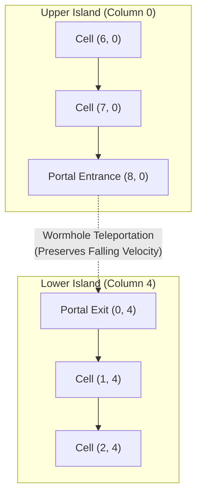

---
tags:
  - mechanics
  - portals
  - graph-theory
  - topology
title: "Portals and Teleporters: Non-Euclidean Board Topologies"
created: 2026-10-25
status: complete
aliases:
  - Portals
  - Teleporters
  - Board Topology
---

# ⚙️ Portals and Teleporters: Non-Euclidean Topologies

> [!NOTE] Topological Complexity
> Portals fundamentally transform Candy Crush from a flat 2D Euclidean grid into a **directed graph manifold** where falling candies exit the bottom of one island and instantly re-emerge at the top of an isolated island.

---

## 1. Portal Graph Representation

In King configuration files (`configs_v1.208.json`), portals are specified as paired coordinate lists:
```json
"portals": [
  [[0, 8], [4, 0]],
  [[1, 8], [5, 0]]
]
```
where each element `[[c_in, r_in], [c_out, r_out]]` defines a directed teleporter pipe:



---

## 2. Physics & Momentum Rules Across Portals

1. **Continuous Cascade Inflow:**  
   When a match clears candies on Lower Island beneath Portal Exit $(0, 4)$, it draws candies directly out of Upper Island via Portal Entrance $(8, 0)$.
2. **Backpressure & Flow Blockage:**  
   If the exit tile $(0, 4)$ is obstructed (by an anchored Frosting blocker, Licorice lock, or stationary candy), flow through the portal ceases entirely. Upper Island cannot drop candies through the portal until the blockage at the exit is cleared.
3. **Deadlock Vulnerability:**  
   In certain levels, a player who fails to prioritize clearing the exit zone of a portal will starve an entire upper column, reducing available legal moves and causing early game failure.

---

## 3. How AlphaCandy Embedds Portals

1. **Spatial Tensor Channel 19:**  
   [models/network.py](file:///home/hammad/Antigravity_Workspace/Candy-Crush-AI/models/network.py) encodes Portal Entrances as $-1.0$ and Portal Exits as $+1.0$ in dedicated feature channel 19.
2. **Transformer Spatial Self-Attention:**  
   In the [[AlphaCandy_Spatial_Transformer]], tokens for paired portal coordinates attend directly to each other via $\mathcal{O}(1)$ query-key dot products, bypassing intermediate void cells.

---

## 🔗 Related Notes
- [[King_Engine_Core_Physics]]
- [[AlphaCandy_Spatial_Transformer]]
- [[Transformers_and_Spatial_Attention_in_Grid_Worlds]]
- Back to: [[02_Game_Mechanics_MOC]]
