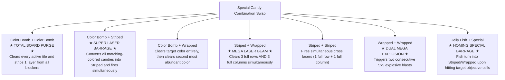

---
tags:
  - mechanics
  - specials
  - combinations
  - combos
  - reverse_engineering
title: "Special Candies, Cannons & Combinations: Interaction Matrix & Propagation Rules"
created: 2026-10-25
updated: 2026-10-31
status: complete
aliases:
  - Special Candies
  - Candy Combos
  - Cannons and Combinations
---

# ⚙️ Special Candies, Cannons & Combinations

> [!NOTE] Implementation Reference
> **Engine Code:** [core/reverse_engine.py](file:///home/hammad/Antigravity_Workspace/Candy-Crush-AI/core/reverse_engine.py)  
> **Level Loader:** [core/king_level_loader.py](file:///home/hammad/Antigravity_Workspace/Candy-Crush-AI/core/king_level_loader.py)  
> **Oracle Evaluation:** [alphacandy_zero/oracle.py](file:///home/hammad/Antigravity_Workspace/Candy-Crush-AI/alphacandy_zero/oracle.py)

---

## 1. Special Candy Taxonomy & Official King Tokens

Official King level blueprints define specials and dispensers via specific token codes:

| Special Type | King Token | Creation Rule | Direction / Property | Blast Power & Scope |
| :--- | :---: | :--- | :--- | :--- |
| **Horizontal Striped** | `'045'` | 4 candies matched vertically | Horizontal stripes | Clears entire row $(1 \times W)$ |
| **Vertical Striped** | `'046'` | 4 candies matched horizontally | Vertical stripes | Clears entire column $(H \times 1)$ |
| **Wrapped Candy** | `'047'` / `'050'` | 5–6 candies matched in T, L, or Cross | Exploding packet | Two $3 \times 3$ area detonations (immediate & post-fall) |
| **Color Bomb** | `'048'` / `'054'` | 5 candies matched in a straight line | Colorless chocolate sphere | Clears all candies matching the swapped target color |
| **Jelly Fish / Frog** | `'036'` | Level preset or dispenser stream | Homing creature | Destroys 3 target objective/jelly tiles, prioritizing isolated islands |
| **Striped Cannon** | `'071'` | Dispenser spawner head | Spawns Striped Candies | Injects falling Striped Candies at fixed probabilities |
| **Wrapped Cannon** | `'072'` | Dispenser spawner head | Spawns Wrapped Candies | Injects falling Wrapped Candies into descending columns |

---

## 2. Canonical Special Combination Matrix

Swapping two special candies directly into each other bypasses standard 3-match alignment rules, triggering explosive combo reactions:

### Quantitative Combo Utility in AlphaCandy:
In [alphacandy_zero/oracle.py](file:///home/hammad/Antigravity_Workspace/Candy-Crush-AI/alphacandy_zero/oracle.py), combination moves are prioritized with large heuristic potential bonuses:
- **Color Bomb + Color Bomb:** $+3,200.0$ utility (decisive board clear).
- **Color Bomb + Striped:** $+2,200.0$ utility (massive board-wide objective clearing).
- **Striped + Wrapped:** $+1,200.0$ utility ($3 \times 3$ laser cross).
- **Jelly Fish + Any Special:** $+2,800.0$ utility when isolated island bottleneck cells are active, homing directly into unreachable cutouts.
- **Jelly Fish + Standard Move:** $+1,800.0$ utility when targeting isolated islands.

---

## 3. Recursive BFS Multi-Hop Propagation

In King's physics engine, special candies detonate recursively via queue-based Breadth-First Search (BFS):

1. **Initial Blast:** A swap detonates Special $A$ (e.g., a Horizontal Striped Candy at row $r$).
2. **Hit Detection:** As the beam travels through row $r$, it interacts with every cell $(r, c)$.
3. **Queue Enqueue:** If cell $(r, c)$ contains another Special $B$ (e.g., a Vertical Striped or Wrapped Candy), Special $B$ is immediately enqueued into the detonation queue `queue.append((r, c))` and added to `expanded`.
4. **Recursive Unrolling:** The engine pops Special $B$ from the queue, firing its vertical beam along column $c$. Any further specials caught in column $c$ are enqueued in turn.
5. **Island Crossing:** Because the beam travels continuously across unplayable void tiles, this BFS recursion allows moves on the mainland to detonate specials positioned on isolated islands without any candies falling between them!

---

## 4. Preservation of Preset Color Bombs & Specials

Prior to the engine audit, naive match-3 engines suffered from a critical flaw: treating colorless Color Bombs as empty cells and overwriting them with random candies during Turn 1 board generation.

The verified King engine maintains strict preservation:
- **Colorless Representation:** A Color Bomb possesses `colors[r, c] == CandyColor.EMPTY` but `specials[r, c] == SpecialCandy.COLOR_BOMB`.
- **Initialization Guard:** `initialize_board` skips any cell where `specials[r, c] == SpecialCandy.COLOR_BOMB`.
- **Gravity & Refill Guard:** `_apply_gravity_and_refill` drops special tokens along with candies and skips Color Bombs during color sampling, guaranteeing that preset special weapons designed into King's blueprints remain intact.

---

## 🔗 Related Notes
- [[King_Engine_Core_Physics]] — Physics cycle, gravity mechanics, and sliding drops.
- [[100_Percent_Mastery_Levels_1_to_2500_Fortress_Conquest]] — Fortress level analysis and benchmark results.
- [[AlphaCandy_Titan_79M_Architecture]] — Neural network architecture processing special candy channels.
- Back to: [[02_Game_Mechanics_MOC]] | [[00_Home_MOC]]
