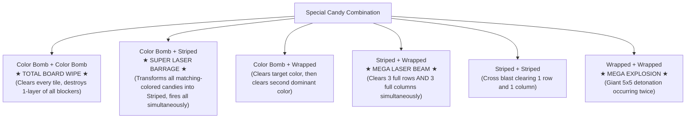

---
tags:
  - mechanics
  - specials
  - combinations
  - combos
title: "Special Candies and Combinations: Creation Rules and Interaction Matrix"
created: 2026-10-25
status: complete
aliases:
  - Special Candies
  - Candy Combos
---

# ⚙️ Special Candies and Combinations

> [!NOTE] Implementation Reference
> **Engine Code:** [core/reverse_engine.py](file:///home/hammad/Antigravity_Workspace/Candy-Crush-AI/core/reverse_engine.py)

---

## 1. Special Candy Creation Rules

| Special Type | Creation Pattern | Orientation / Property | Blast Power |
| :--- | :--- | :--- | :--- |
| **Striped (Horizontal)** | 4 candies matched vertically | Stripes point horizontal | Clears entire row $(1 \times W)$ |
| **Striped (Vertical)** | 4 candies matched horizontally | Stripes point vertical | Clears entire column $(H \times 1)$ |
| **Wrapped Candy** | 5 or 6 candies in T-shape, L-shape, or cross | Wrapped package | Two $3 \times 3$ explosive detonations |
| **Color Bomb** | 5 candies in a straight line | Chocolate sphere with sprinkles | Clears all candies of swapped color |

---

## 2. The 10 Canonical Special Combinations Matrix

When two special candies are swapped directly into each other, they bypass normal matching rules and trigger high-power combo detonations:

---

## 3. AlphaCandy's Combination Construction Heuristics

In [models/candyrl_ensemble.py](file:///home/hammad/Antigravity_Workspace/Candy-Crush-AI/models/candyrl_ensemble.py), AlphaCandy explicitly rewards:
1. **Special Proximity Maneuvering:** If two specials are separated by 1 tile, moves that clear the intermediary candy receive a **$+150,000$ tactical bonus**.
2. **Color Bomb + Striped Alignment:** The highest-reward combo in the game; the agent will protect a Color Bomb until a Striped Candy can be aligned adjacent to it.

---

## 🔗 Related Notes
- [[King_Engine_Core_Physics]]
- [[Blocker_Hierarchy_and_Damage_Phases]]
- [[Grandmaster_Unified_Agent]]
- Back to: [[02_Game_Mechanics_MOC]]
