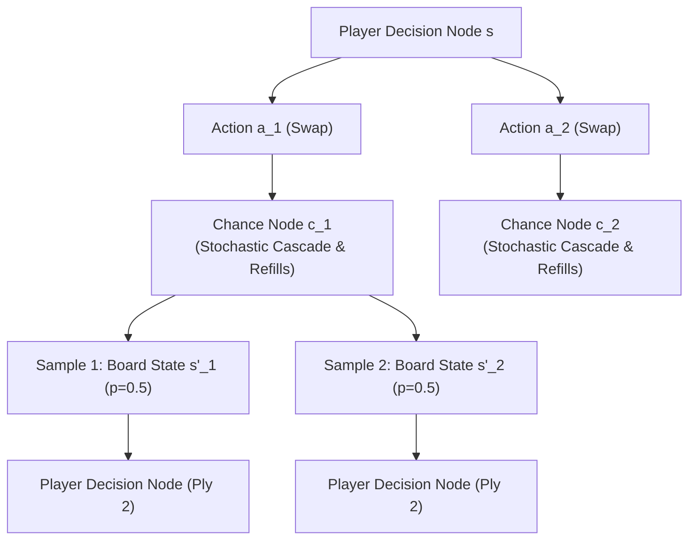

---
tags:
  - architecture
  - search
  - expectimax
  - lookahead
title: "Adaptive Expectimax Lookahead with Chance-Node Sampling"
created: 2026-10-25
status: complete
aliases:
  - Expectimax Lookahead
  - Adaptive Lookahead
---

# 🧠 Adaptive Expectimax Lookahead

> [!NOTE] Implementation Reference
> **Code Modules:** [models/superhuman_solver.py](file:///home/hammad/Antigravity_Workspace/Candy-Crush-AI/models/superhuman_solver.py) & [models/grandmaster_unified_agent.py](file:///home/hammad/Antigravity_Workspace/Candy-Crush-AI/models/grandmaster_unified_agent.py)

---

## 1. Game Theoretic Tree Structure: Stochastic Chance Nodes

In Candy Crush, after a deterministic player action $a$, the environment introduces a **Chance Node** representing random dispenser refills and stochastic cascades:

The expected utility of action $a$ is computed as:
$$V(s, a) = \mathbb{E}_{\omega \sim \mathcal{Z}}\left[R(s, a, \omega) + \gamma \max_{a'} V(s', a')\right]$$
where $\omega$ represents the random seed outcome sampled from the dispenser distribution.

---

## 2. Adaptive Depth Escalation Strategy

To maintain high throughput without sacrificing endgame precision:
- **Phase 1: 1-Ply Pruning:** Evaluates all legal moves ($15\text{–}25$) using fast multi-paradigm neural consensus. Selects the top $k=4\text{–}6$ candidates.
- **Phase 2: Standard Play (Moves $> 8$):** Depth is fixed to $1$ ply. The highest-scoring candidate is executed immediately ($\sim 10\text{–}15\text{ ms}$).
- **Phase 3: Escalation (Moves $\le 8$ or Objectives $\le 6$):**
  - Depth automatically escalates to **3-ply**.
  - Samples $M=2$ stochastic refill outcomes per candidate.
  - Explores the top 16 response moves on the 2nd ply, detecting multi-turn Color Bomb setups and cascading clearances.

---

## 🔗 Related Notes
- [[Grandmaster_Unified_Agent]]
- [[AlphaCandy_Spatial_Transformer]]
- [[Walsh_2014_Candy_Crush_NP_Hard]]
- Back to: [[01_Architecture_MOC]]
