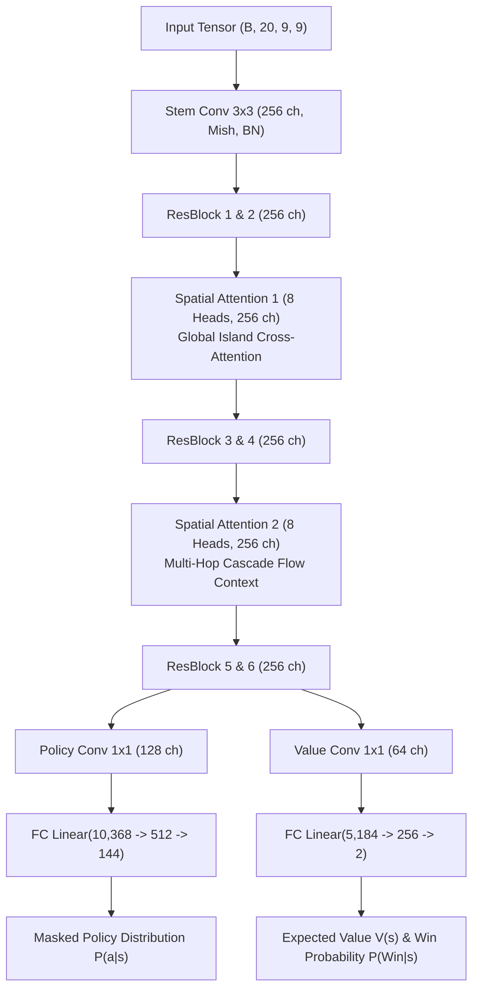

# AlphaCandy Large Architecture (~14.4M Parameters)

The **AlphaCandy Large** architecture (`AlphaCandyLargeNet` in `models/spatial_transformer_net.py`) is a high-capacity, dual-head spatial attention network specifically engineered to conquer complex multi-hop board layouts, multi-layer chocolate spawners, magic mixers, and long cascade sequences across thousands of official King levels.

---

## 🏗️ Architectural Specifications

| Component | Standard AlphaCandy (`AlphaCandySpatialNet`) | **AlphaCandy Large (`AlphaCandyLargeNet`)** |
| :--- | :--- | :--- |
| **Total Parameters** | ~2.9 Million | **~14.42 Million** |
| **Hidden Channels ($C$)** | 128 | **256** |
| **Self-Attention Stages** | 1 stage (4 Attention Heads) | **2 stages (8 Attention Heads each)** |
| **Residual Conv Blocks** | 4 blocks (Mish + BatchNorm) | **6 blocks (Mish + BatchNorm)** |
| **Policy Head FC Layer** | Linear(5,184 $\to$ 256) $\to$ 144 | **Linear(10,368 $\to$ 512) $\to$ 144** |
| **Value Head FC Layer** | Linear(2,592 $\to$ 128) $\to$ 2 | **Linear(5,184 $\to$ 256) $\to$ 2** |
| **Dropout Regularization** | 0.10 | **0.15** |

---

## 🔄 Network Topology & Flow

---

## ⚡ Deployment & Kaggle Async Scaling

`AlphaCandyLargeNet` is integrated into:
1. **[`GrandmasterUnifiedAgent`](file:///home/hammad/Antigravity_Workspace/Candy-Crush-AI/models/grandmaster_unified_agent.py)** via `model_size="large"`.
2. **Kaggle Kernel**: [`alphacandy-async-grandmaster-large-gpu`](https://www.kaggle.com/code/hammadshakeelai/alphacandy-async-grandmaster-large-gpu), which evaluates large-scale campaigns across 2,500+ official King levels in parallel.

---

## 🔗 Related Notes
- [[01_Architecture_MOC]]
- [[AlphaCandy_Spatial_Transformer]]
- [[Grandmaster_Unified_Agent]]
- [[Async_GPU_Parallelism_Architecture]]
- [[Multi_Model_Kaggle_GPU_Learning_Fleet]]
