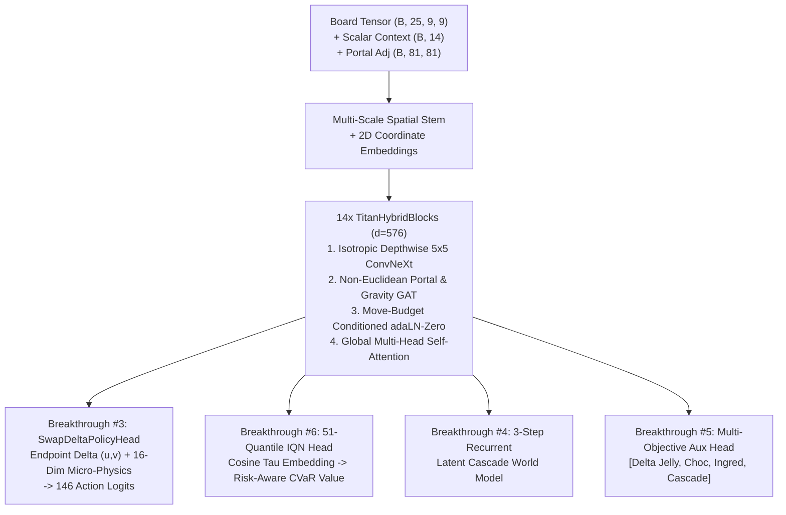

# AlphaCandy Titan (79.30M), Leviathan (310M), and Colossus (1.05B) Architectural Blueprint

> **Tags**: `#AIModels` `#AlphaCandyTitan` `#AlphaCandyLeviathan` `#Colossus1B` `#IQN` `#WorldModel` `#CrossAttemptMemory`
> **Related Notes**: [[Project_History_Red_Team_Critique_and_Evolution]], [[Forensic_Autopsy_of_Unsolved_Levels_and_History]], [[Physics_Engine_Audit_and_Historical_Evolution]]

---

## 1. The AlphaCandy Flagship Scaling Ladder

To conquer the final **349 unsolved levels in 1–2,500** (`86.04%` $\to$ `99%+` target) and scale across the **5,918 unsolved levels in 1–15,000**, our flagship architecture scales across four distinct parameter tiers:

| Model Architecture | Source File | Parameters | Core Paradigm & Primary Deployment Target |
| :--- | :--- | :---: | :--- |
| **`AlphaCandyLargeNet`** | `models/alphacandy_large.py` | **14.41M** | Fast ConvNeXt + Transformer baseline for rapid campaign sweeps |
| **`AlphaCandyOmegaNet`** | `models/alphacandy_omega.py` | **36.01M** | Mid-scale Hybrid ViT + Distributional Value head for MCGS rollouts |
| **`AlphaCandyTitanNet`** | [`models/alphacandy_titan.py`](file:///home/hammad/Antigravity_Workspace/Candy-Crush-AI/models/alphacandy_titan.py) | **79.30M** | **Current Flagship**: 6 First-Principles Breakthroughs for workstation/cloud GPU |
| **`AlphaCandyLeviathanNet` (300M)** | [`models/alphacandy_leviathan_300m.py`](file:///home/hammad/Antigravity_Workspace/Candy-Crush-AI/models/alphacandy_leviathan_300m.py) | **310M** | **Next-Gen Datacenter**: Cross-Attempt Memory + Latent Beam Imagination |
| **`AlphaCandyLeviathanNet` (Colossus)** | [`models/alphacandy_leviathan_300m.py`](file:///home/hammad/Antigravity_Workspace/Candy-Crush-AI/models/alphacandy_leviathan_300m.py) | **1.05B** | **Billion-Parameter Foundation Model**: 24-layer, $d=1536$, $K=8$ beam world model |

---

## 2. `AlphaCandyTitanNet` (`79.30M` Parameters) — Production Flagship

Implemented in [`models/alphacandy_titan.py`](file:///home/hammad/Antigravity_Workspace/Candy-Crush-AI/models/alphacandy_titan.py), `AlphaCandyTitanNet` (`d_model=576`, `num_layers=14`, `num_heads=9`, `mlp_ratio=4.0`, `num_quantiles=51`) integrates **six first-principles architectural breakthroughs** directly addressing the forensic failure modes of Levels 1–2,500:

### The 6 First-Principles Breakthroughs in Titan (`79.30M`)
1. **Explicit Non-Euclidean Portal & Gravity Graph Attention (`NonEuclideanPortalGraphBlock`)**:
   - Message-passing over arbitrary portal teleportation edges (`portal_adj` $\in \mathbb{R}^{B \times 81 \times 81}$) and gravity drop paths, directly targeting the **28.9% (101 / 349)** of unsolved levels with wormhole portals.
2. **Move-Budget-Conditioned Adaptive LayerNorm (`adaLN-Zero`)**:
   - Dynamically shifts and scales every layer's activations ($\gamma_i, \beta_i, \alpha_i$) as a function of remaining moves ($m_{\text{left}}$), smoothly transitioning the entire network from **setup/blocker containment** ($m_{\text{left}} > 15$) to **desperation objective sniping** ($m_{\text{left}} \le 5$).
3. **Action-Conditioned Swap-Delta Cross-Attention Policy (`SwapDeltaPolicyHead`)**:
   - Represents each of the 146 swaps by concatenating cell endpoint embeddings $[h_u, h_v, h_u - h_v, h_u \odot h_v]$, cross-attending over all 81 board tokens to evaluate long-range line blasts, and fusing 16 deterministic micro-physics features.
4. **3-Step Recurrent Latent Cascade World Model (`LatentCascadeWorldModel`)**:
   - Unrolls $K=3$ recurrent GRU-residual imagination steps in latent space conditioned on a candidate action embedding, predicting future objective clearances and reward before executing costly MCTS rollouts.
5. **Multi-Objective Progress Auxiliary Heads**:
   - Predicts normalized remaining ratios for `[Jelly, Chocolate, Ingredients, Score/Frosting]`, providing dense supervision even on failed attempts.
6. **51-Quantile Implicit Quantile Network (IQN) Value Head (`IQNDistributionalValueHead`)**:
   - Replaces scalar value estimation with 51 full return quantiles $Z_\tau(s) \in [-1, 1]$ ($\tau \in \{0.01, \dots, 0.99\}$). Enables dynamic risk posture: neutral expectation early in the game, and **optimistic upper-tail CVaR** ($\tau \in [0.80, 0.98]$) when 1–5 moves remain.

---

## 3. `AlphaCandyLeviathanNet` (`310M` & `1.05B` Colossus) — Future Datacenter Blueprint

Implemented in [`models/alphacandy_leviathan_300m.py`](file:///home/hammad/Antigravity_Workspace/Candy-Crush-AI/models/alphacandy_leviathan_300m.py), `AlphaCandyLeviathanNet` extends the Titan paradigm to foundation-model scale for multi-GPU A100/H100 clusters.

### Exact Preset Specifications
| Hyperparameter | `AlphaCandyTitanNet` (`79.30M`) | `AlphaCandyLeviathanNet` (`310M`) | `AlphaCandyColossusNet` (`1.05B`) |
| :--- | :---: | :---: | :---: |
| **Hidden Dimension (`d_model`)** | `576` | **`1,024`** | **`1,536`** |
| **Hybrid Transformer Depth (`num_layers`)** | `14` | **`20`** | **`24`** |
| **Attention Heads (`num_heads`)** | `9` (head dim `64`) | **`16`** (head dim `64`) | **`24`** (head dim `64`) |
| **FFN Architecture** | GELU MLP ($4.0\times$) | **SwiGLU FFN** + **QK-Norm** | **SwiGLU FFN** + **QK-Norm** |
| **In-Context Episode Trajectory Memory** | None (Markov state) | **$T=8$ Past Board-Action States** | **$T=16$ Past Board-Action States** |
| **Cross-Attempt Failure Memory** | None | **$M=8$ Prior Failed Attempts** | **$M=16$ Prior Failed Attempts** |
| **Latent Beam World Model** | $K=1$ branch, $H=3$ steps | **$K=4$ beams, $H=5$ steps** | **$K=8$ beams, $H=6$ steps** |
| **IQN Distributional Quantiles** | `51` quantiles | **`64` quantiles** | **`64` quantiles** |
| **Total Trainable Parameters** | **`79.30M`** | **`~310M`** | **`~1.05B`** |

### Architectural Innovations Unique to Leviathan (`310M`) & Colossus (`1.05B`)

#### 1. In-Context Episode Trajectory Memory (`EpisodeTrajectoryTransformer`)
- **Problem**: A single board snapshot $s_t$ does not reveal the **spawner cadence** (e.g., King levels where chocolate or licorice swirls spawn once every $k$ moves or where ingredients drop on a fixed turn interval).
- **Solution**: Compresses the last $T=8$ (or $16$) board-action transitions into 4 latent tokens per historical step ($32$ historical tokens total) and cross-attends the current 81 board tokens over the episode trajectory.

#### 2. Cross-Attempt Failure Memory (`CrossAttemptMemoryBank`)
- **Problem**: On ultra-hard holdout levels (`[148, 201, 235, 272, 279, 300]`), memoryless agents repeat the same structural trap across consecutive attempts (e.g., breaking a protective licorice lock on turn 3 that releases expanding chocolate before striped combos are ready).
- **Solution**: Stores a compact `d_model`-dimensional failure summary vector from each of the last $M=8$ failed attempts on the current level. Through gated cross-attention (`failure_avoidance_gate`), the policy actively down-weights opening lines that historically led to deadlocked board states.

#### 3. Multi-Branch Latent Beam Imagination (`LatentBeamImaginationEngine`)
- **Problem**: Single-path latent unrolling ($K=1$) blurs multimodal stochastic skyfall outcomes after a big combo.
- **Solution**: Splits each candidate action into **$K=4$ (Leviathan) or $K=8$ (Colossus) stochastic skyfall branches** unrolled over $H=5\text{--}6$ recurrent steps, predicting per-branch probability weights $\pi_k$, step rewards, and multi-objective clearances.

#### 4. Ultra-Scale Training Stability (`QK-Norm` + `SwiGLU` + `adaLN-Zero`)
- At $d=1024\text{--}1536$ and 20–24 layers, raw attention logits can diverge during mixed-precision (`bf16`) RL self-play. Leviathan applies **Query-Key RMSNorm (`QK-Norm`)** prior to scaled dot-product attention alongside **SwiGLU** gated projections and zero-initialized `adaLN-Zero` residual gates, guaranteeing stable gradient flow from step 0.
