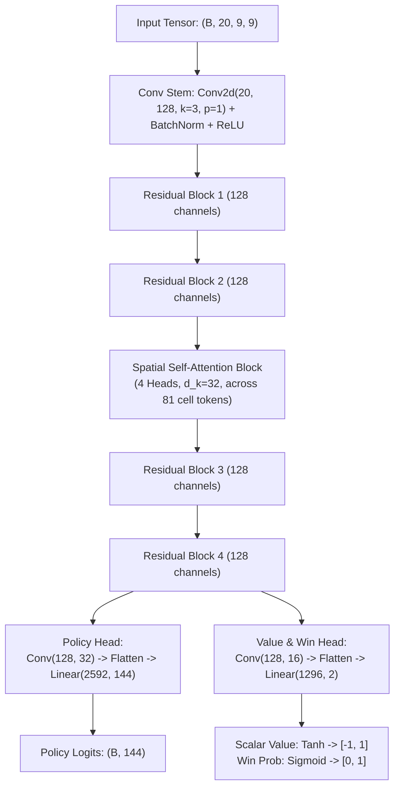

---
tags:
  - architecture
  - transformer
  - attention
  - deep-learning
title: "AlphaCandy Spatial Attention Transformer: Neural Architecture"
created: 2026-10-25
status: complete
aliases:
  - AlphaCandy Transformer
  - Spatial Transformer
---

# 🧠 AlphaCandy Spatial Attention Transformer

> [!NOTE] Implementation Reference
> **Code Module:** [models/spatial_transformer_net.py](file:///home/hammad/Antigravity_Workspace/Candy-Crush-AI/models/spatial_transformer_net.py)  
> **Model Parameters:** $1.4\text{M}$ trainable parameters.  
> **Pre-Training Metric:** **88.26% policy match accuracy** on Kaggle GPU.

---

## 1. 20-Channel Board Tensor Representation

Every board state is mapped into a 20-channel spatial tensor $X \in \mathbb{R}^{20 \times 9 \times 9}$:

| Channel Index | Semantics | Value Range |
| :---: | :--- | :---: |
| **0 – 5** | Regular Candy Colors (Red, Blue, Green, Yellow, Orange, Purple) | $\{0, 1\}$ one-hot |
| **6** | Striped Candy (Horizontal) | $\{0, 1\}$ |
| **7** | Striped Candy (Vertical) | $\{0, 1\}$ |
| **8** | Wrapped Candy | $\{0, 1\}$ |
| **9** | Color Bomb | $\{0, 1\}$ |
| **10** | Chocolate Blocker | $\{0, 1\}$ |
| **11** | Licorice Swirl Blocker | $\{0, 1\}$ |
| **12** | Frosting (Single Layer) | $\{0, 1\}$ |
| **13** | Frosting (Multi-Layer $\ge 2$) | $\{0, 1\}$ |
| **14** | General Blocker Presence Mask | $\{0, 1\}$ |
| **15** | Jelly (Single Layer) | $\{0, 1\}$ |
| **16** | Jelly (Double Layer) | $\{0, 1\}$ |
| **17** | Ingredients (Cherries / Hazelnuts) | $\{0, 1\}$ |
| **18** | Active Playable Cell Mask (1=Playable, 0=Void) | $\{0, 1\}$ |
| **19** | Dynamic Game Context ($\text{moves\_norm} \times 0.5 + \text{obj\_norm} \times 0.5$) | $[0, 1]$ |

---

## 2. Neural Architecture

---

## 3. Canonical 144-Action Policy Space

In an $H \times W = 9 \times 9$ grid, every swap has a unique canonical representation:
- **Horizontal Swaps (RIGHT):** $r \times (W - 1) + c \implies 9 \times 8 = 72$ actions ($[0, 71]$).
- **Vertical Swaps (DOWN):** $72 + r \times W + c \implies 8 \times 9 = 72$ actions ($[72, 143]$).
- Any swap to the LEFT or UP is mapped to its equivalent canonical RIGHT or DOWN index.
- **Action Masking:** Unplayable or illegal swaps are masked out with $-\infty$ before softmax.

---

## 🔗 Related Notes
- [[Grandmaster_Unified_Agent]]
- [[Transformers_and_Spatial_Attention_in_Grid_Worlds]]
- [[Double_Dueling_DQN_PER]]
- Back to: [[01_Architecture_MOC]]
