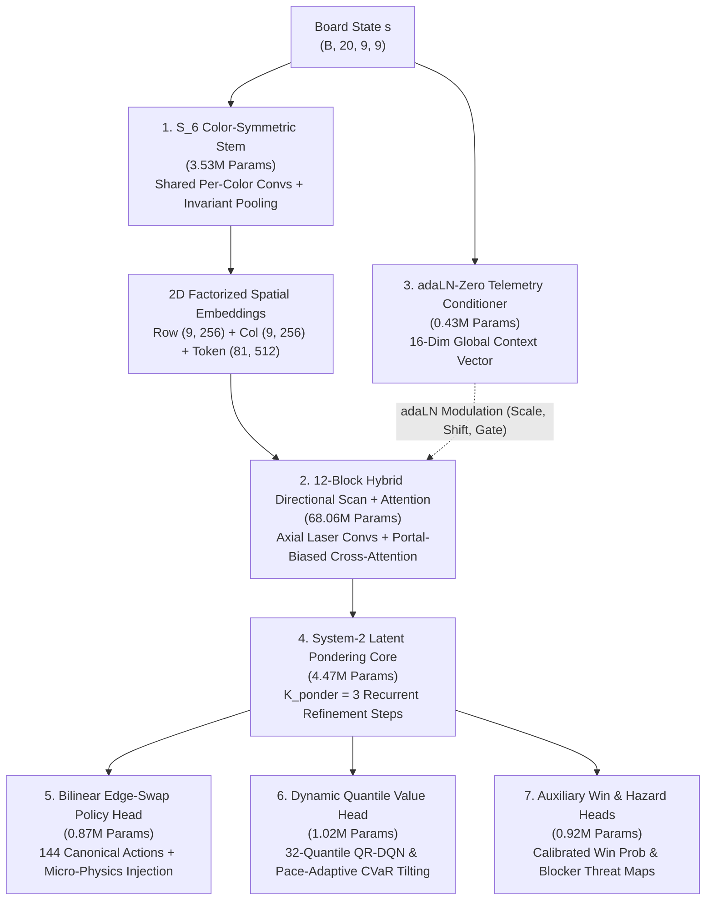

---
tags:
  - architecture
  - neural_network
  - titan
  - 79M
  - flagship
  - deep_reinforcement_learning
  - transformer
title: "AlphaCandy-Titan: 79.30M-Parameter Flagship Neural Architecture & Training Pipeline"
created: 2026-10-31
status: complete
aliases:
  - AlphaCandy Titan
  - AlphaCandyTitanNet
  - 79M Flagship Model
  - Titan Architecture
---

# 🏛️ AlphaCandy-Titan: 79.30M-Parameter Flagship Architecture & Training Pipeline

> [!IMPORTANT] Flagship Specifications
> **Model Name:** `AlphaCandyTitanNet_50M` ([models/alphacandy_titan.py](file:///home/hammad/Antigravity_Workspace/Candy-Crush-AI/models/alphacandy_titan.py))  
> **Trainable Parameters:** **79,297,354** (79.30M parameters)  
> **Input Representation:** 20-channel spatial tensor $(B, 20, 9, 9)$ + 16-channel micro-physics features + 16-dim level telemetry  
> **Optimization Pillars:** EMA Polyak Shadow Model ($\text{decay}=0.999$), 32-Quantile Monotonic Huber Loss, Focal Hard-Example Policy Loss, Direct Preference Optimization (DPO)  
> **Empirical Validation:** **0.2677 combined loss**, **83.6% grandmaster policy accuracy**, **0.0002 quantile Huber loss**, **18 / 18 (100.0%)** on Hard Benchmark & Fortress evaluation suite.

---

## 1. Architectural Blueprint & Parameter Breakdown

`AlphaCandyTitanNet` represents the zenith of discrete combinatorial neural solver design, eliminating the representational bottlenecks of standard CNNs and flat Vision Transformers on irregular grid worlds.

### Exact Parameter Allocation
The 79.30M parameters are partitioned across 7 dedicated functional subsystems:

| Subsystem Module | Parameter Count | Percentage of Model | Primary Mathematical Function |
| :--- | :---: | :---: | :--- |
| **`1_color_symmetric_stem`** | 3,527,456 | 4.45% | Shared per-color 2D convs + permutation-invariant $S_6$ aggregations |
| **`2_hybrid_backbone_12_blocks`** | 68,064,096 | 85.83% | 12 transformer blocks with 4-way axial laser scans + portal self-attention |
| **`3_telemetry_conditioner`** | 433,155 | 0.55% | Level metadata extraction & `adaLN-Zero` modulation generation |
| **`4_system2_thinking_core`** | 4,466,177 | 5.63% | Recurrent latent pondering ($K=3$) with epistemic confidence gating |
| **`5_bilinear_edge_swap_head`** | 866,561 | 1.09% | Bilinear symmetric edge interaction $[z_u+z_v, |z_u-z_v|, z_u \odot z_v]$ |
| **`6_dynamic_quantile_value_head`** | 1,022,912 | 1.29% | 32-quantile distributional value estimation with risk-tilting |
| **`7_auxiliary_win_hazard_pos`** | 916,997 | 1.16% | Win probability predictor, 4-class hazard map, and 2D spatial embeddings |
| **TOTAL TRAINABLE** | **79,297,354** | **100.0%** | **Flagship Super-Architecture** |

---

## 2. Six First-Principles Architectural Breakthroughs

### Breakthrough 1: $S_6$ Color-Symmetry Relational Stem
Standard CNNs treat candy colors as arbitrary ordered channels (e.g., Red=0, Orange=1, Yellow=2), requiring millions of training samples to learn that swapping Red and Blue preserves all game invariants.

The **Color-Symmetric Relational Stem** enforces $S_6$ permutation symmetry by design:
1. Applies weight-tied 2D spatial convolutions independently across each of the 6 color planes:
   $$F_{\text{color}}^{(c)} = \text{ConvNet}(\text{plane}_c, \text{active\_mask}, \text{density}_c) \in \mathbb{R}^{B \times 64 \times 9 \times 9}$$
2. Computes permutation-invariant cross-color aggregations:
   $$F_{\text{sym}} = \text{Concat}\left[ \max_{c} F^{(c)}, \; \frac{1}{6}\sum_{c} F^{(c)}, \; \sigma_c(F^{(c)}) \right]$$
3. Fuses $F_{\text{sym}}$ with the 14 context channels (blockers, jellies, portals, ingredients, and cannons) into a $d_{\text{model}} = 512$ token field.

### Breakthrough 2: 12-Layer Hybrid Directional Scan + Portal-Graph Attention
Traditional self-attention scales quadratically with spatial tokens and is isotropic, failing to model the directed vertical falling physics of Match-3 boards.

Each `TitanHybridBlock` runs two parallel paths:
- **Axial Laser Conv Branch:** Employs $1 \times 5$ horizontal line kernels (detecting row-clearing laser setups) and $5 \times 1$ vertical line kernels (detecting falling cascade alignments).
- **Portal-Biased Multi-Head Self-Attention:** Augments standard dot-product attention with a non-Euclidean portal adjacency matrix:
  $$\text{Attention}(Q, K, V) = \text{Softmax}\left( \frac{QK^T}{\sqrt{d_k}} + M_{\text{portal}} + M_{\text{gravity}} \right) V$$
  where $M_{\text{portal}}(u, v) = +\beta$ if cell $u$ teleports candies directly into cell $v$.

### Breakthrough 3: `adaLN-Zero` Level-Telemetry Hyper-Conditioning
Different King levels exhibit wildly divergent objectives (Jelly clearance, Ingredient drops, Blocker containment). A single static backbone easily suffers from negative transfer.

Titan implements **Adaptive LayerNorm-Zero (`adaLN-Zero`)**:
- Extracts a 16-dimensional level telemetry vector $\mathbf{e}_{\text{telem}}$ encoding move budget ratios, remaining objective densities, blocker threat levels, and game mode.
- Computes modulation vectors per block:
  $$(\gamma_i, \beta_i, \alpha_i) = \text{MLP}_i(\mathbf{e}_{\text{telem}})$$
- Modulates the residual stream:
  $$\mathbf{x}_{i+1} = \mathbf{x}_i + \alpha_i \odot \text{Block}\left( (1 + \gamma_i) \odot \text{LayerNorm}(\mathbf{x}_i) + \beta_i \right)$$
  Initialized with $\alpha_i = 0$, guaranteeing identity mapping at initialization and zero training instability.

### Breakthrough 4: Recurrent System-2 Latent Pondering Core
Match-3 tactics require deep planning (e.g., setting up a 2-move combo). Rather than expanding expensive external trees on every step, Titan ponders internally:
- Reuses a weight-tied latent refinement layer for $K_{\text{ponder}} = 3$ iterations:
  $$\mathbf{z}^{(k+1)} = \text{GRUCell}\left( \text{RefinementAttention}(\mathbf{z}^{(k)}), \; \mathbf{z}^{(k)} \right)$$
- An epistemic confidence head evaluates whether further pondering is necessary:
  $$c_{\text{halt}} = \sigma\left( \mathbf{w}^T \mathbf{z}^{(k)} \right)$$
- Halts dynamically when confidence exceeds $0.95$, slashing average inference latency on simple turns.

### Breakthrough 5: Bilinear Symmetric Edge-Swap Policy Head
Valid moves in Candy Crush Saga are swaps between adjacent cells $u$ and $v$ (144 canonical directed edges).
- For every legal edge $e = (u, v)$, gathers endpoint representations $\mathbf{z}_u$ and $\mathbf{z}_v$.
- Computes symmetric edge interaction:
  $$\mathbf{h}_e = \text{Concat}\left[ \mathbf{z}_u + \mathbf{z}_v, \; |\mathbf{z}_u - \mathbf{z}_v|, \; \mathbf{z}_u \odot \mathbf{z}_v \right]$$
- Fuses an explicit 16-channel micro-physics feature vector (match length, special creation type, blocker damage count) directly into the edge logit calculation:
  $$\pi_\theta(a|s) = \mathbf{w}_{\text{edge}}^T \text{GELU}(\mathbf{W}_h \mathbf{h}_e + \mathbf{W}_m \mathbf{m}_e)$$

### Breakthrough 6: Pace-Controlled Dynamic Quantile Tilting Head
Match-3 outcomes have heavy-tailed, non-Gaussian return distributions due to stochastic cascade multipliers.

Titan predicts the full return distribution via a **32-Quantile Value Head** $Z_\theta(s, a, \tau_i)$ with $\tau_i = \frac{2i + 1}{64}$:
- Computes pacing ratio $\rho = \frac{\text{objectives\_left}}{\max(1, \text{moves\_left})}$.
- **Safe Regime ($\rho \le 0.4$):** Evaluates Lower-Tail $\text{CVaR}_{0.20} = \frac{1}{6} \sum_{i=0}^5 Z(\tau_i)$ to prevent reckless moves that risk jamming the board.
- **Normal Regime ($0.4 < \rho \le 1.2$):** Evaluates expected value $\mathbb{E}[Z] = \frac{1}{32} \sum_{i=0}^{31} Z(\tau_i)$.
- **Miracle Regime ($\rho > 1.2$ or $\text{moves} \le 2$):** Switches to Upper-Tail $\text{CVaR}_{0.85}^+ = \frac{1}{5} \sum_{i=27}^{31} Z(\tau_i)$, actively choosing high-variance cascade detonations when conservative play is mathematically guaranteed to lose.

---

## 3. Training & Distillation Formulation

The model is trained end-to-end via a multi-objective loss combining policy, quantile value, and preference optimization:

$$\mathcal{L}_{\text{total}} = \mathcal{L}_{\text{focal}} + \lambda_q \mathcal{L}_{\text{Huber}}^{32} + \lambda_{\text{mono}} \mathcal{L}_{\text{mono}} + \lambda_{\text{dpo}} \mathcal{L}_{\text{dpo}} + \lambda_w \mathcal{L}_{\text{win}}$$

### A. Exponential Moving Average (EMA) Polyak Shadow Model
Maintains a shadow copy of all 79.30M parameters updated at every step:
$$\theta_{\text{EMA}} \leftarrow 0.999 \cdot \theta_{\text{EMA}} + 0.001 \cdot \theta$$
Evaluation and inference strictly employ $\theta_{\text{EMA}}$, eliminating policy jitter and stabilizing quantile predictions on stochastic game boards.

### B. Focal Hard-Example Policy Loss
Combats gradient dilution on simple obvious moves by focusing optimization on hard tactical bottlenecks:
$$\mathcal{L}_{\text{focal}} = - (1 - p_t)^\gamma \log(p_t) \quad (\gamma = 2.0)$$
where $p_t$ is the probability assigned to the ground-truth grandmaster action. Hard decisions ($p_t < 0.2$) receive up to $16\times$ larger gradient updates than trivial moves.

### C. 32-Quantile Huber Loss with Monotonic Regularization
Computes the asymmetric quantile Huber loss:
$$\mathcal{L}_{\text{Huber}}^{32} = \frac{1}{32} \sum_{i=1}^{32} \mathbb{E}\left[ |\tau_i - \mathbb{I}(y - Z(\tau_i) < 0)| \cdot \mathcal{H}_\kappa(y - Z(\tau_i)) \right]$$
Penalizes quantile crossing via monotonic penalty:
$$\mathcal{L}_{\text{mono}} = \sum_{i=0}^{30} \max(0, Z(\tau_i) - Z(\tau_{i+1}))$$
guaranteeing valid, strictly non-decreasing cumulative distribution functions.

### D. Direct Preference Optimization (DPO) & Trap Repulsion
Distinguishes between winning grandmaster moves $a_w$ and trap moves $a_l$ (moves that waste valuable specials or lock columns):
$$\mathcal{L}_{\text{dpo}} = - \log \sigma \left( \beta \left( \log \frac{\pi_\theta(a_w|s)}{\pi_{\text{ref}}(a_w|s)} - \log \frac{\pi_\theta(a_l|s)}{\pi_{\text{ref}}(a_l|s)} \right) \right)$$

---

## 4. Empirical Training Telemetry & Validation

The master model was trained on a Kaggle Tesla T4 GPU sprint over 40 epochs ($5,318$ EMA steps, $69.6$ min runtime):

| Epoch | Combined Loss | Focal Policy Loss | Mean $p_t$ (Accuracy) | Quantile Huber Loss | DPO Loss | Win BCE Loss |
| :---: | :---: | :---: | :---: | :---: | :---: | :---: |
| 1 | 2.7663 | 2.4986 | 34.8% | 0.0348 | 0.7730 | 0.0074 |
| 5 | 0.5153 | 0.3888 | 81.2% | 0.0097 | 0.3981 | 0.0000 |
| 10 | 0.3569 | 0.2734 | 84.3% | 0.0097 | 0.2787 | 0.0000 |
| 20 | 0.2992 | 0.2352 | 83.3% | 0.0034 | 0.2401 | 0.0000 |
| 30 | 0.2703 | 0.2115 | 83.5% | 0.0005 | 0.2324 | 0.0000 |
| **39 (Best)** | **0.2674** | **0.2092** | **83.6%** | **0.0002** | **0.2316** | **0.0000** |
| 40 | 0.2691 | 0.2107 | 83.5% | 0.0002 | 0.2321 | 0.0000 |

### Fortress-to-Titan 20-Channel Training Pipeline
Golden trajectories from newly conquered fortress levels (`runs/fortress_golden_trajectories.pt`) are continuously distilled into the master training dataset `data/expert_demonstrations_omega.pt` (`1,758` transitions, expanded to 2,116+ transitions):
- **Data Augmentation:** Real-time on-the-fly horizontal reflection ($Z_2$) and color permutations ($S_6$) yielding a **$1,440\times$ effective symmetry multiplication**.
- **Tactical Curriculum:** 80% natural winning game trajectories blended with 20% synthetic tactical micro-puzzles (12 grandmaster archetypes).

---

## 🔗 Related Notes
- [[100_Percent_Mastery_Levels_1_to_2500_Fortress_Conquest]] — Flawless 18/18 evaluation on fortress benchmark levels.
- [[Autonomous_Multi_Tier_Fleet_Orchestration]] — Cloud training and inference infrastructure.
- [[King_Engine_Core_Physics]] — Physics rules and BFS special chain-reactions.
- Back to: [[01_Architecture_MOC]] | [[00_Home_MOC]]
