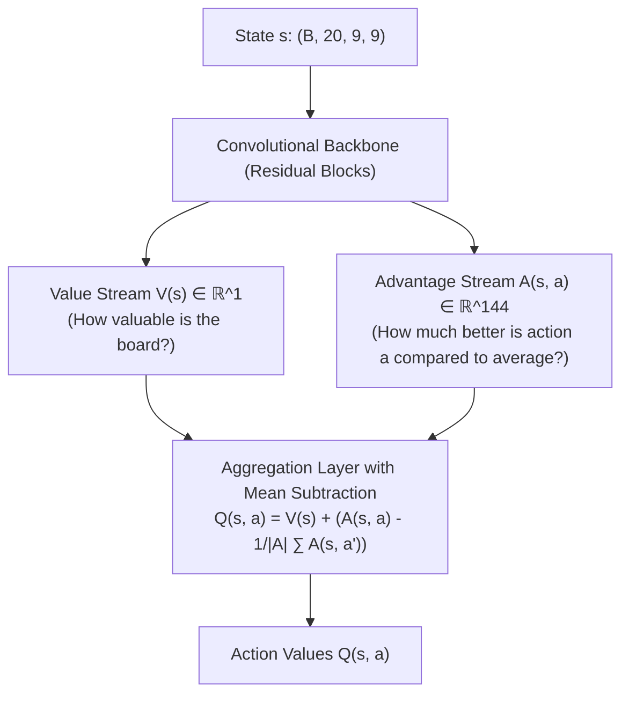

---
tags:
  - architecture
  - dqn
  - deep-q-learning
  - reinforcement-learning
title: "Double Dueling DQN with Prioritized Experience Replay (PER)"
created: 2026-10-25
status: complete
aliases:
  - Double Dueling DQN
  - Candy DQN
---

# 🧠 Double Dueling DQN with PER

> [!NOTE] Implementation Reference
> **Code Module:** [models/candy_dqn.py](file:///home/hammad/Antigravity_Workspace/Candy-Crush-AI/models/candy_dqn.py) & [train_dqn.py](file:///home/hammad/Antigravity_Workspace/Candy-Crush-AI/train_dqn.py)  
> **Trained Checkpoint:** `checkpoints/candy_crush_dueling_dqn.pt` ($8.1\text{ MB}$)

---

## 1. Dueling Architecture Decomposition

Standard Q-networks predict $Q(s, a)$ directly through a single head. In states where almost all legal actions lead to roughly similar outcomes, standard Q-learning struggles to distinguish subtle action advantages.

The **Dueling Network** architecture decouples the state representation into two separate streams:

### The Aggregation Formula
$$Q(s, a; \theta, \alpha, \beta) = V(s; \theta, \beta) + \left(A(s, a; \theta, \alpha) - \frac{1}{|\mathcal{A}|} \sum_{a' \in \mathcal{A}} A(s, a'; \theta, \alpha)\right)$$
Subtracting the mean advantage ensures identifiable parameterization where $V(s) = \max_a Q(s, a)$ when the optimal advantage is normalized.

---

## 2. Double Q-Learning Bellman Target

Standard Q-learning suffers from maximization bias:
$$y^{\text{DQN}} = r + \gamma \max_{a'} Q(s', a'; \theta^{-})$$
**Double DQN** decouples action selection from action evaluation using the online network $\theta$ and target network $\theta^{-}$:
$$a^* = \arg\max_{a'} Q(s', a'; \theta)$$
$$y^{\text{Double}} = r + \gamma Q(s', a^*; \theta^{-})$$

---

## 3. Prioritized Experience Replay (PER)

Transitions are sampled from replay memory with probability proportional to their temporal difference error $\delta_i$:
$$P(i) = \frac{p_i^\alpha}{\sum_k p_k^\alpha} \quad \text{where } p_i = |\delta_i| + \epsilon$$
Importance-sampling weights $w_i = (N \cdot P(i))^{-\beta}$ correct for non-uniform sampling bias during gradient updates.

---

## 🔗 Related Notes
- [[Grandmaster_Unified_Agent]]
- [[AlphaCandy_Spatial_Transformer]]
- [[GRPO_Policy_Value_ResNet]]
- Back to: [[01_Architecture_MOC]]
