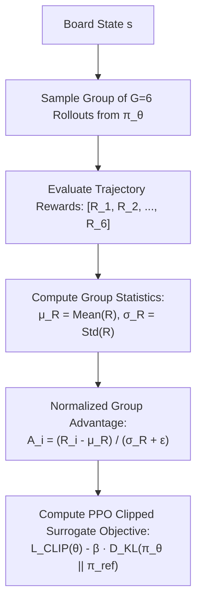

---
tags:
  - architecture
  - grpo
  - policy-gradient
  - reinforcement-learning
title: "Group Relative Policy Optimization (GRPO) Policy-Value ResNet"
created: 2026-10-25
status: complete
aliases:
  - GRPO ResNet
  - Group Relative Policy Optimization
---

# 🧠 GRPO Policy-Value ResNet

> [!NOTE] Implementation Reference
> **Code Module:** [models/network.py](file:///home/hammad/Antigravity_Workspace/Candy-Crush-AI/models/network.py) & [train_grpo.py](file:///home/hammad/Antigravity_Workspace/Candy-Crush-AI/train_grpo.py)  
> **Trained Checkpoint:** `checkpoints/candy_crush_grandmaster_superhuman.pt` ($3.3\text{ MB}$)

---

## 1. Why GRPO for Match-3?

Standard Proximal Policy Optimization (PPO) or Actor-Critic requires training a separate Value Critic network $V_\phi(s)$ to estimate advantage:
$$A(s_t, a_t) = R_t - V_\phi(s_t)$$
In Candy Crush, training an accurate value critic across 23,355 non-stationary levels requires immense parameter capacity.

**Group Relative Policy Optimization (GRPO)** eliminates the separate critic network:
- For each board state $s$, the policy samples a **group of $G$ candidate trajectories** (or rollouts):
  $$\{o_1, o_2, \dots, o_G\} \sim \pi_{\theta_{\text{old}}}(\cdot \mid s)$$
- The reward $R_i$ of each trajectory is normalized against the **group mean and standard deviation**:
  $$\hat{A}_i = \frac{R_i - \text{Mean}(\{R_1, \dots, R_G\})}{\text{Std}(\{R_1, \dots, R_G\}) + \epsilon}$$

---

## 2. Clipped Surrogate Objective & KL Penalty

The policy parameters $\theta$ are updated by maximizing:
$$\mathcal{L}_{\text{GRPO}}(\theta) = \mathbb{E}\left[\frac{1}{G} \sum_{i=1}^G \min\left(r_i(\theta) \hat{A}_i, \text{clip}(r_i(\theta), 1-\epsilon, 1+\epsilon) \hat{A}_i\right) - \beta D_{\text{KL}}(\pi_\theta \parallel \pi_{\text{ref}})\right]$$
where $r_i(\theta) = \frac{\pi_\theta(a_i \mid s)}{\pi_{\theta_{\text{old}}}(a_i \mid s)}$ is the probability ratio, and the KL divergence penalty prevents the policy from collapsing outside the safe optimization trust region.

---

## 3. Checkpoint Performance

- Checkpoint `candy_crush_grandmaster_superhuman.pt` was trained on thousands of GRPO episodes across multi-color King levels, achieving high stability and smooth policy updates.

---

## 🔗 Related Notes
- [[Grandmaster_Unified_Agent]]
- [[Double_Dueling_DQN_PER]]
- [[AlphaCandy_Spatial_Transformer]]
- Back to: [[01_Architecture_MOC]]
