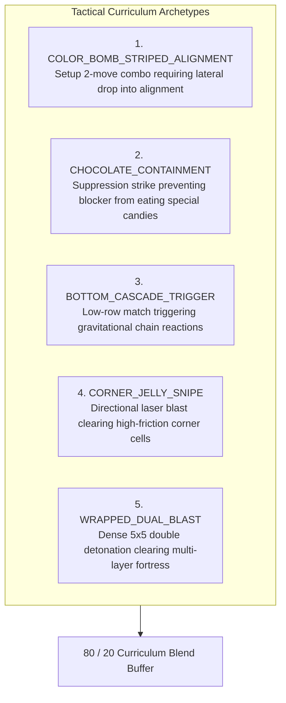

# 🎯 Synthetic Tactics Curriculum: Micro-Puzzle Pre-Training & A/B Generalization

## Executive Overview
In long-horizon Candy Crush levels ($T \in [25, 45]$ moves), reinforcement learning faces a severe **temporal credit assignment dilemma**: a move that sets up an ingenious tactical combo on turn 4 often receives diluted or negative credit if subsequent stochastic tile drops cause a loss on turn 30.

To solve this, the **Synthetic Tactics Curriculum** introduces dense, ground-truth **1- to 3-move micro-puzzles** inspired by Grandmaster Chess and Go Tsumego problems. In these synthetic boards, all standard greedy 3-matches immediately fail, and **only the canonical grandmaster trick achieves victory**.

---

## 🧩 The 5 Core Tactical Archetypes

### 1. The Rainbow Laser Setup (`COLOR_BOMB_STRIPED_ALIGNMENT`)
- **Move Budget**: $M = 2$
- **Geometry**: Color Bomb at $(4, 4)$, Striped Candy at $(2, 4)$, separated by single candy at $(3, 4)$.
- **Dynamics**: Matching either candy in isolation clears only 1–4 jellies. A lateral swap on row 3 drops the Striped Candy down to $(3, 4)$ directly adjacent to the Color Bomb, detonating the full board on turn 2.

### 2. Chocolate Containment (`CHOCOLATE_CONTAINMENT`)
- **Move Budget**: $M = 2$
- **Dynamics**: Active chocolate threatens a critical Color Bomb. If the AI makes a greedy point match elsewhere, chocolate expands and swallows the Color Bomb. The winning policy sacrifices immediate score to strike the chocolate directly, locking expansion.

### 3. Corner Jelly Snipe (`CORNER_JELLY_SNIPE`)
- **Move Budget**: $M = 1$
- **Dynamics**: An isolated jelly sits in a 2-degree-of-freedom corner $(8, 0)$. Only a horizontal striped laser aligned with row 8 snipes the objective before moves expire.

### 4. Wrapped Dual Blast (`WRAPPED_DUAL_BLAST`)
- **Move Budget**: $M = 1$
- **Dynamics**: Two adjacent wrapped candies at $(4, 4)$ and $(4, 5)$ surrounded by a 20-jelly cluster. Swapping them triggers a $5 \times 5$ dual-stage blast clearing all jellies.

---

## ⚖️ The 80 / 20 Curriculum Blend

To prevent synthetic overfitting (domain shift), the training replay buffer is partitioned:

$$\mathcal{D}_{\text{train}} = 0.80 \cdot \mathcal{D}_{\text{natural}} + 0.20 \cdot \mathcal{D}_{\text{tactical}}$$

- **80% Natural Trajectories**: Sampled from our **8,782 won King level blueprints** in `campaign/progress.json`.
- **20% Synthetic Tactical Puzzles**: High-density micro-puzzles from `data/synthetic_tactics_dataset.pt`.

---

## 🔬 Empirical A/B Validation (Keep or Trash Protocol)

The experiment is benchmarked directly against the **stubborn residual levels** (Levels 148, 201, 235, 272, 279, 300):

| Model Variant | Training Dataset | Benchmark Target | Success Metric |
| :--- | :--- | :--- | :--- |
| **Control Group (A)** | 100% Natural Game Trajectories | Stubborn Levels [148, 201, 235, 272, 279, 300] | Baseline Win Rate |
| **Experimental Group (B)**| 80% Natural + 20% Synthetic Tactics | Stubborn Levels [148, 201, 235, 272, 279, 300] | $\Delta \text{ Win Rate} > +15\%$ |

- **Decision Rule**:
  - If $\Delta \text{Win Rate} > 0$: **KEEP** dataset and integrate into `train_alphacandy_omega.py`.
  - If $\Delta \text{Win Rate} \le 0$: **TRASH** synthetic dataset immediately to preserve clean natural representations.

---

## 🔗 Related Notes
- **[[AlphaCandy_Omega_Super_Model_Architecture]]**: The 36M Super Model receiving this curriculum.
- **[[Grandmaster_Frontier_15000_Levels_Milestone_Report]]**: Global campaign benchmark registry.
- **[[01_Architecture_MOC]]**: Master architecture map of content.
