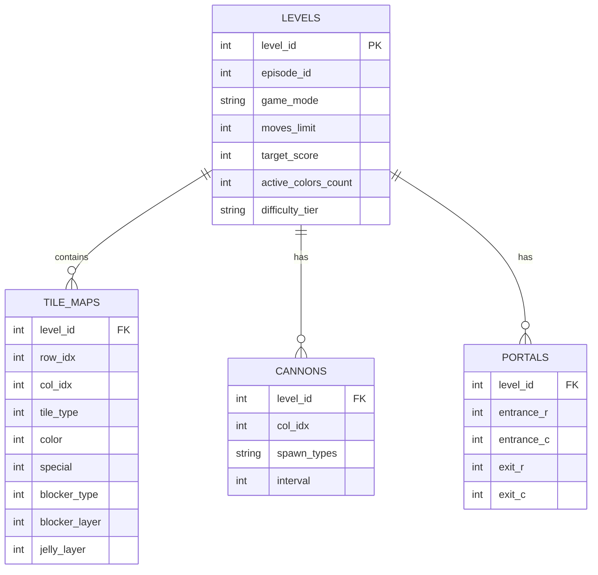

---
tags:
  - database
  - schema
  - sqlite
  - eda
title: "Master 23,355 Level Database Schema and Query APIs"
created: 2026-10-25
status: complete
aliases:
  - Database Schema
  - Level Database
---

# 📊 Master 23,355 Level Database Schema

> [!NOTE] File Location
> **Master Database:** [data/candycrush_master_levels.sqlite](file:///home/hammad/Antigravity_Workspace/Candy-Crush-AI/data/candycrush_master_levels.sqlite) ($55.0\text{ MB}$)  
> **Total Records:** **23,355 Levels Indexed**, with 13,435 full raw grid tile maps and 23,045 verified move limits.

---

## 1. Relational Entity Schema



---

## 2. SQL Table Definitions

### Table: `levels`
```sql
CREATE TABLE IF NOT EXISTS levels (
    level_id INTEGER PRIMARY KEY,
    episode_id INTEGER,
    game_mode TEXT NOT NULL,          -- 'Jelly', 'Ingredients', 'Order', 'Score'
    moves_limit INTEGER NOT NULL,      -- Live move limit
    target_score INTEGER,              -- 1-star target score
    active_colors INTEGER DEFAULT 5,   -- Active colors count (4, 5, or 6)
    difficulty_tier TEXT DEFAULT 'REGULAR', -- 'REGULAR', 'HARD', 'SUPER_HARD', 'NIGHTMARE'
    width INTEGER DEFAULT 9,
    height INTEGER DEFAULT 9
);
CREATE INDEX idx_levels_mode ON levels(game_mode);
CREATE INDEX idx_levels_diff ON levels(difficulty_tier);
```

### Table: `tile_maps`
```sql
CREATE TABLE IF NOT EXISTS tile_maps (
    level_id INTEGER,
    row_idx INTEGER,
    col_idx INTEGER,
    is_active INTEGER DEFAULT 1,      -- 1=playable, 0=void
    candy_color INTEGER DEFAULT 0,    -- 0=random, 1..6=fixed
    special_type INTEGER DEFAULT 0,   -- 1=H-striped, 2=V-striped, 3=Wrapped, 4=ColorBomb
    blocker_type INTEGER DEFAULT 0,   -- 1=Choc, 2=Licorice, 3=Frosting, etc.
    blocker_layers INTEGER DEFAULT 0,
    jelly_layers INTEGER DEFAULT 0,   -- 1=single, 2=double
    PRIMARY KEY (level_id, row_idx, col_idx),
    FOREIGN KEY (level_id) REFERENCES levels(level_id)
);
```

---

## 3. High-Performance Python Query API

The database is loaded through [core/king_level_loader.py](file:///home/hammad/Antigravity_Workspace/Candy-Crush-AI/core/king_level_loader.py):

```python
from core.king_level_loader import KingLevelLoader

loader = KingLevelLoader()
config = loader.load_level(250)

print(f"Level {config.level_id} | Mode: {config.level_type.name} | Moves: {config.moves_limit}")
print(f"Active Grid Shape: {config.height}x{config.width} | Voids: {config.void_count}")
```

---

## 🔗 Related Notes
- [[Exploratory_Data_Analysis_Insights]]
- [[Difficulty_Tier_Classification]]
- [[King_Engine_Core_Physics]]
- Back to: [[04_Level_Database_and_EDA_MOC]]
