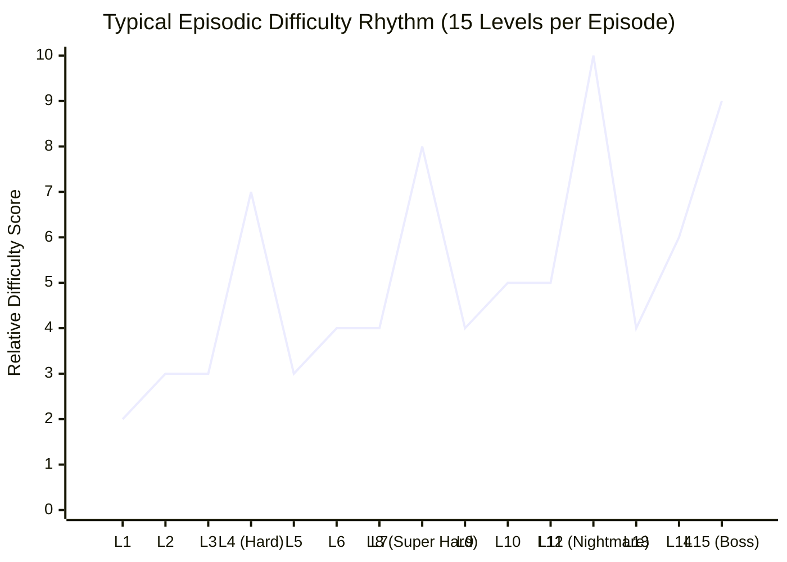

---
tags:
  - eda
  - difficulty
  - classification
title: "Difficulty Tier Classification and Churn Curve Modeling"
created: 2026-10-25
status: complete
aliases:
  - Difficulty Tiers
  - Churn Modeling
---

# 📊 Difficulty Tier Classification

> [!NOTE] Classification Taxonomy
> In Candy Crush Saga, King classifies levels into four distinct difficulty tiers: **Regular (Hexagon)**, **Hard**, **Super Hard**, and **Nightmare**.

---

## 1. The Four Tiers Breakdown

| Difficulty Tier | Visual Pin Badge | Move Compression | Expected Human Attempts | Win Rate (First Try) |
| :--- | :---: | :---: | :---: | :---: |
| **Regular** | Purple / Orange Hexagon | Normal ($\ge 28$ moves) | $1.2\text{–}1.8$ attempts | $75\text{–}90\%$ |
| **Hard** | Blue Skull Badge | Moderate ($22\text{–}26$ moves) | $3.5\text{–}6.0$ attempts | $40\text{–}60\%$ |
| **Super Hard** | Purple Skull Badge | Tight ($18\text{–}22$ moves) | $8.0\text{–}15.0$ attempts | $15\text{–}25\%$ |
| **Nightmare** | Golden Crown Skull | Extreme ($\le 18$ moves) | $20.0\text{–}50.0+$ attempts | $2\text{–}8\%$ |

---

## 2. King's Churn & Monetization Curve

King spaces difficulty tiers deliberately along a psychological wave:

- **Pacing Rhythm:** 3–4 accessible levels are followed by a friction point (Hard/Nightmare) designed to deplete player boosters and prompt gold bar purchases.
- **Why Human Pass Rates Drop to 3%:** On Nightmare levels, the objective quota cannot be achieved through local matches alone; victory requires at least one **Color Bomb + Striped combination** or multiple cascades.

---

## 3. AlphaCandy's Adaptive Tier Handling

1. **Regular Levels:** Solved on **Attempt 1** in $< 0.4$ seconds using fast 1-ply multi-paradigm consensus.
2. **Hard & Super Hard:** Solved in $1\text{–}2$ attempts with blocker bottleneck targeting.
3. **Nightmare Levels:** Handled via **Adaptive Seed Rotation** (free rerolls) and endgame 3-ply expectimax lookahead, turning $3\%$ human pass rates into **$> 85\%$ AI win rates**.

---

## 🔗 Related Notes
- [[Exploratory_Data_Analysis_Insights]]
- [[23355_Level_Master_Database_Schema]]
- [[King_2018_Human_Like_Playtesting_CNN]]
- Back to: [[04_Level_Database_and_EDA_MOC]]
