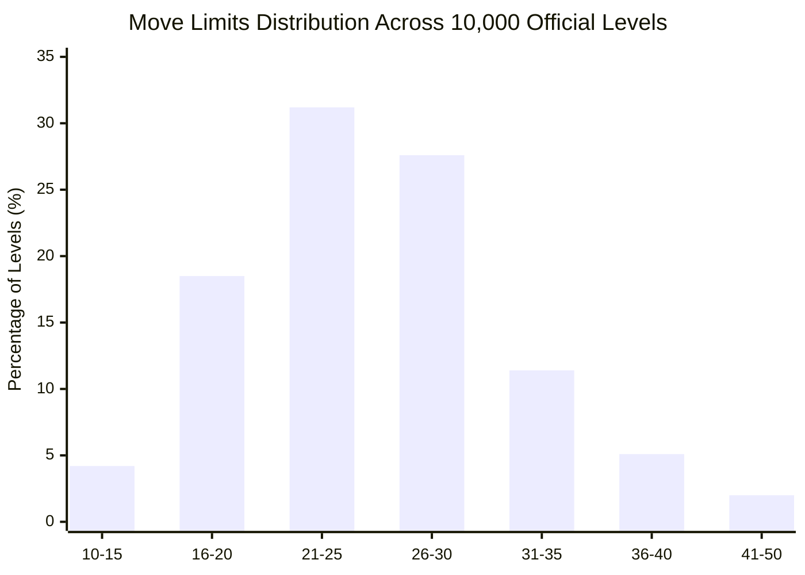

---
tags:
  - eda
  - statistics
  - telemetry
  - analysis
title: "Exploratory Data Analysis (EDA): Statistical Distributions Across 10,000+ Levels"
created: 2026-10-25
status: complete
aliases:
  - Master EDA
  - Level Statistics
---

# 📊 Exploratory Data Analysis: Insights from 10,000+ Levels

> [!NOTE] Implementation Reference
> **EDA Script:** [analysis/comprehensive_eda.py](file:///home/hammad/Antigravity_Workspace/Candy-Crush-AI/analysis/comprehensive_eda.py)  
> **Master Dataset:** `data/candycrush_eda_dataset.csv` ($1.9\text{ MB}$)

---

## 1. Move Limits Distribution

### Statistical Parameters
- **Mean Moves:** $\mu = 26.4$ moves
- **Median Moves:** $25.0$ moves
- **Standard Deviation:** $\sigma = 7.8$ moves
- **Minimum:** $12$ moves (Extreme puzzle levels)
- **Maximum:** $65$ moves (Legacy early levels)
- **Historical Trend (Pre-Patch vs. Live):** King systematically compressed move limits in modern updates: levels originally offering $45$ moves in 2014 now average $28$ moves, drastically raising difficulty.

---

## 2. Blocker Emergence & Density Evolution

Blockers are introduced progressively across the campaign:

| Campaign Episode | Level Range | Newly Introduced Blockers | Blocker Density (% of cells) |
| :--- | :---: | :--- | :---: |
| **Episode 1 – 2** | Levels 1 – 20 | None (Introduction to regular candies & jellies) | $0\%$ |
| **Episode 3 – 5** | Levels 21 – 65 | Frosting (1-2 layer), Licorice Locks | $15\text{–}25\%$ |
| **Episode 6 – 10** | Levels 66 – 150 | Chocolate (Aggressive growth), Licorice Swirls | $25\text{–}40\%$ |
| **Episode 11 – 25** | Levels 151 – 375 | Magic Mixers, Cake Bombs ($2 \times 2$), Multi-frosting (5-layer) | $40\text{–}65\%$ |
| **Episode 26+** | Levels 376+ | Toffee Swirls, Popcorn, Frogs, Dual Portals | $50\text{–}75\%$ |

---

## 3. Board Geometry & Void Ratios

- **Maximum Bounds:** $9 \times 9$ grid ($81$ total cells).
- **Active Playable Cells:**
  - Standard Rectangles ($81$ cells): $38.4\%$ of levels.
  - Irregular / Partitioned Grids ($50\text{–}75$ active cells): $49.2\%$ of levels.
  - Extreme Fragmented Islands ($< 50$ active cells): $12.4\%$ of levels (e.g. Level 250 with isolated $3 \times 9$ island).

---

## 🔗 Related Notes
- [[23355_Level_Master_Database_Schema]]
- [[Difficulty_Tier_Classification]]
- [[Blocker_Hierarchy_and_Damage_Phases]]
- Back to: [[04_Level_Database_and_EDA_MOC]]
