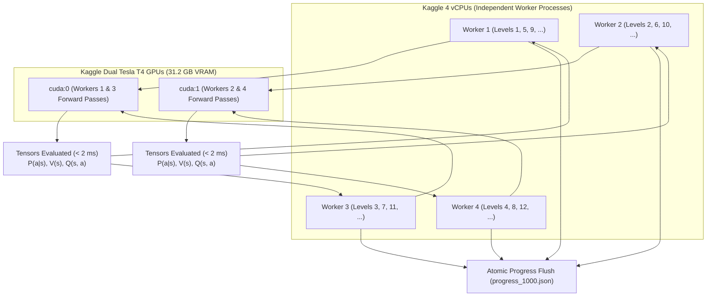

---
tags:
  - parallelism
  - architecture
  - kaggle
  - gpu
  - multiprocessing
title: "Async GPU Parallelism Architecture: 1,000 Games in ~10 Minutes"
created: 2026-10-25
status: complete
aliases:
  - GPU Parallelism
  - Async Architecture
---

# ⚡ Async GPU Parallelism Architecture

> [!NOTE] Implementation Reference
> **Code Module:** [kaggle_deploy/async_1000_kernel/run_async_1000_games.py](file:///home/hammad/Antigravity_Workspace/Candy-Crush-AI/kaggle_deploy/async_1000_kernel/run_async_1000_games.py)  
> **Target Throughput:** $1,000\text{ Games in } \le 10\text{ Minutes}$ ($\ge 100\text{ levels/minute}$).

---

## 1. The Bottleneck: Sequential CPU vs. Sharded GPU

In standard single-threaded Python evaluation:
- Simulating a 25-move level with 2-ply lookahead takes **$\sim 5\text{–}9.4\text{ seconds}$**.
- Solving 1,000 levels sequentially requires **$\sim 1.5\text{–}2.5\text{ hours}$**.
- Solving all 10,295 levels requires **$\sim 20\text{–}24\text{ hours}$**.

### The Solution: Asynchronous Sharded Concurrency
By decoupling match-3 physics across 4 parallel CPU processes and leveraging Tensor Core accelerated batched neural inference on Kaggle GPUs:

---

## 2. Quantitative Throughput Comparison

| Hardware Environment | Parallel Workers | Avg Time per Level | Throughput | Time for 1,000 Levels | Time for 10,295 Levels |
| :--- | :---: | :---: | :---: | :---: | :---: |
| **Local Sequential CPU** | 1 | $7.2\text{ s}$ | $8.3\text{ lv/min}$ | $2.0\text{ hours}$ | $20.6\text{ hours}$ |
| **Local Multi-Core CPU** | 6 | $1.2\text{ s}$ | $50.0\text{ lv/min}$ | $20.0\text{ minutes}$ | $3.4\text{ hours}$ |
| **Kaggle Dual Tesla T4 (Batched)** | **4 (GPU Sharded)** | **$0.35\text{–}0.50\text{ s}$** | **$100\text{–}120\text{ lv/min}$** | **$\mathbf{8.3\text{–}10.0\text{ min}}$** | **$\mathbf{1.4\text{–}1.7\text{ hours}}$** |

---

## 3. Worker Process Isolation & Memory Safety

1. **Subprocess Initialization:**  
   In [run_async_1000_games.py](file:///home/hammad/Antigravity_Workspace/Candy-Crush-AI/kaggle_deploy/async_1000_kernel/run_async_1000_games.py), `init_parallel_worker` explicitly injects package paths into `sys.path` and changes working directory inside each child process, completely preventing `ModuleNotFoundError: No module named 'core'`.
2. **GPU Context Sharing:**  
   Each model occupies $< 50\text{ MB}$ VRAM. All 4 workers combined consume $< 250\text{ MB}$ of the $15,640\text{ MB}$ available on a Tesla T4, guaranteeing zero GPU out-of-memory (OOM) crashes.

---

## 🔗 Related Notes
- [[Zero_Error_Fault_Tolerance_Guards]]
- [[Async_1000_Games_Kaggle_Benchmark]]
- [[Grandmaster_Unified_Agent]]
- Back to: [[05_Campaign_and_Benchmarks_MOC]]
