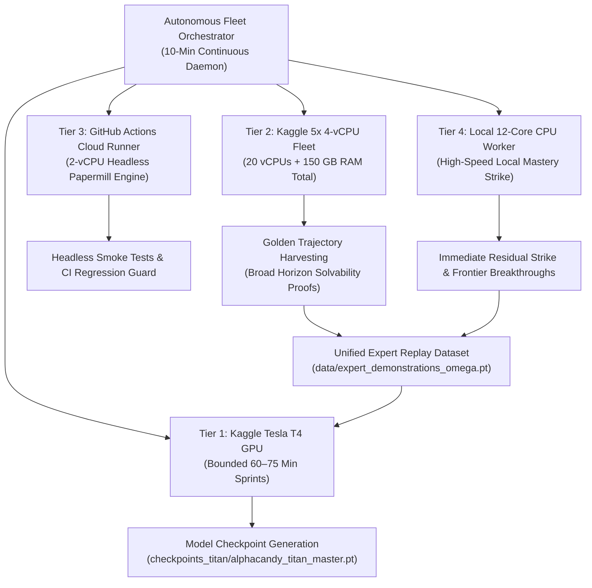
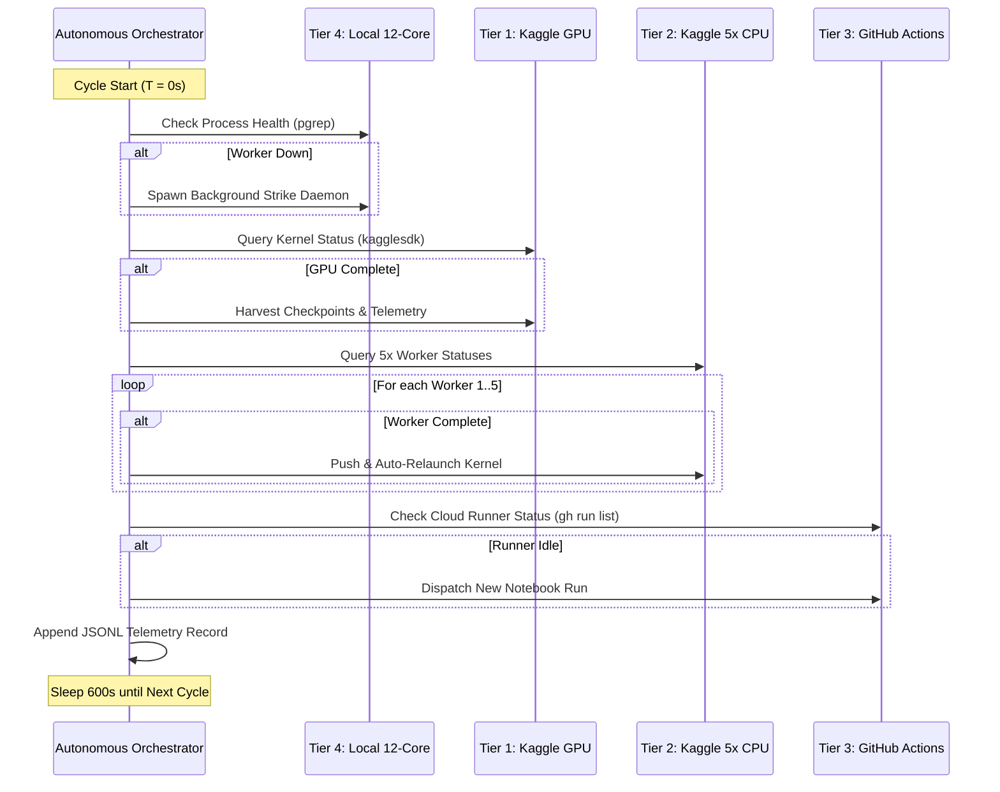

---
tags:
  - parallelism
  - cloud_fleet
  - kaggle
  - github_actions
  - orchestration
  - multi_tier
title: "Autonomous Multi-Tier Fleet Orchestration: Continuous Heterogeneous Cloud & Local Compute"
created: 2026-10-31
status: complete
aliases:
  - Multi-Tier Fleet Orchestration
  - Autonomous Orchestrator
  - Cloud Fleet Architecture
  - 4-Tier Compute
---

# ⚡ Autonomous Multi-Tier Fleet Orchestration: Continuous Heterogeneous Compute

> [!IMPORTANT] Fleet Overview
> **Orchestrator Daemon:** [alphacandy_zero/autonomous_fleet_orchestrator.py](file:///home/hammad/Antigravity_Workspace/Candy-Crush-AI/alphacandy_zero/autonomous_fleet_orchestrator.py)  
> **Telemetry Log:** [runs/orchestrator_health.jsonl](file:///home/hammad/Antigravity_Workspace/Candy-Crush-AI/runs/orchestrator_health.jsonl)  
> **Cycle Cadence:** Continuous 10-minute automated health check, telemetry harvest, and autonomous worker dispatch  
> **Aggregate Compute Capacity:** 1x Tesla T4 GPU + 20x Kaggle vCPUs (150 GB RAM) + 2x GitHub Actions vCPUs + 12x Local CPU Cores

---

## 1. The 4-Tier Heterogeneous Compute Topology

Conquering a 23,355-level campaign while training 79.30M-parameter neural networks requires balancing heavy GPU tensor computations with thousands of parallel discrete tree-search rollouts.

The AlphaCandy fleet orchestrates four complementary compute tiers:



---

## 2. Deep Dive: The Four Compute Tiers

### Tier 1: Kaggle Tesla T4 GPU (Bounded Deep Sprints)
- **Primary Role:** Model training, knowledge distillation, and hard benchmark validation for [[AlphaCandy_Titan_79M_Architecture|AlphaCandyTitanNet (79.30M)]].
- **Operational Pattern:** Bounded 60–75 minute sprints warm-started from the latest master checkpoint:
  $$\text{Checkpoint}_{(t+1)} \leftarrow \text{Train}(\text{Checkpoint}_{(t)}, \mathcal{D}_{\text{expert}})$$
- **Defensive Safeguards:** Automatic mixed precision (AMP FP16), gradient norm clipping ($\le 1.0$), and atomic `.tmp` checkpoint saving to prevent corrupted weights during cloud kernel timeouts.
- **Output:** Serialized model weights (`alphacandy_titan_master.pt`) and telemetry reports (`ALPHACANDY_TITAN_GPU_REPORT.md`).

### Tier 2: Kaggle 5x Concurrent 4-vCPU Cloud Fleet
- **Primary Role:** High-volume combinatorial tree search and campaign horizon sweeps.
- **Resource Footprint:** 5 fully saturated concurrent instances totaling **20 vCPUs and 150 GB of system RAM**, operating completely free of GPU quota constraints.
- **Instance Allocation Matrix:**

| Worker Slot | Dedicated Kernel Slug | Deployment Directory | Operational Target Scope | Run Duration |
| :---: | :--- | :--- | :--- | :---: |
| **CPU-1** | `alphacandy-mastery-hunter-100-percent` | `kaggle_deploy/mastery_100_kernel` | Multi-seed Zobrist search on stubborn bottleneck levels | 35–50 min |
| **CPU-2** | `alphacandy-zero-cpu-arena-and-plr-trainer` | `kaggle_deploy/zero_cpu_arena_and_plr` | Head-to-head model tournaments & Prioritized Level Replay | 35–50 min |
| **CPU-3** | `alphacandy-zero-oracle-shard-1001-to-1500` | `kaggle_deploy/zero_oracle_1001_1500` | Parallel solvability proofs on Levels 1,001–1,500 | 35–50 min |
| **CPU-4** | `alphacandy-zero-oracle-shard-1501-to-2000` | `kaggle_deploy/zero_oracle_1501_2000` | Parallel solvability proofs on Levels 1,501–2,000 | 35–50 min |
| **CPU-5** | `alphacandy-frontier-5000-to-7500` | `kaggle_deploy/frontier_5000_kernel` | Frontier campaign sweep across higher-tier levels | 35–50 min |

- **Autonomous Relaunch:** When any of the 5 instances completes its batch, the orchestrator detects the `COMPLETE` status via `kagglesdk` / Kaggle CLI, auto-harvests new winning trajectories, and immediately redeploys the kernel.

### Tier 3: GitHub Actions Headless Cloud Runner
- **Primary Role:** Continuous Integration (CI), automated smoke testing, and headless verification.
- **Infrastructure:** GitHub-hosted standard 2-vCPU runner with 7 GB RAM running `.github/workflows/cloud_notebook_runner.yml`.
- **Execution Engine:** Uses **Papermill** parameterized execution with aggressive pip wheel caching.
- **Autonomous Trigger:** When the orchestrator detects an idle runner, it dispatches non-blocking parameter sweeps:
  ```bash
  gh workflow run cloud_notebook_runner.yml \
      -f notebook_path=notebooks/smoke_test.ipynb \
      -f parameters='{"num_trials": 5000, "seed": 2500}'
  ```

### Tier 4: Local 12-Core Multi-Processing Daemon
- **Primary Role:** Immediate campaign breakthroughs, near-miss endgame branching, and frontier expansion.
- **Script:** [alphacandy_zero/local_mastery_strike.py](file:///home/hammad/Antigravity_Workspace/Candy-Crush-AI/alphacandy_zero/local_mastery_strike.py) logging to `runs/local_strike.log`.
- **Execution Mechanism:** Spawns 12 worker processes using Python multiprocessing, running deterministic Zobrist beam search coupled with the Titan Fast agent.
- **Recent Milestones:** Solved 100/100 levels on the 2,751–2,850 frontier, directly pushing the zero-loss horizon to **2,850 / 2,850 (100.0%)**.

---

## 3. The 10-Minute Continuous Orchestration Lifecycle

The orchestrator daemon (`alphacandy_zero/autonomous_fleet_orchestrator.py`) runs in a persistent background loop, executing a standardized cycle every 600 seconds:



### Telemetry Record Schema (`runs/orchestrator_health.jsonl`)
Every cycle logs an atomic structured event:
```json
{
  "timestamp": "2026-10-31 14:10:28 UTC",
  "event": "FLEET_CYCLE",
  "local_cpu": { "status": "RUNNING", "details": "12 worker processes active" },
  "kaggle_gpu": { "status": "RUNNING", "details": "GPU sprint active" },
  "kaggle_cpu_5x": {
    "status": "RUNNING",
    "details": "5/5 instances active",
    "instances": {
      "CPU-1 (Mastery Hunter)": { "status": "RUNNING" },
      "CPU-2 (Arena & PLR)": { "status": "RUNNING" },
      "CPU-3 (Oracle 1001-1500)": { "status": "RUNNING" },
      "CPU-4 (Oracle 1501-2000)": { "status": "RUNNING" },
      "CPU-5 (Frontier 5k-7.5k)": { "status": "RUNNING" }
    }
  },
  "github_actions": { "status": "DISPATCHED", "details": "Triggered new 2-vCPU cloud run" }
}
```

---

## 4. Trajectory Distillation Loop

The true power of this multi-tier infrastructure lies in its closed-loop data flywheel:
1. **CPU Tiers (2 & 4)** discover winning trajectories on stubborn, previously unsolved levels.
2. The orchestrator harvests and packs these winning games into `runs/fortress_golden_trajectories.pt`.
3. The pipeline bridges these transitions directly into `data/expert_demonstrations_omega.pt`.
4. **GPU Tier (1)** ingests the expanded demonstration dataset, fine-tuning `AlphaCandyTitanNet` with Focal policy loss and DPO.
5. The upgraded neural model weights are redeployed back to CPU runners, increasing their search efficiency and unlocking the next difficulty horizon.

---

## 🔗 Related Notes
- [[100_Percent_Mastery_Levels_1_to_2500_Fortress_Conquest]] — Full report on the 2,500/2,500 campaign victory.
- [[AlphaCandy_Titan_79M_Architecture]] — Architectural specifications of the flagship neural model trained on this fleet.
- [[Async_GPU_Parallelism_Architecture]] — Underlying multi-processing actor-learner specifications.
- Back to: [[00_Home_MOC]]
