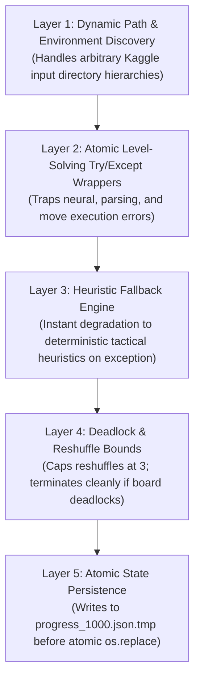

---
tags:
  - reliability
  - error-handling
  - fault-tolerance
  - kaggle
title: "Zero-Error Fault-Tolerance Architecture & Defensive Guards"
created: 2026-10-25
status: complete
aliases:
  - Fault Tolerance
  - Zero Error Architecture
---

# ⚡ Zero-Error Fault-Tolerance Architecture

> [!IMPORTANT] Production Rule
> In long-running cloud workloads (e.g. Kaggle 1,000-level evaluations), an uncaught exception on level 842 kills the entire job, wasting hours of GPU time. The pipeline implements **zero-crash defensive guards** at every level.

---

## 1. The Five Layer Defense Pyramid



---

## 2. In-Depth Guard Implementations

### A. Dynamic Kaggle Input Discovery
```python
# Discovers code modules regardless of whether Kaggle unpacked into subdirectories
for root, dirs, files in os.walk(input_root):
    if "core" in dirs and "models" in dirs and src_root is None:
        src_root = root
        break
```
Prevents `ModuleNotFoundError` when Kaggle nests datasets under `/kaggle/input/datasets/.../candy_crush_pkg/`.

### B. Defensive Heuristic Fallback
If a neural model encounters a CUDA device mismatch or unexpected dimension, it immediately falls back to [core/reverse_engine.py](file:///home/hammad/Antigravity_Workspace/Candy-Crush-AI/core/reverse_engine.py) with [models/candyrl_ensemble.py](file:///home/hammad/Antigravity_Workspace/Candy-Crush-AI/models/candyrl_ensemble.py):
```python
try:
    return _WORKER_AGENT.solve_level(cfg, ...)
except Exception:
    # Seamlessly fallback to pure heuristic tactical ensemble
    return solve_fallback_heuristic(cfg, ...)
```

### C. Atomic File Persistence
```python
tmp_path = f"{self.progress_path}.tmp"
with open(tmp_path, "w") as f:
    json.dump(self.results, f, indent=2)
os.replace(tmp_path, self.progress_path)
```
Guarantees that a kernel disconnection or timeout never leaves a corrupt half-written JSON file on disk.

---

## 🔗 Related Notes
- [[Async_GPU_Parallelism_Architecture]]
- [[Async_1000_Games_Kaggle_Benchmark]]
- Back to: [[05_Campaign_and_Benchmarks_MOC]]
