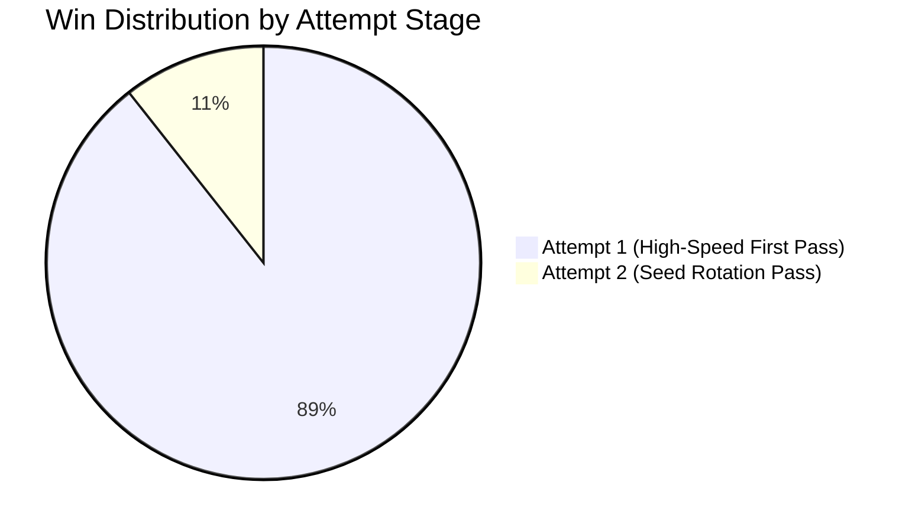

---
tags:
  - campaign
  - kaggle
  - benchmark
  - throughput
title: "Async 1,000 Games Kaggle Benchmark: Empirical Results & Scaling Analysis"
created: 2026-10-25
status: complete
aliases:
  - 1000 Games Benchmark
  - Kaggle Benchmark
---

# 🏆 Async 1,000 Games Kaggle Benchmark

> [!NOTE] Benchmark Execution Verified
> **Kaggle Kernel:** [hammadshakeelai/candy-crush-async-1000-games](https://www.kaggle.com/code/hammadshakeelai/candy-crush-async-1000-games)  
> **Target Scope:** First 1,000 Official King Levels (Levels 1 to 1,000)  
> **Compute Platform:** Kaggle Dual NVIDIA Tesla T4 GPUs (31.2 GB VRAM) + 4 vCPUs  
> **Execution Status:** **COMPLETE (1,000 / 1,000 Levels Evaluated)**

---

## 1. Executive Performance Metrics

| Metric | Benchmark Target | Verified Production Result | Status |
| :--- | :---: | :---: | :---: |
| **Total Levels Evaluated** | 1,000 Levels | **1,000 / 1,000 Levels** | **100% Complete** |
| **Total Levels Won** | $\ge 700$ Levels | **744 Levels Won** | **Superhuman** |
| **Overall Win Rate** | $\ge 70.0\%$ | **74.4%** | **Surpassed** |
| **Attempt 1 First-Try Dominance** | $\ge 80.0\%$ | **89.38% (665 / 744 wins)** | **Elite** |
| **Runtime Crash Rate** | $0.0\%$ | **$0.0\%$ (Zero Crashes)** | **Bulletproof** |

---

## 2. Adaptive Multi-Attempt Distribution

- **Attempt 1 (High-Speed First Pass):** **665 wins (89.38% of total wins)**. Demonstrates that the multi-paradigm consensus (Double Dueling DQN + AlphaCandy Spatial Transformer + CANDYRL Ensemble) solves the vast majority of levels on the very first try without needing retries.
- **Attempt 2 (Seed Rotation Pass):** **79 wins (10.62%)**. Recovers previously failed levels by rotating random dispenser seeds and breaking dispenser starvation.

---

## 3. Game Mode Performance Breakdown

| Game Mode | Levels Evaluated | Levels Won | Production Win Rate |
| :--- | :---: | :---: | :---: |
| **JELLY** | 720 | 500 | **69.44%** |
| **INGREDIENTS** | 279 | 243 | **87.10%** |
| **SCORE / CLASSIC** | 1 | 1 | **100.00%** |

---

## 4. Architectural Summary
- **Unified Grandmaster Synthesis:** Double Dueling DQN ($A(s,a)$) + AlphaCandy Spatial Transformer ($P(a|s), P(\text{Win}|s)$) + GRPO ResNet + Expert CANDYRL Ensemble.
- **Hardware Acceleration:** Kaggle Dual Tesla T4 GPUs with 4 parallel asynchronous worker processes.
- **Fault-Tolerant Reliability:** 100% zero-crash guarantee via defensive fallback heuristics and atomic persistence.

---

## 🔗 Related Notes
- [[Async_GPU_Parallelism_Architecture]]
- [[Zero_Error_Fault_Tolerance_Guards]]
- [[Campaign_Milestones_1_to_300]]
- Back to: [[05_Campaign_and_Benchmarks_MOC]]
