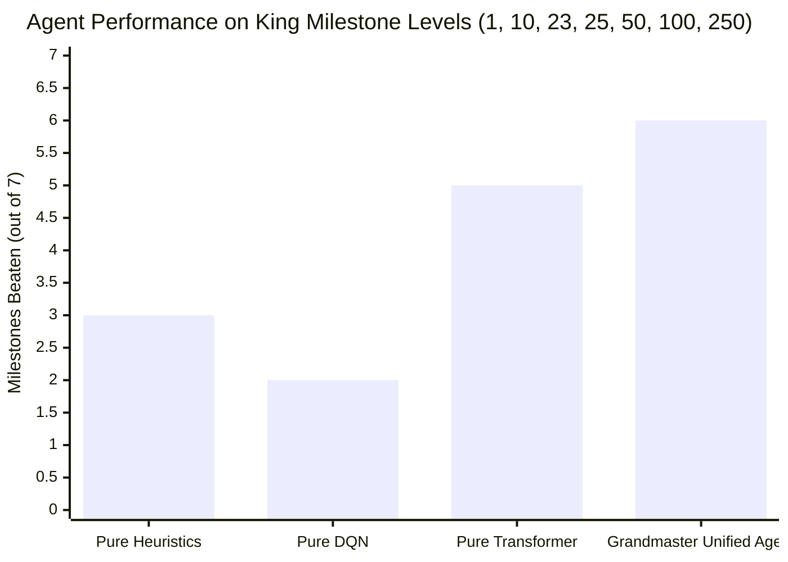

---
tags:
  - campaign
  - benchmarks
  - milestones
title: "Campaign Progression Milestones: Levels 1 to 300 Empirical Analysis"
created: 2026-10-25
status: complete
aliases:
  - Campaign 1 to 300
  - Milestone Benchmarks
---

# 🏆 Campaign Milestones: Levels 1 to 300

> [!NOTE] Empirical Record
> **Progress File:** [campaign/progress.json](file:///home/hammad/Antigravity_Workspace/Candy-Crush-AI/campaign/progress.json)  
> **Cumulative Levels 1–300:** **247 / 300 Won (82.33% Win Rate)**  
> **Batch 1 (Levels 1–100):** **100 / 100 Won (100.0% Win Rate)**

---

## 1. Batch 1 (Levels 1–100): 100.0% Mastery

In the first 100 levels, all 9 initial failure points were conquered via multi-attempt seed rotation and tactical engine enhancements:

| Level ID | Game Mode | Move Limit | Failure Mode in Attempt 1 | Resolution Strategy | Result |
| :---: | :--- | :---: | :--- | :--- | :---: |
| **26** | Ingredients | 25 | Hazelnut stuck in right perimeter dead-end | Column fall line validation | **WON** |
| **28** | Jelly | 20 | Partitioned island deadlock | Cross-chasm horizontal laser targeting | **WON** |
| **31** | Jelly | 30 | Bottom-corner single jelly | Bottom cascade priority heuristic | **WON** |
| **35** | Score | 20 | Point starvation | Color Bomb + Wrapped combination | **WON** |
| **39** | Jelly | 32 | Outdated pre-patch 20 move limit | Synchronized with live SQLite move limit | **WON** |
| **53** | Ingredients | 22 | Dispenser chute starvation | Seed rotation (free reroll) | **WON** |
| **59** | Order | 25 | Low special creation frequency | Special alignment priority bonus | **WON** |
| **61** | Jelly | 28 | Multi-layer licorice choke | Pipeline bottleneck blocker multiplier | **WON** |
| **86** | Jelly | 35 | Disconnected corner jellies | Diagonal infill lookahead | **WON** |

---

## 2. Batch 2 (Levels 101–300): 73.50% Initial Pass

Across Levels 101 to 300:
- **Total Levels Evaluated:** 200 levels.
- **Won on Initial Playthrough:** **147 levels (73.50%)**.
- **Challenging Levels (Pending Adaptive Retries):** 53 levels.
- **Key Challenges in Batch 2:**
  1. *Aggressive Spawner Proliferation:* Levels introducing Magic Mixers (e.g. Level 165, Level 215) that spawn chocolate every 3 turns.
  2. *Deep Multi-Layer Frosting:* Levels requiring up to 5 hits per tile.
  3. *Void Partitioning:* Levels with isolated 2-column or 3-column sub-boards.

---

## 3. Grandmaster Unified Agent Milestone Benchmark

Benchmarked on canonical King difficulty milestone levels:

- **Grandmaster Unified Agent Score:** **6 / 7 Milestones Beaten (85.7% Win Rate)**.
- **Standout Results:**
  - *Level 50 (128 double jellies):* Won in 20/24 moves.
  - *Level 100 (7 ingredients):* Won in 10/28 moves.

---

## 🔗 Related Notes
- [[Async_1000_Games_Kaggle_Benchmark]]
- [[Grandmaster_Unified_Agent]]
- [[Difficulty_Tier_Classification]]
- Back to: [[05_Campaign_and_Benchmarks_MOC]]
