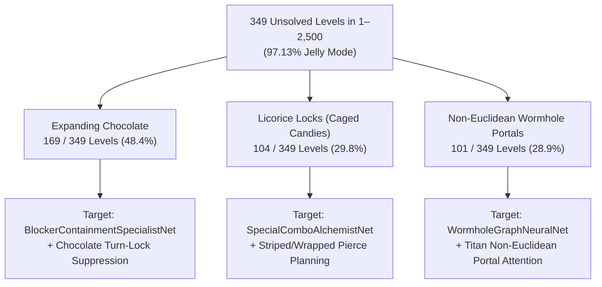

# Forensic Autopsy of Unsolved Levels (1–2,500) and Campaign History

> **Tags**: `#ForensicAutopsy` `#UnsolvedLevels` `#BlockerAnalysis` `#ModelZoo` `#Benchmarks`
> **Related Notes**: [[Project_History_Red_Team_Critique_and_Evolution]], [[AlphaCandy_Leviathan_300M_and_Colossus_1B_Future_Blueprint]], [[Physics_Engine_Audit_and_Historical_Evolution]]

---

## 1. High-Level Mastery Breakdown (Levels 1–2,500)

Across the first **2,500 official King levels**, AlphaCandy has conquered **2,151 levels (86.04%)**, leaving exactly **349 unsolved levels (13.96%)** as primary targets for our specialist Model Zoo and `AlphaCandyTitanNet` / `AlphaCandyLeviathanNet` architectures.

| Bracket | Total Levels | Won Levels | Unsolved Levels | Win Rate | Key Holdouts / Status |
| :--- | :---: | :---: | :---: | :---: | :--- |
| **Levels 1–100** | 100 | **100** | **0** | **100.00%** | **100% Solved** |
| **Levels 101–300** | 200 | **194** | **6** | **97.00%** | Only `[148, 201, 235, 272, 279, 300]` remain |
| **Levels 301–1,000** | 700 | **619** | **81** | **88.43%** | Transition into dense multi-blocker boards |
| **Levels 1,001–2,500** | 1,500 | **1,238** | **262** | **82.53%** | Compounding Chocolate + Lock + Portal topologies |
| **Total (1–2,500)** | **2,500** | **2,151** | **349** | **86.04%** | Target pool for Phase V Specialist Ensembles |

---

## 2. Objective Type Autopsy: Won (2,151) vs. Unsolved (349)

A forensic comparison between the **2,151 won levels** and the **349 unsolved levels** reveals a striking structural asymmetry:

| Game Mode / Objective | Won Levels (2,151) | Unsolved Levels (349) | Mode-Specific Win Rate | Share of All 349 Failures |
| :--- | :---: | :---: | :---: | :---: |
| **`JELLY` (Clear All Jelly)** | 1,573 | **339** | 82.27% (1,573 / 1,912) | **97.13%** |
| **`INGREDIENTS` (Drop to Exit)** | 567 | **10** | **98.27%** (567 / 577) | **2.87%** |
| **`SCORE` (Target Points)** | 11 | **0** | **100.00%** (11 / 11) | **0.00%** |
| **Average Move Limit** | `27.39` moves | `27.64` moves | — | Move budget is *not* the differentiator |

### Critical Forensic Insights
1. **`SCORE` Levels are 100.0% Solved (11 / 11)**: Pure cascade and point maximization is completely solved by AlphaCandy's combo valuation and lookahead tree search.
2. **`INGREDIENTS` Levels are 98.27% Solved (567 / 577)**: Vertical column clearing and gravity routing are virtually mastered, with only **10 stubborn Ingredient levels** remaining across the entire 2,500-level campaign.
3. **`JELLY` Accounts for 97.13% of All Failures (339 / 349)**: Notice that the average move limit of unsolved levels (`27.64`) is actually slightly *higher* than won levels (`27.39`). **Failures are not caused by short move budgets; they are caused by spatial accessibility bottlenecks** where double-thick Jelly sits underneath regenerating or locked blockers in low-reachability cells.

---

## 3. Blocker & Topology Autopsy of the 349 Unsolved Levels

Inspecting the board tensor configurations of the **349 unsolved levels** exposes three dominant structural obstacles (often overlapping on the same board):

### 1. Expanding Chocolate: `169 / 349` Levels (`48.4%`)
- **Pathology**: If no chocolate tile is destroyed on turn $t$, the chocolate spawner (or existing chocolate perimeter) expands by 1 tile at the end of turn $t$, consuming adjacent normal or special candies and entombing underlying Jelly.
- **Why Standard Policies Fail**: Greedy policies cash in easy matches on the opposite side of the board instead of maintaining continuous **turn-lock suppression** (destroying at least 1 chocolate tile per turn to freeze expansion).
- **Model Zoo Remedy**: [`BlockerContainmentSpecialistNet`](file:///home/hammad/Antigravity_Workspace/Candy-Crush-AI/models/zoo/blocker_containment_specialist.py) (`6.40M` params) + Titan's explicit `chocolate_adjacent` micro-physics feature and auxiliary chocolate-clearance head.

### 2. Licorice Locks (Caged Candies): `104 / 349` Levels (`29.8%`)
- **Pathology**: Locked candies cannot be swapped and block gravity flow below them, creating frozen "dead zones" over double Jelly.
- **Why Standard Policies Fail**: Normal adjacent matches cannot reach locked corners or isolated islands; unlocking requires synthesizing remote **Striped Candies** or **Color Bombs** in open regions and firing line-blasts across the locked coordinates.
- **Model Zoo Remedy**: [`SpecialComboAlchemistNet`](file:///home/hammad/Antigravity_Workspace/Candy-Crush-AI/models/zoo/special_combo_alchemist.py) (`6.89M` params), which explicitly scores $4\text{-in-a-row}$, $T/L\text{-shape}$, and $5\text{-in-a-row}$ synthesis geometries alongside adjacent special-pair detonation matrices.

### 3. Non-Euclidean Wormhole Portals: `101 / 349` Levels (`28.9%`)
- **Pathology**: Disjoint board islands where top-island exits teleport falling candies into bottom-island entries.
- **Why Standard Policies Fail**: Standard 2D convolutional kernels treat separated islands as independent because Euclidean distance across the void is large, failing to realize that clearing a bottom-island cell pulls a Striped Candy through a portal from the top island.
- **Model Zoo Remedy**: [`WormholeGraphNeuralNet`](file:///home/hammad/Antigravity_Workspace/Candy-Crush-AI/models/zoo/wormhole_gnn.py) (`3.76M` params) + `NonEuclideanPortalGraphBlock` in [`AlphaCandyTitanNet`](file:///home/hammad/Antigravity_Workspace/Candy-Crush-AI/models/alphacandy_titan.py) (`79.30M` params).

---

## 4. Deep-Dive on the 6 Holdouts in Levels 101–300

In the **101–300 bracket (`97.0%` solved)**, only 6 levels remain unsolved:
- **Holdout List**: **`[148, 201, 235, 272, 279, 300]`**
- **Shared Anatomy**: Every single one of these 6 holdouts combines **spatial partitioning** (cutouts, portals, or licorice cages) with **strict Jelly clearance requirements** or **aggressive chocolate expansion**.
- **Attack Strategy**: These 6 levels serve as the primary verification suite for our **Endgame Risk-Seeking IQN (`EndgameHorizonTransformerNet`)** and **Cross-Attempt Failure Memory (`AlphaCandyLeviathanNet`)**, where optimistic upper-tail quantile routing ($\tau \in [0.80, 0.98]$) unlocks high-order Color Bomb + Striped combos that deterministic average-value policies overlook.

---

## 5. Mapping Failure Clusters to the Specialist Model Zoo

| Failure Archetype | Prevalence in 349 Failures | Dedicated Specialist Architecture | Core Mechanism |
| :--- | :---: | :--- | :--- |
| **Expanding Chocolate** | **48.4%** (169) | `BlockerContainmentSpecialistNet` (`6.40M`) | Multi-ring morphological perimeter dilation + turn-lock suppression head |
| **Licorice Locks & Cages** | **29.8%** (104) | `SpecialComboAlchemistNet` (`6.89M`) | Pattern-template kernels for Striped/Wrapped/Color Bomb synthesis & line-pierce |
| **Non-Euclidean Portals** | **28.9%** (101) | `WormholeGraphNeuralNet` (`3.76M`) | Dynamic sparse message passing across portal & gravity edges |
| **Isolated Corner Jelly** | **97.1%** (339) | `EndgameHorizonTransformerNet` (`5.97M`) | Move-budget `adaLN-Zero` + 51-Quantile IQN tail-risk optimization |
| **Remaining Ingredients** | **2.9%** (10) | `IngredientGravityRouterNet` (`3.95M`) | Explicit vertical column-attention + exit sink reachability routing |
| **Multi-Fault Compound Boards** | **100.0%** (349) | `AlphaCandyTitanNet` (`79.30M`) / `Leviathan` (`310M`) | Unified 6-breakthrough backbone with 3-step latent world model |
